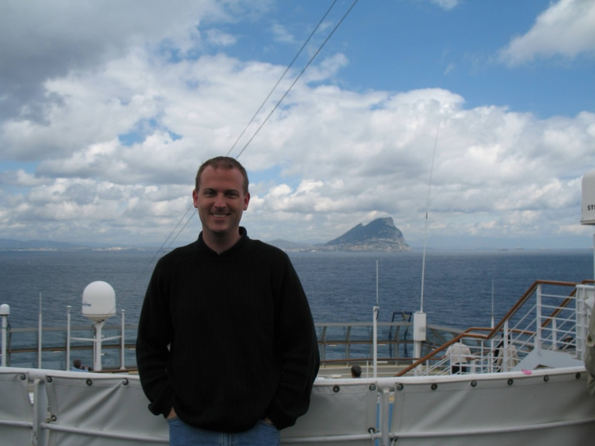
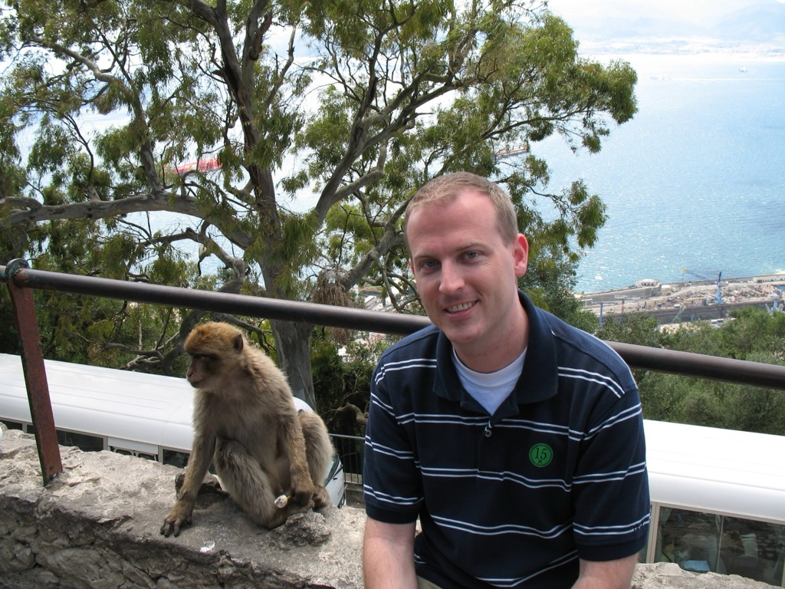
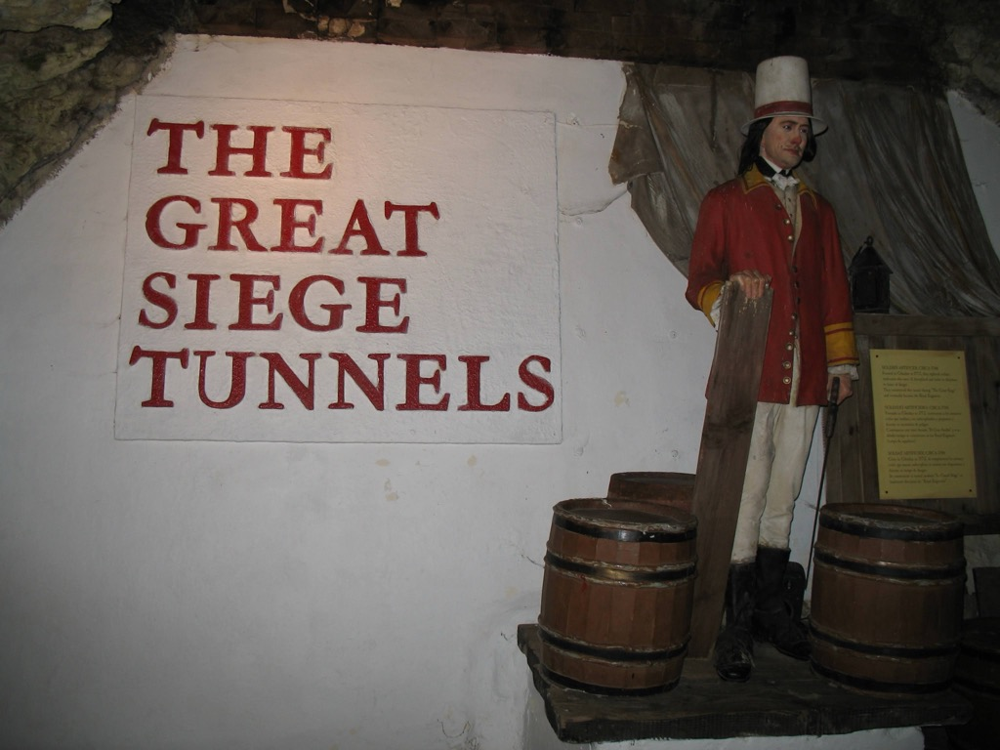

# Day 11 — Gibraltar
+ **When**: Monday, April 30, 2007
+ **Where**: Gibraltar

The Rock. No, not the high-energy Sean Connery/Nicolas Cage vehicle… this time we're talking about the [Rock of Gibraltar](https://www.visitgibraltar.gi/).

The sea was angry that day my friends. Like an old man trying to send back soup at a deli. Undaunted, I made my way to the top deck to admire the view. Since Sherri was nestled into bed reading a book, a kind Asian man wielded the family camera and squeezed off this shot:

<figure>
    
    <figcaption style="text-align: center; font-style:italic;">Brian on the top deck as the ship approaches the Rock of Gibraltar.</figcaption>
</figure>

I've given it some thought, and Gibraltar is my overall favorite port of the trip. This day had the right mix of walking, riding, scenery, beer, and monkeys. I wouldn't want more or less of any of those.

We were booked into a shore excursion here, which ended up working out for the best. We were supposed to take a cable car to the top of the Rock, walk down some, and then a tour bus would pick us up and take us the rest of the way down. Only, it was too windy for the cable car. So if we HADN'T booked a tour, we would've been on the hook for hiring a cab to make it up to the top, which could get expensive. Instead, our cab took us up the Rock.

First stop was [St. Michael's Cave](https://www.visitgibraltar.gi/see-and-do/st-michaels-cave), where they have an indoor theater!

Outside the caves is where we had our first taste (so to speak) of the Barbary apes. This guy's telling me a story:

<figure>
    
    <figcaption style="text-align: center; font-style:italic;">Brian and a Barbary macaque atop the Rock of Gibraltar.</figcaption>
</figure>

We walked downhill for a while, dodging taxis on the narrow road. Then the bus picked us up and took us over to the [Siege Tunnels](https://www.visitgibraltar.gi/see-and-do/the-great-siege-tunnels).

<figure>
    
    <figcaption style="text-align: center; font-style:italic;">The Great Siege Tunnels, Gibraltar.</figcaption>
</figure>

The Siege Tunnels are neat. There are stellar views from the cutouts in the tunnels. You can even see the frontier and Gibraltar's unique [airport](https://en.wikipedia.org/wiki/Gibraltar_International_Airport) from there.

There's a road that crosses the runway. That's the one and only way from Gibraltar into Spain, and is known as the Frontier… which, instead of reminding me of the Old West, always reminds me of The Last Starfighter instead. Anyway, they have to stop car and pedestrian traffic every time they want to land a plane.

Another interesting tidbit: many people come over from Spain to buy gas in Gibraltar because it's cheaper.

After the tour, we stopped into the [main square](https://en.wikipedia.org/wiki/Casemates_Square) for a beer and a snack at Latino's. Is 30 minutes too long to wait for garlic cheese bread? Me thinks so. I was wearing the cheapo shades I haggled from a Paris vendor for $6, sitting a little too high on my face. There was even a fancy Burger King on the square.

Obviously the weather cleared up in a hurry and the skies were beautiful. Back on the ship, I snapped a few photos while we left Gibraltar.

It was a memorable day. Gibraltar is definitely [a place I'd like to visit again](). Next time, hopefully I can remember to book a tour of the World War II tunnels, which are part of a separate tour.

Tomorrow is Tangier, Morocco, the strangest city on our voyage. Watch me as I pet the camel! That's not a euphemism.
