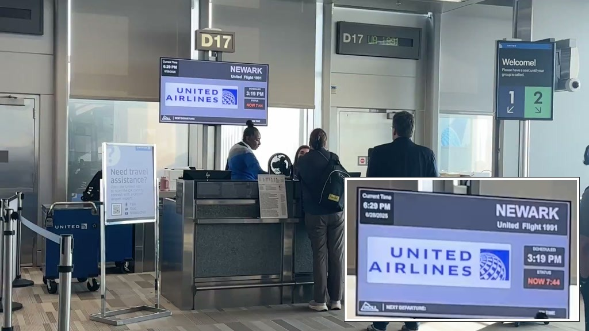
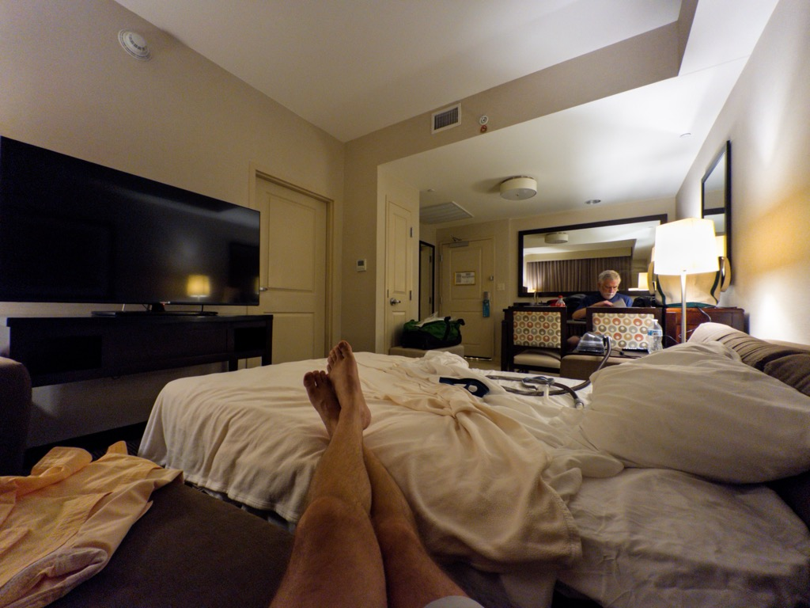

- **Start of day:** Home in North Carolina
- **End of day:** Elizabeth, NJ

Our 3:19 PM flight was delayed by more than 4 hours. 

At some point during a delay like that, you start to question whether the flight will go off at all, and what your contingencies might be. With six people, we don't have a large enough car for everyone, so I started browsing the rental car agency website to see what was available. 

I can't say I was excited about the prospect of a 9-10 hour drive to Bayonne, NJ, but I was also cognizant it could've been worse, like an 11-12 hour drive to Fort Lauderdale. There weren't systemic flight cancellations; this seemed to be a one-off United thing, so I still had decent confidence the flight would go off. 

Eventually we boarded and we made it to Newark. Bag pickup was fine. Getting an Uber was the usual Newark airport Thunderdome chaos. 

I booked us into the [Embassy Suites by Hilton Newark Airport](https://www.hilton.com/en/hotels/ewreles-embassy-suites-newark-airport/) in Elizabeth, New Jersey, which is reasonably close to our Bayonne cruise port. I think one guy was running the place. We needed sheets for the foldout sofas and he gave us directions to the linen closet upstairs and told us to help ourselves. 

We were too late for a proper dinner, so we made do with whatever we could raid from the Embassy Suites snack pantry thing. 

I crashed in the living room of my parents' room. The bed was... you know. I knew I was headed for a more comfortable bed the following night. 

