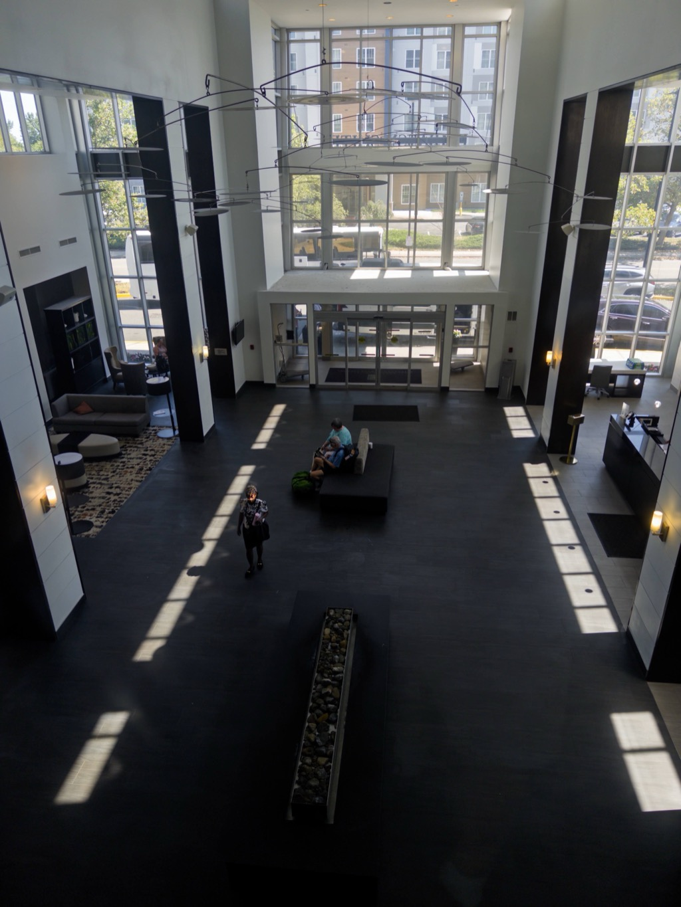
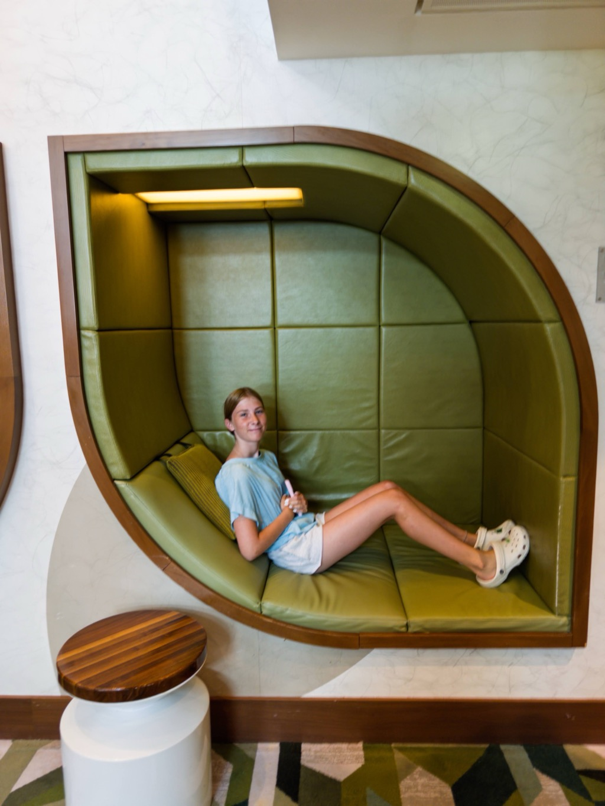
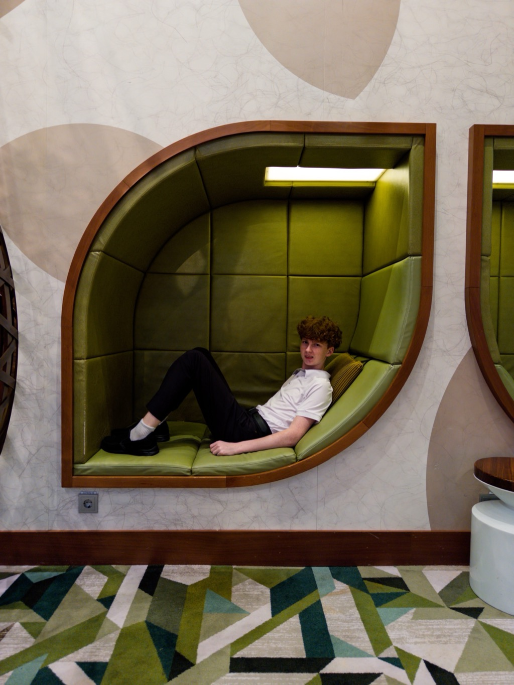
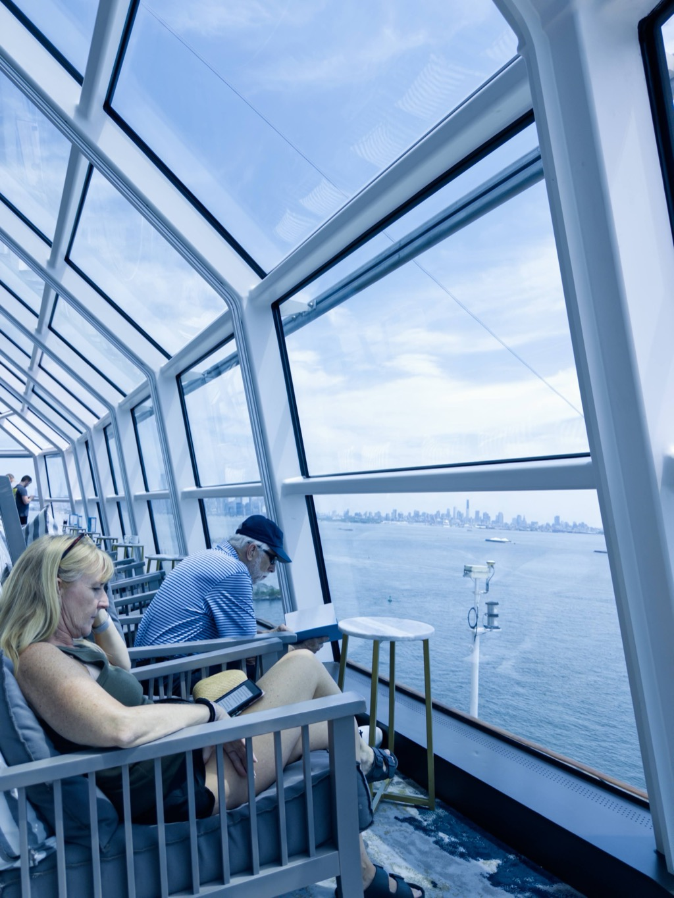
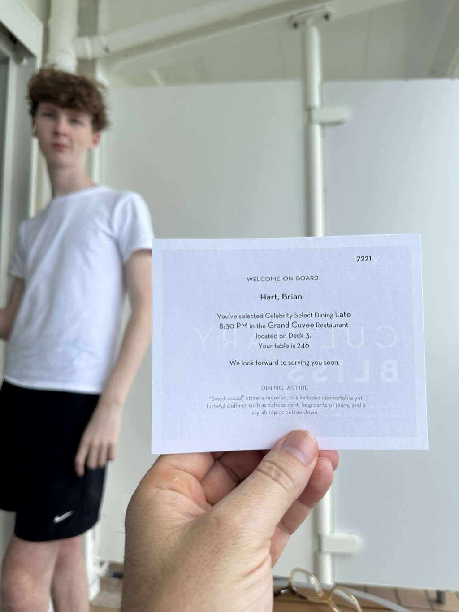
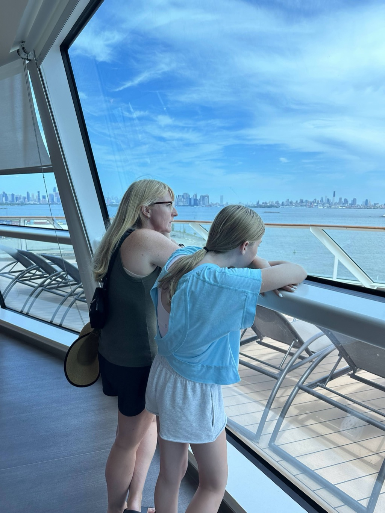
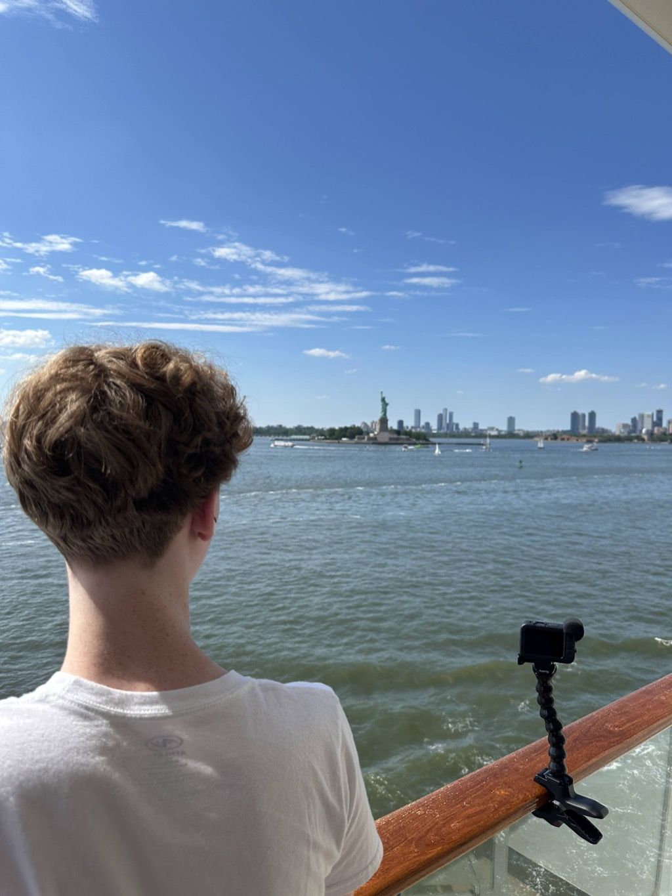
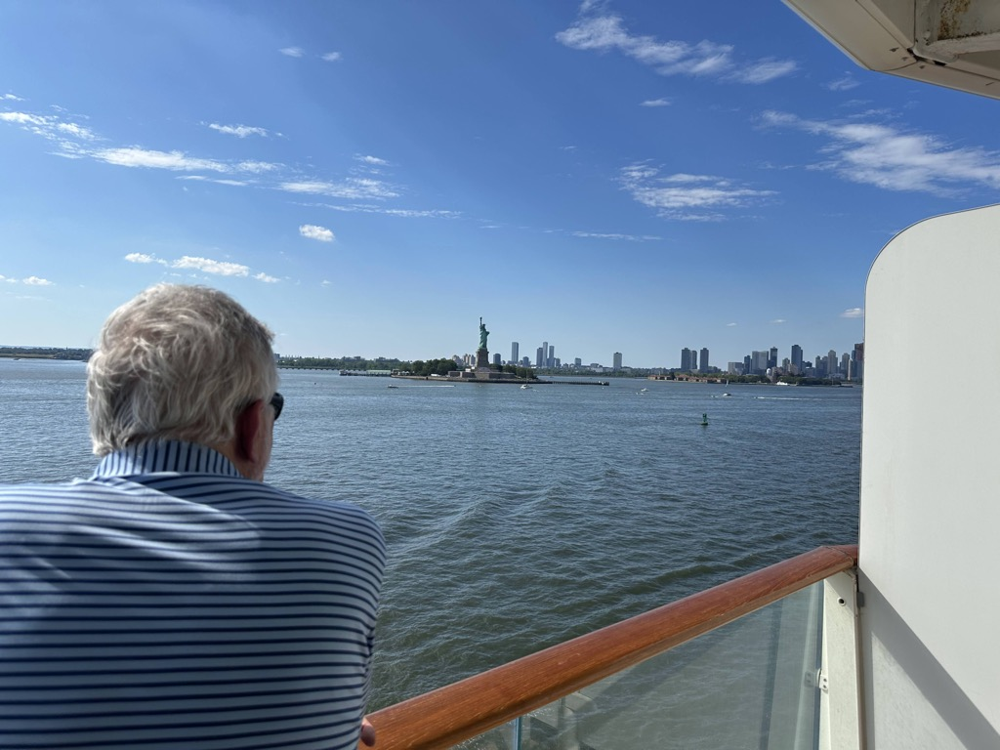
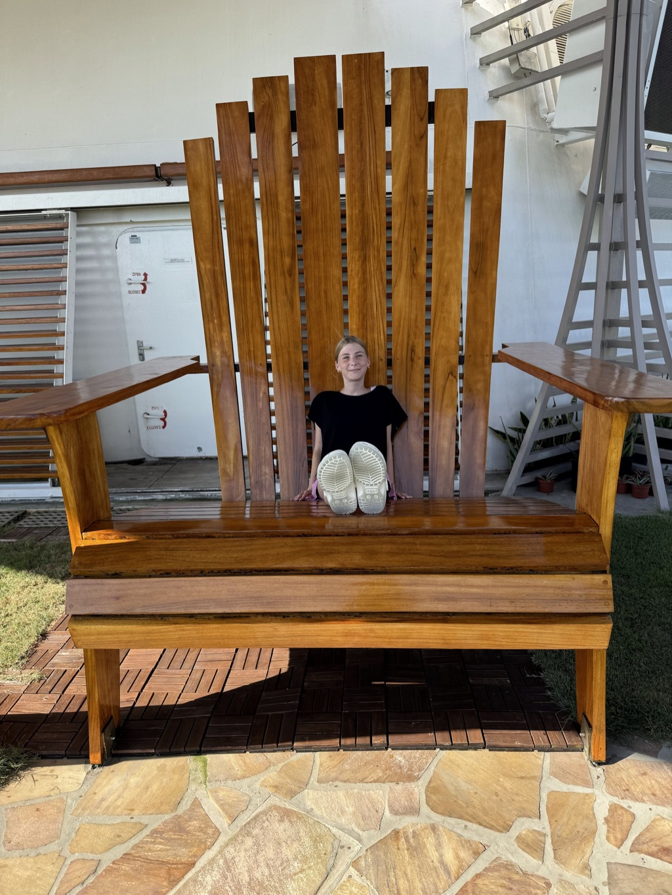
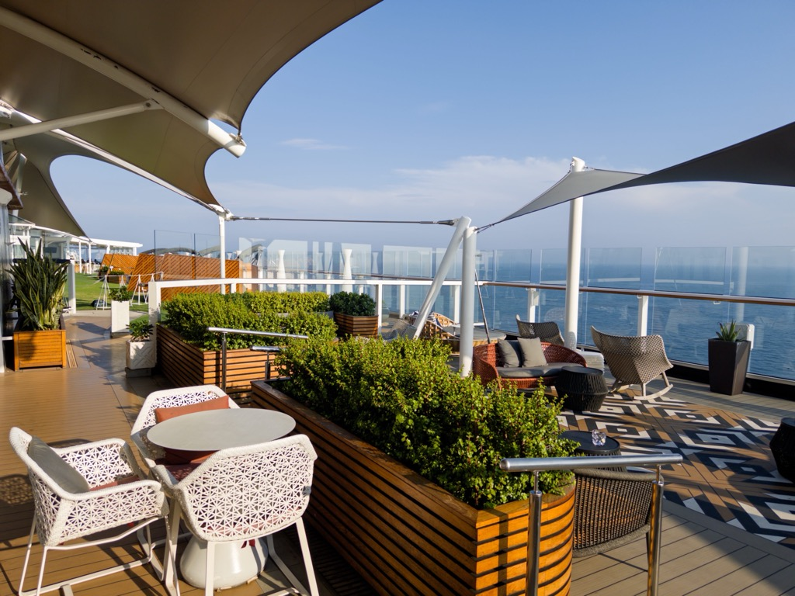

- **Start of day:** Elizabeth, New Jersey
- **End of day:** At sea

Good morning from the [Embassy Suites by Hilton Newark Airport](https://www.hilton.com/en/hotels/ewreles-embassy-suites-newark-airport/). 

We had breakfast at the hotel, which was fine once they washed some plates for us. 

Near check-out time we Ubered our way over to the port, around 20 minutes. Embarkation was super smooth, with no waits to check luggage, for security, or for cruise check-in. We were onboard and at the buffet in no time.

One of the best things about sailing from Cape Liberty or Manhattan is the incredible city views as you leave. From sailing past the [Statue of Liberty](https://www.nps.gov/stli/index.htm) to ducking underneath the [Verrazzano–Narrows Bridge](https://en.wikipedia.org/wiki/Verrazzano%E2%80%93Narrows_Bridge), it's tough to beat New York.

Next up: two sea days. 