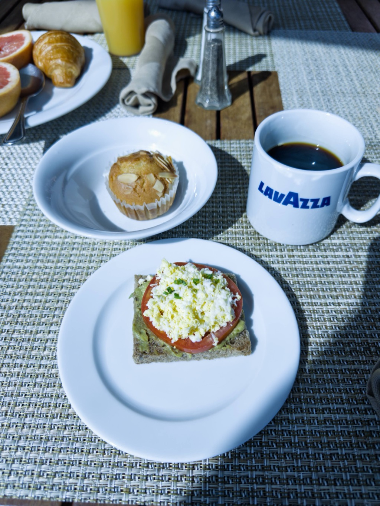
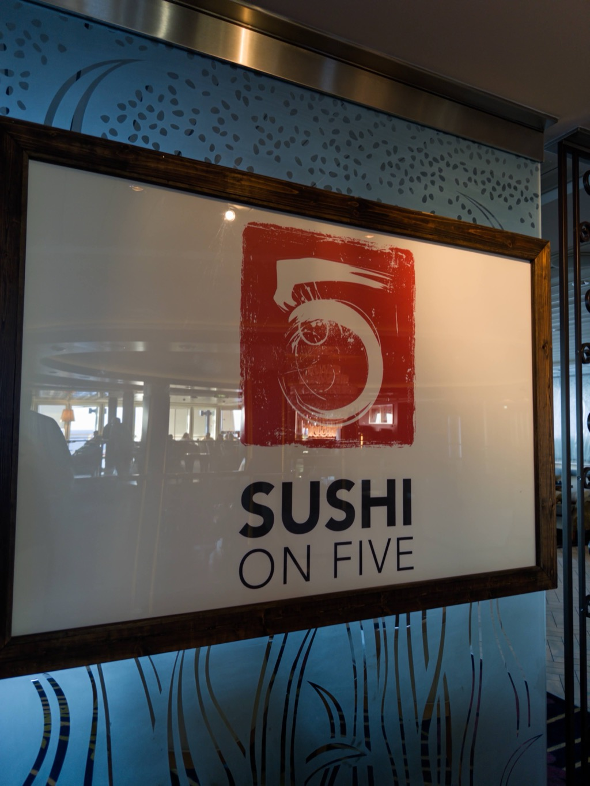
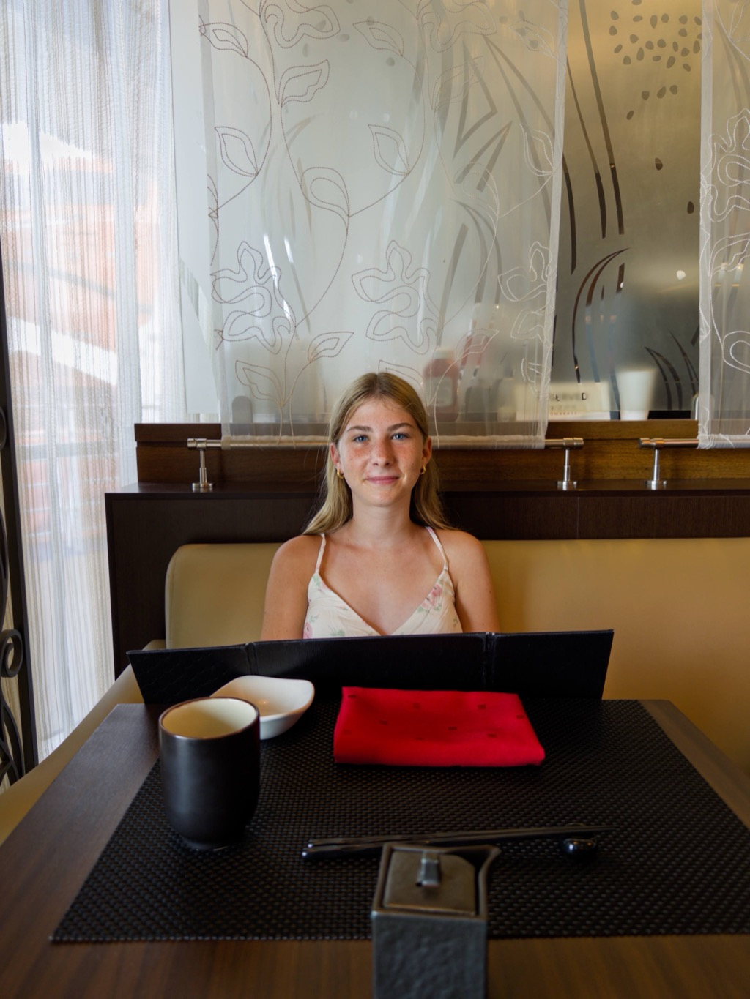
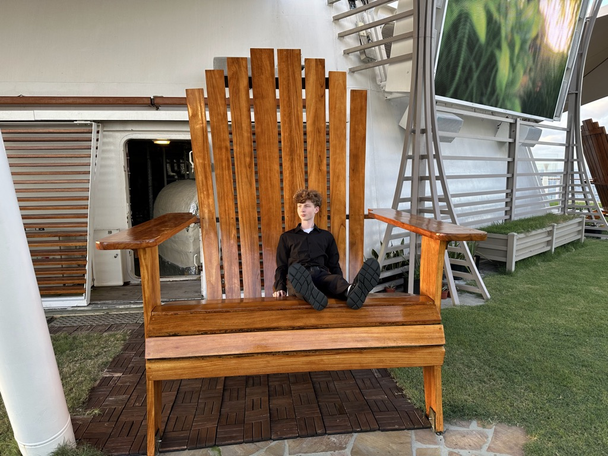
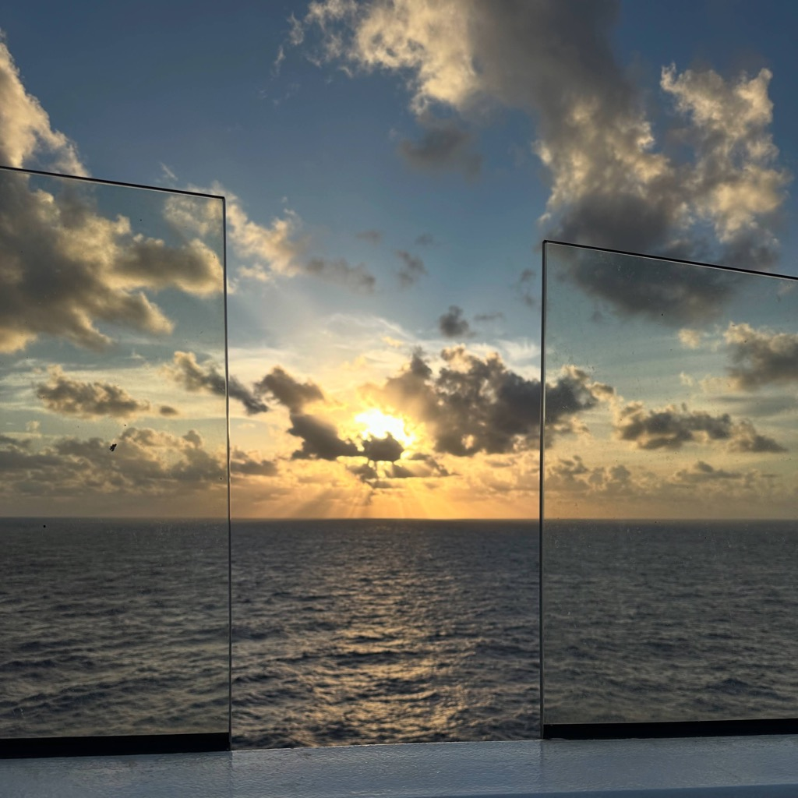
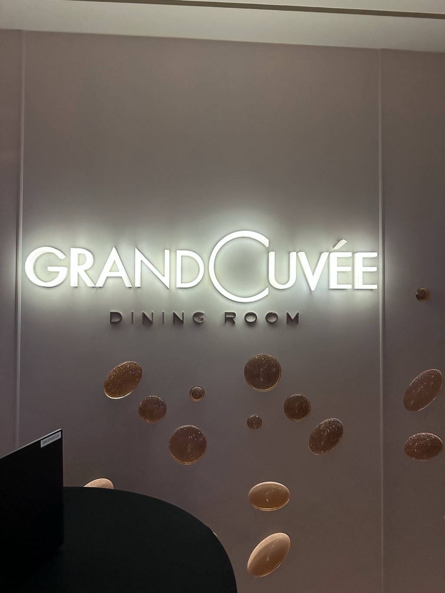
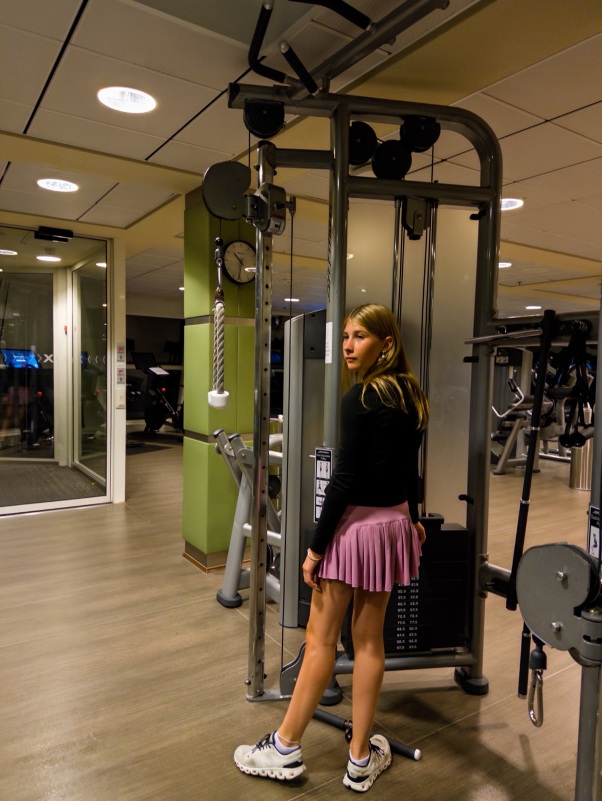

- **Start of day:** At sea
- **End of day:** At sea

We had a light breakfast at the [Spa Café](https://www.celebritycruises.com/things-to-do-onboard/eat-and-drink/restaurants-and-cafes/aquaspa-cafe) in the Solarium, which I often forget exists.

For lunch, my daughter and I peeled off from the group for a nice meal at [Sushi on Five](https://www.celebritycruises.com/things-to-do-onboard/eat-and-drink/restaurants-and-cafes/sushi-on-five).

The rest of the day was just sea day filler. 

