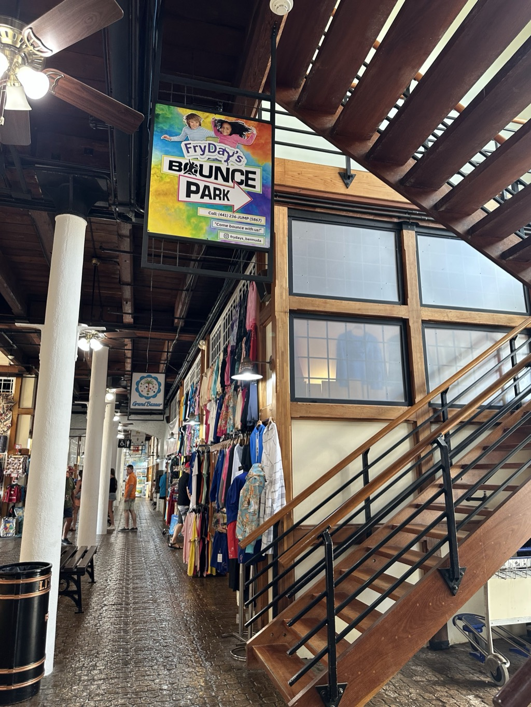
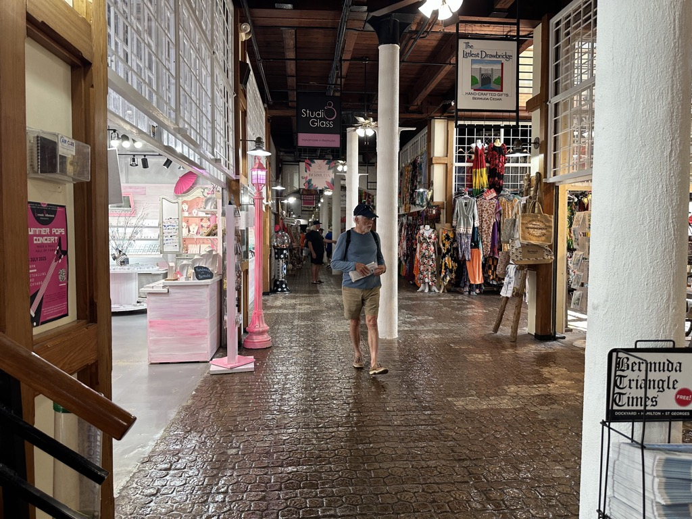
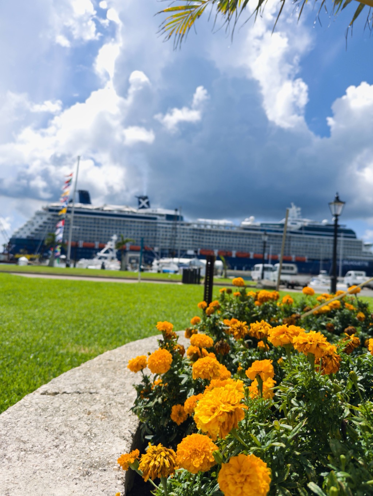

- **Start of day:** At sea
- **End of day:** Royal Naval Dockyard, Bermuda

This is our first day in Bermuda. We'll be docked here for two nights.

The [Royal Naval Dockyard](https://www.gotobermuda.com/our-bermuda/explore/dockyard) sits at the far western tip of the island, and it was the British Royal Navy's main base in this part of the Atlantic for over a century. These days big cruise ships like ours dock here because the old naval docks have the deep water they need, while the channels into Hamilton and St. George's are too narrow and shallow for something the size of the [Silhouette](https://www.celebritycruises.com/cruise-ships/celebrity-silhouette).

It's my second visit to Bermuda, the first being back in July 2000 when I worked for Celebrity/Royal Caribbean. On that trip I was sailing onboard a Celebrity Century-class ship (I believe the [Galaxy](https://en.wikipedia.org/wiki/Marella_Explorer)), with a gross tonnage of ~77,000 and length of ~866 ft. Compare that to the Silhouette's ~122,000 gross tons and ~1047 ft length and you understand why the Century-class ships could squeeze into Hamilton but the larger ships cannot. 

<figure>
    
    <figcaption style="text-align: center; font-style:italic;">Royal Naval Dockyard sits at the western end of the island chain, across the Great Sound from Hamilton. Image: <a href="https://commons.wikimedia.org/wiki/File:Bermuda_oli_2014275_lrg-cropped.jpg">NASA Earth Observatory / Jesse Allen, Landsat data from USGS</a>, public domain, via Wikimedia Commons (cropped, arrow added)</figcaption>
</figure>

The Dockyard itself is a half-day visit at best. Use it as a jumping off point to other places: rent a car, take the [ferry](https://www.marineandports.bm/) to Hamilton, board a snorkeling excursion, etc. 

It was hot and humid. We mainly wandered around the shops and the dockyard for a while before reboarding.

