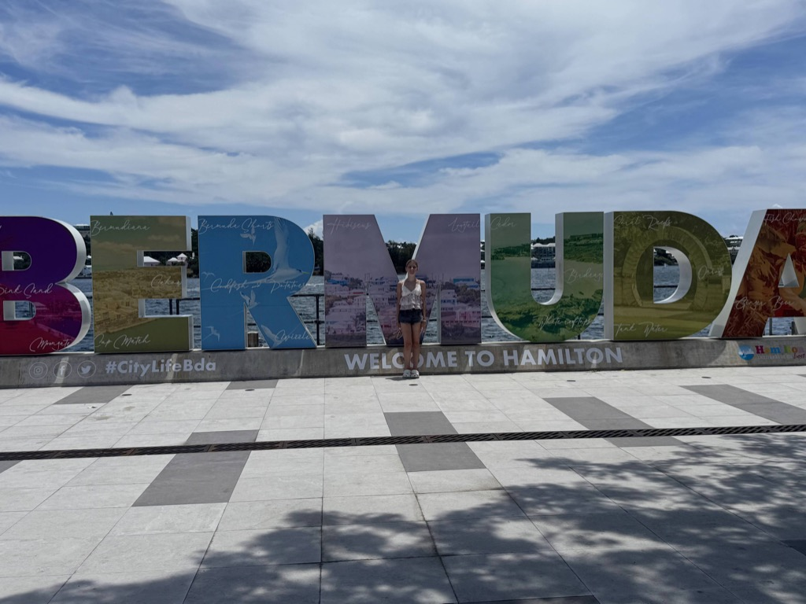
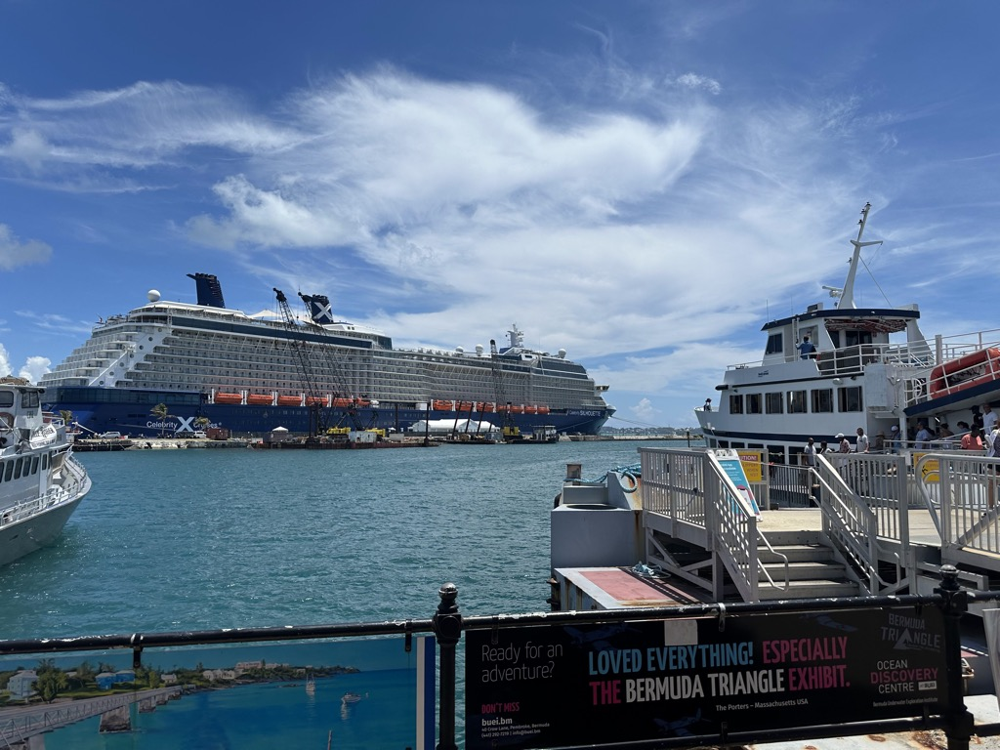
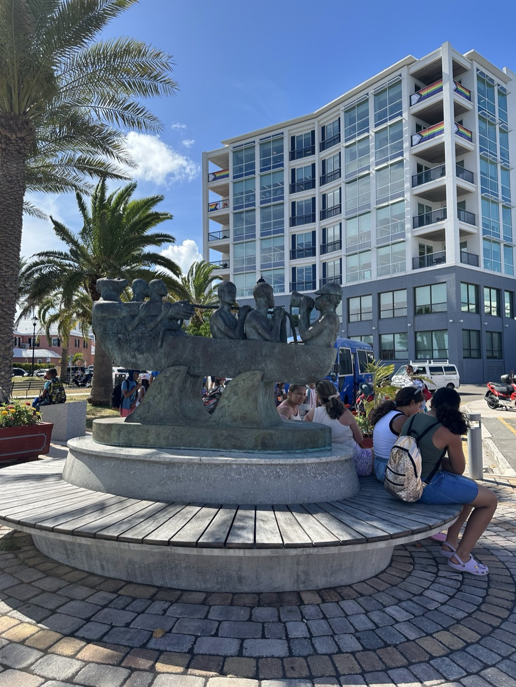
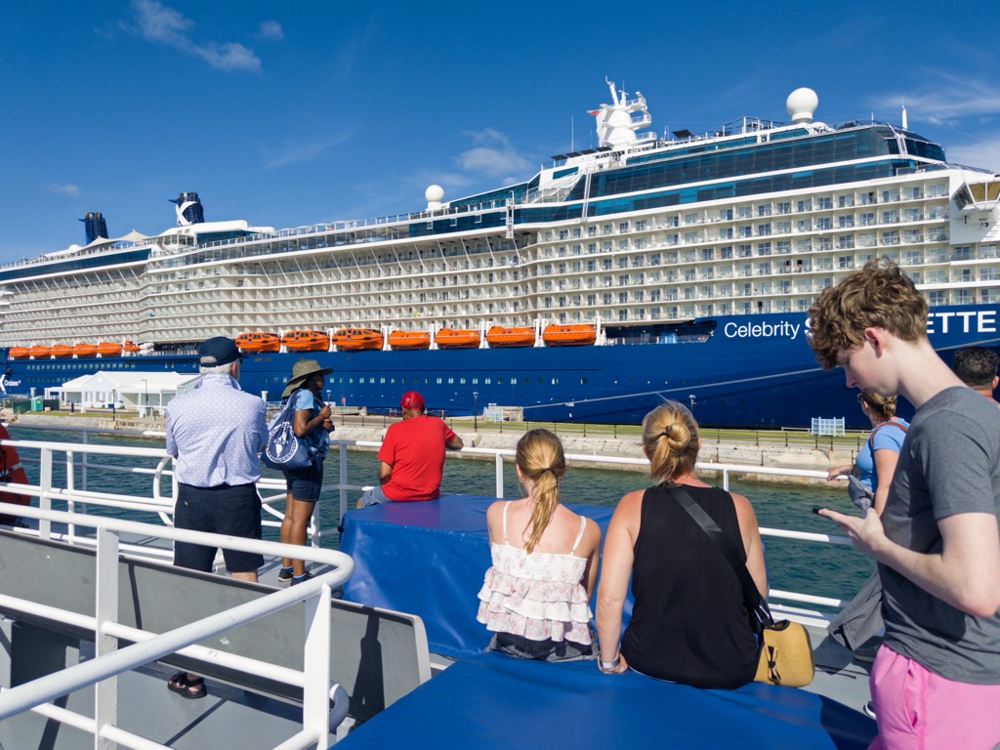
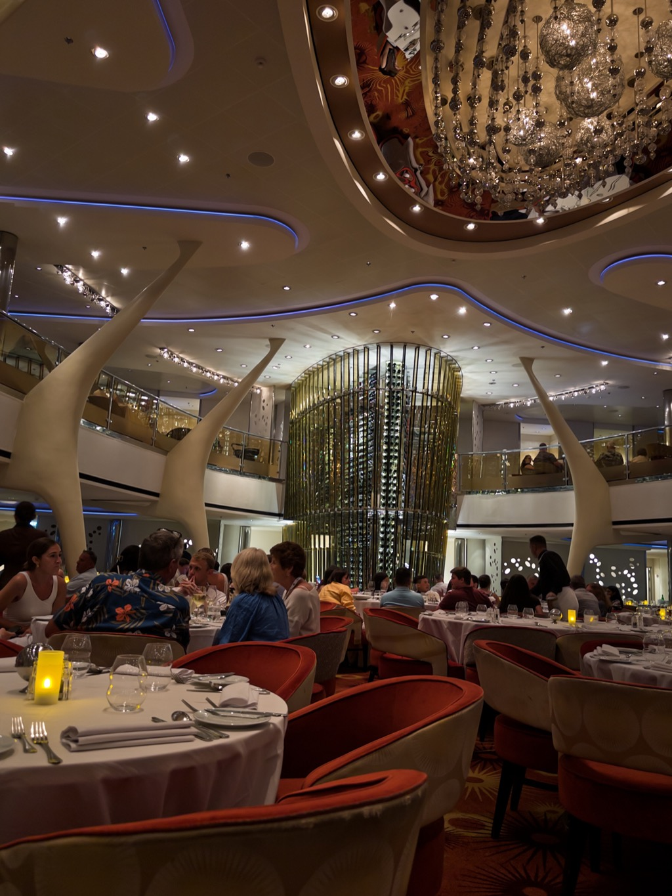

- **Start of day:** Royal Naval Dockyard, Bermuda
- **End of day:** Royal Naval Dockyard, Bermuda

Today we took the [ferry](https://www.marineandports.bm/) over to Hamilton to meet up with Sherri's uncle, Bobby. He works part of the year in Bermuda and fortunately was in town. 

Dinner was onboard in the Main Dining Room. 

