- **Start of day:** Royal Naval Dockyard, Bermuda
- **End of day:** At sea

Happy Fourth of July! 🇺🇸

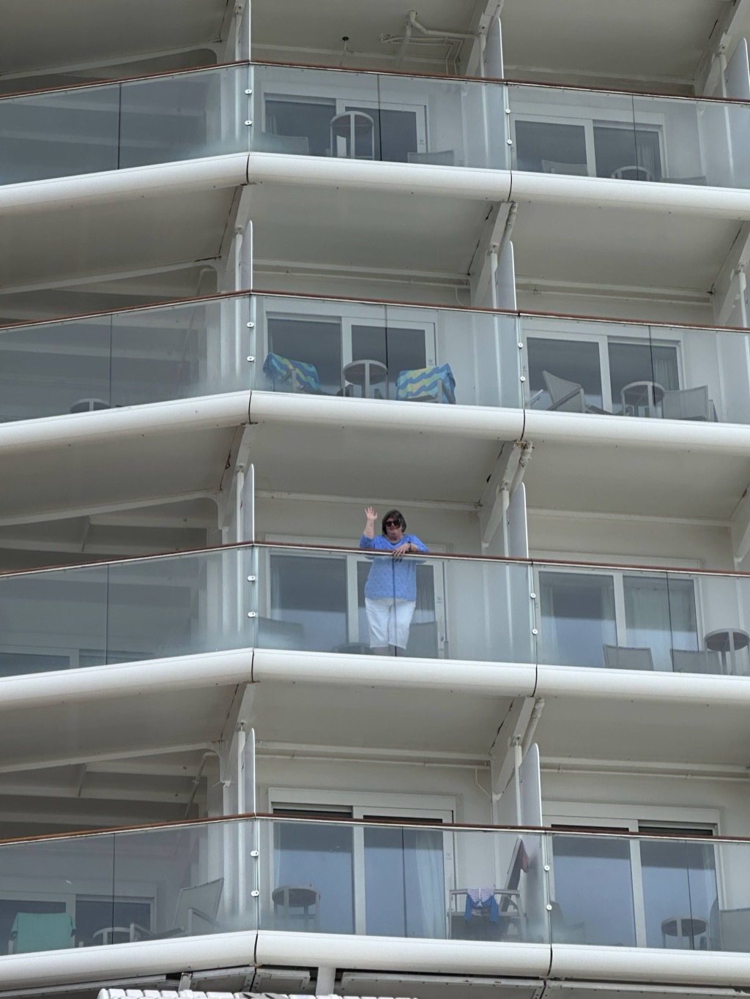

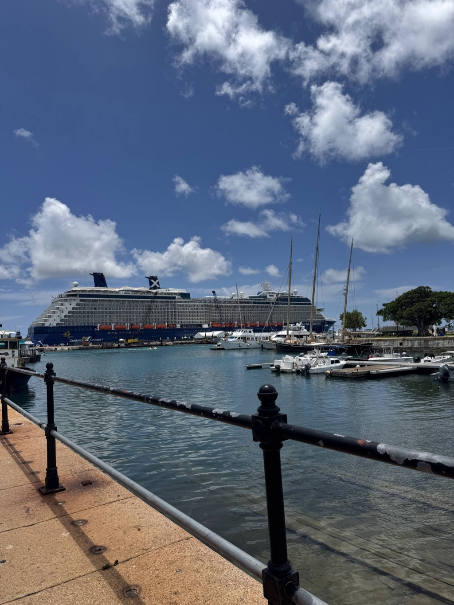

I decided rather late in our stay to visit the [National Museum](https://nmb.bm/).
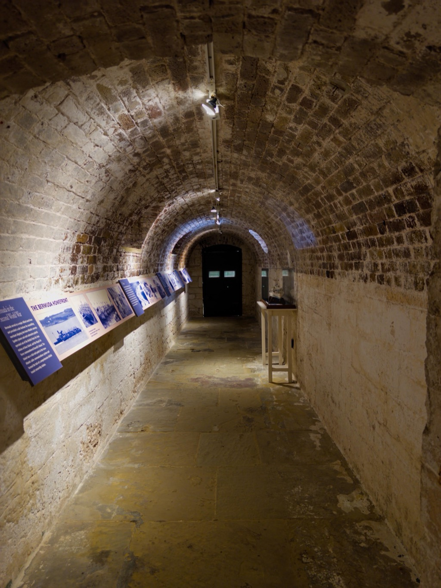

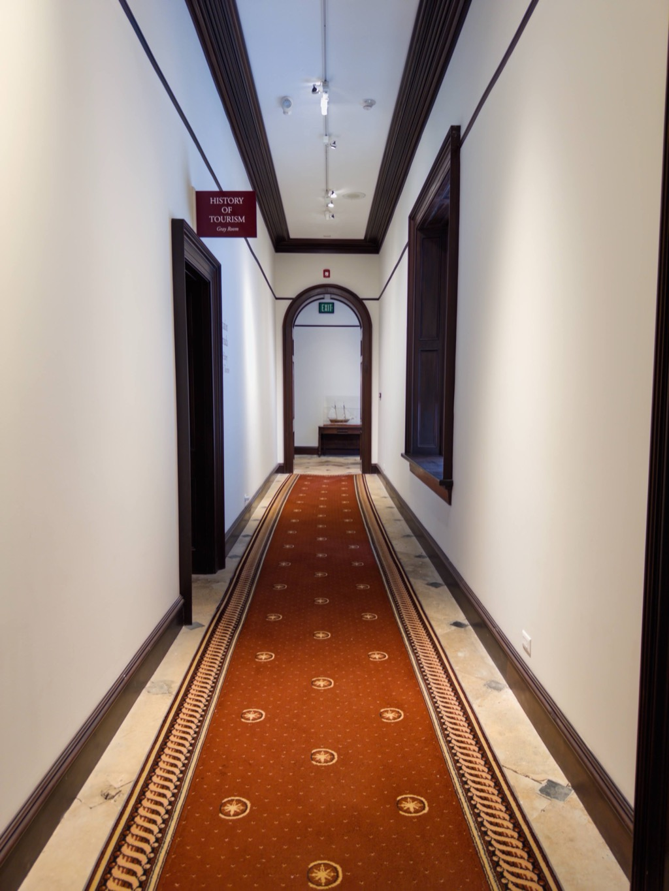

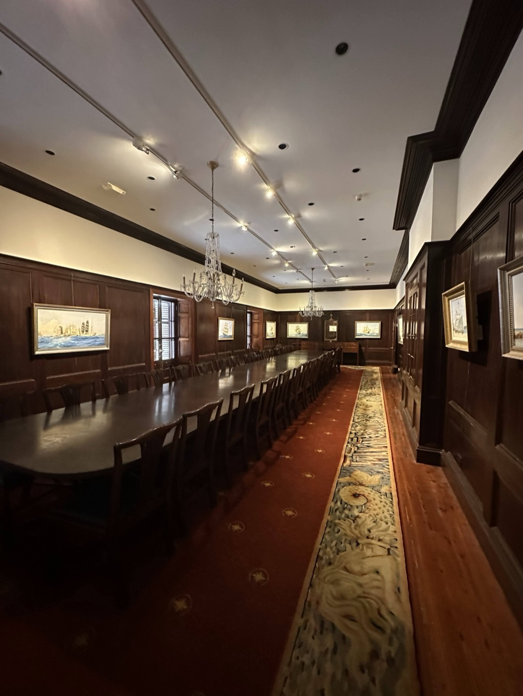

I got a better look at the outside of the Commissioner's House on my [return visit in 2026]().

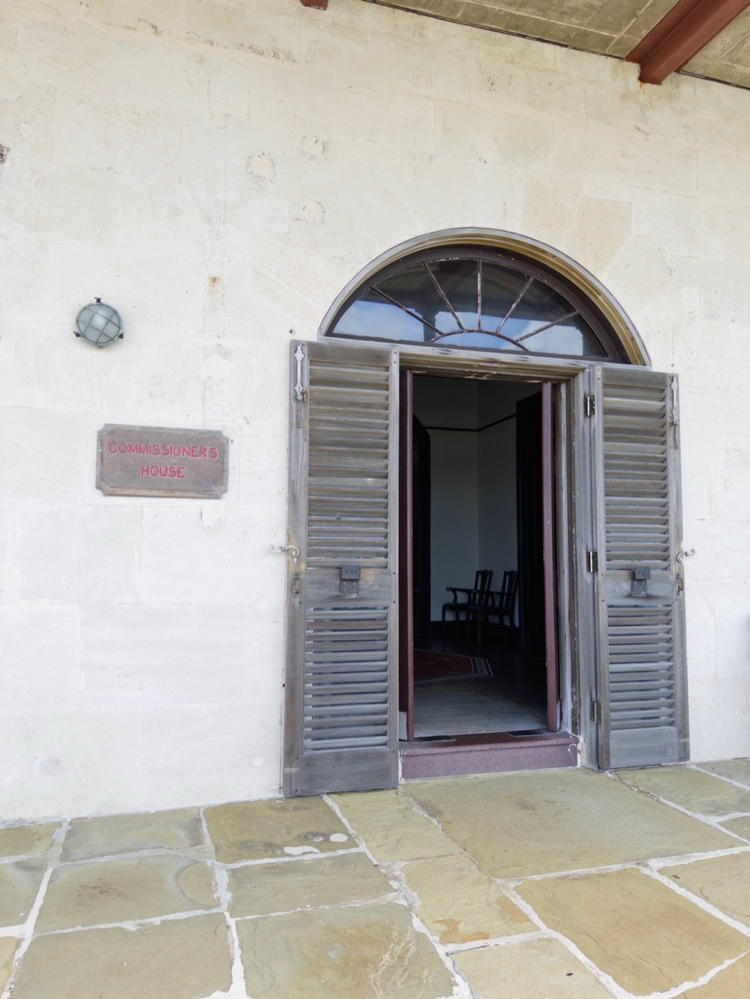

The Museum grounds overlook the expensive [snorkel beach](https://www.gotobermuda.com/listings/beaches-water-activities/snorkel-park-beach-club):
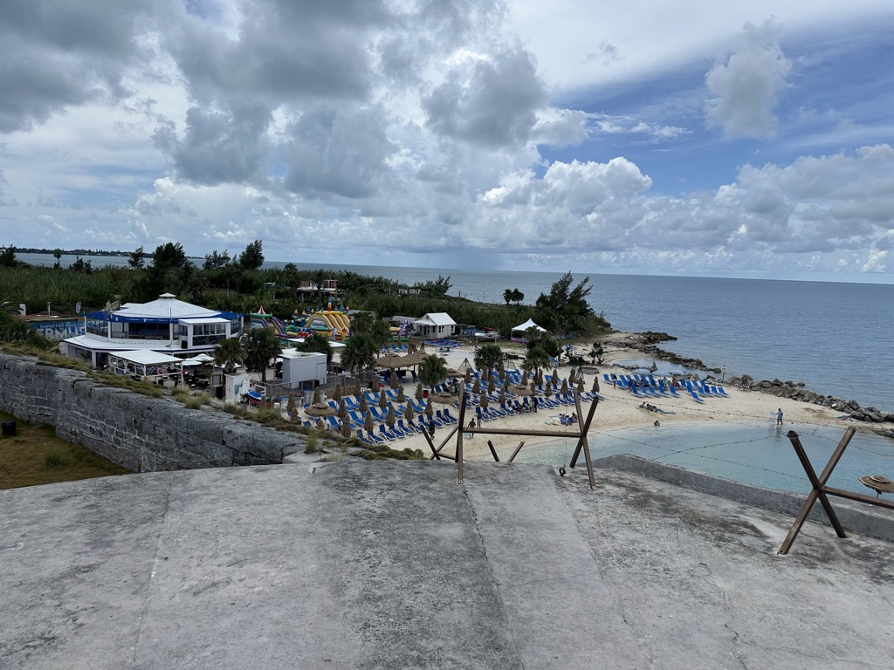

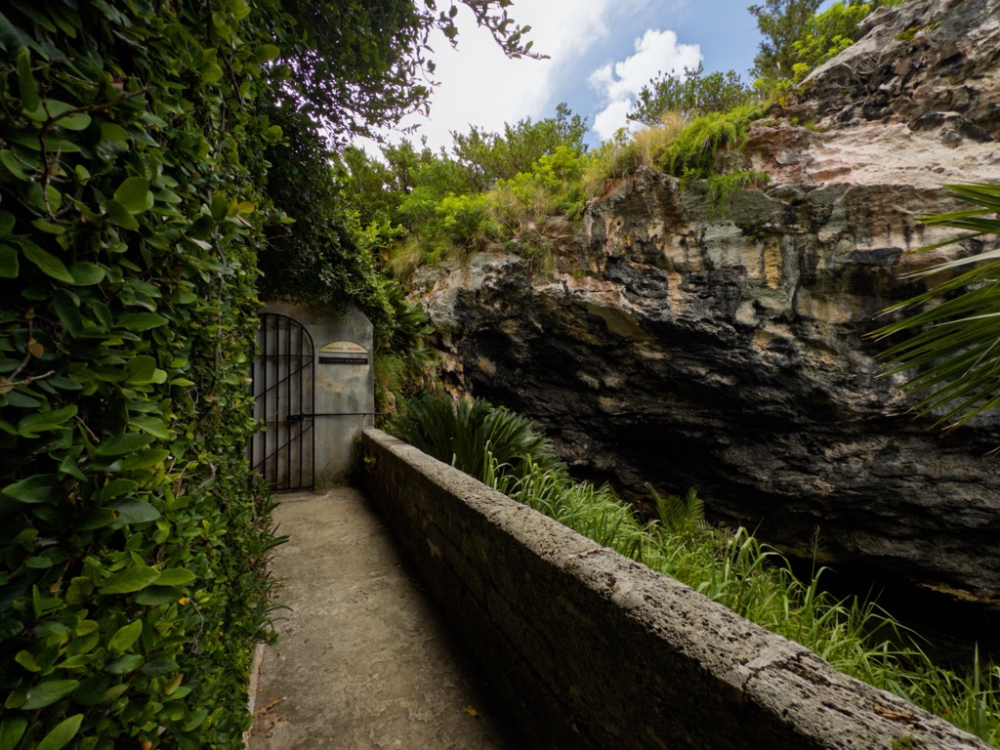

While I was doing that, Sherri and Siena were up on the helicopter pad checking things out.

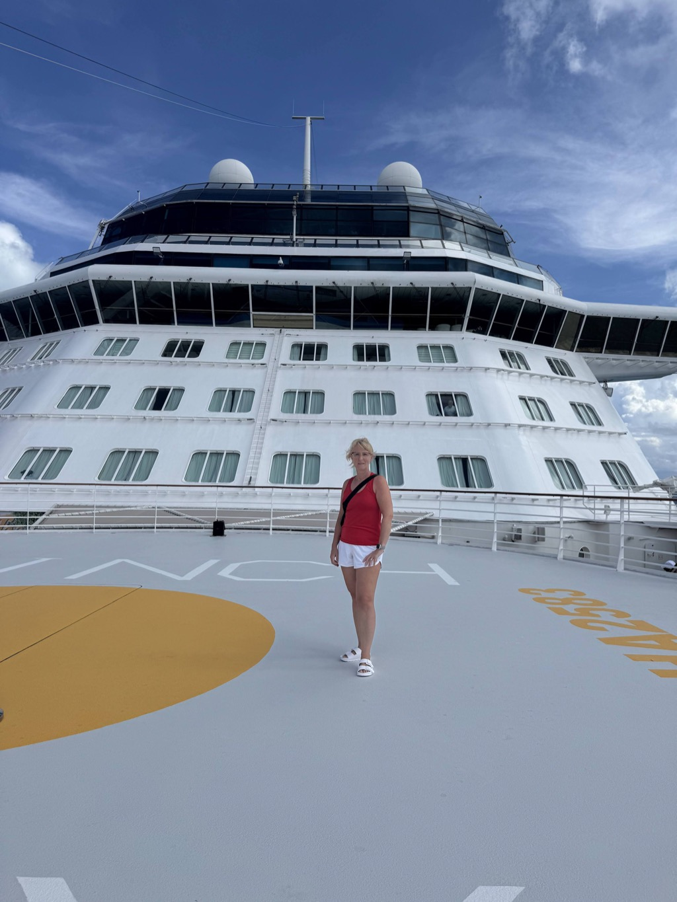

Here's the cozy area Rowan spent a lot of time at during the voyage.

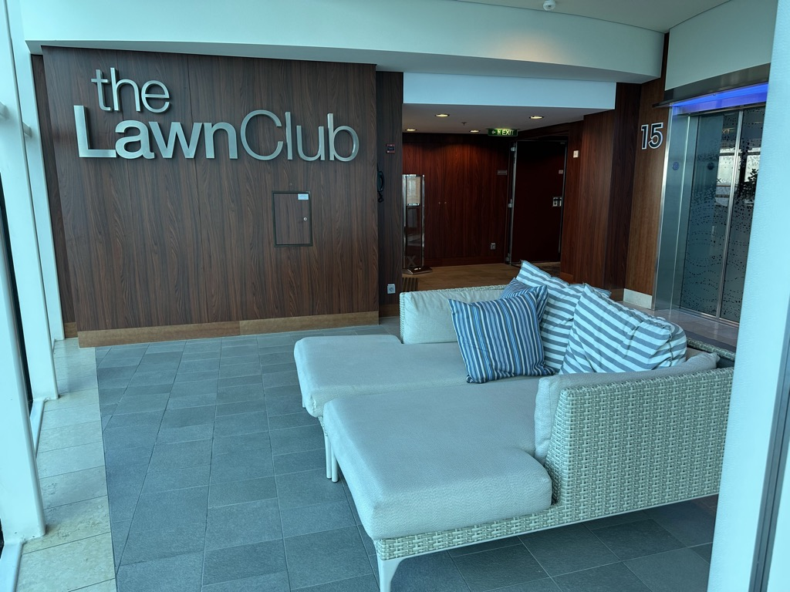

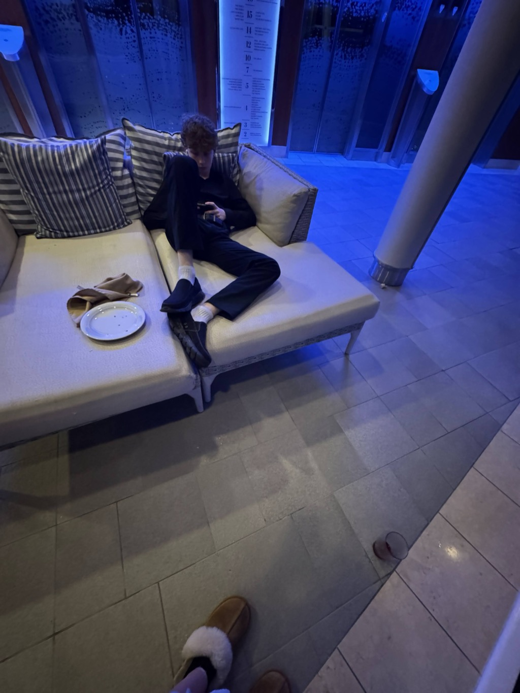

And there was a Fourth of July party in the Grand Foyer.
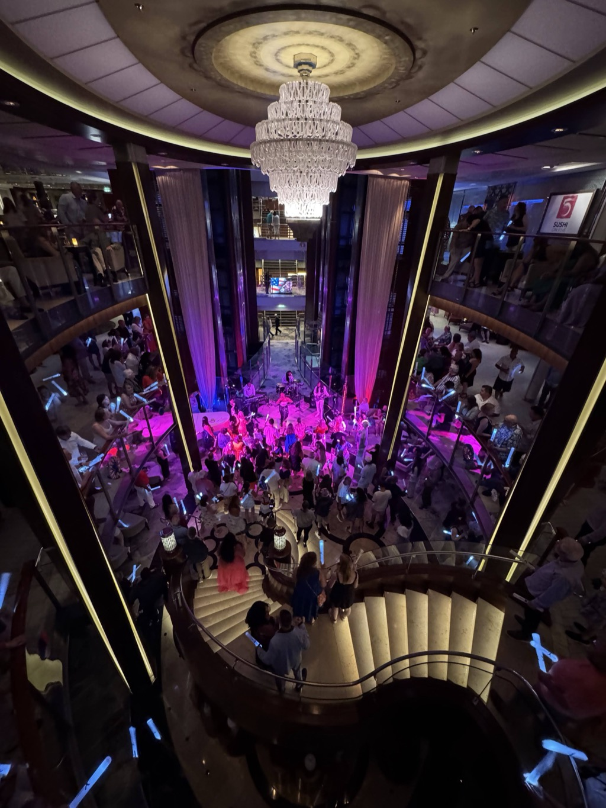

