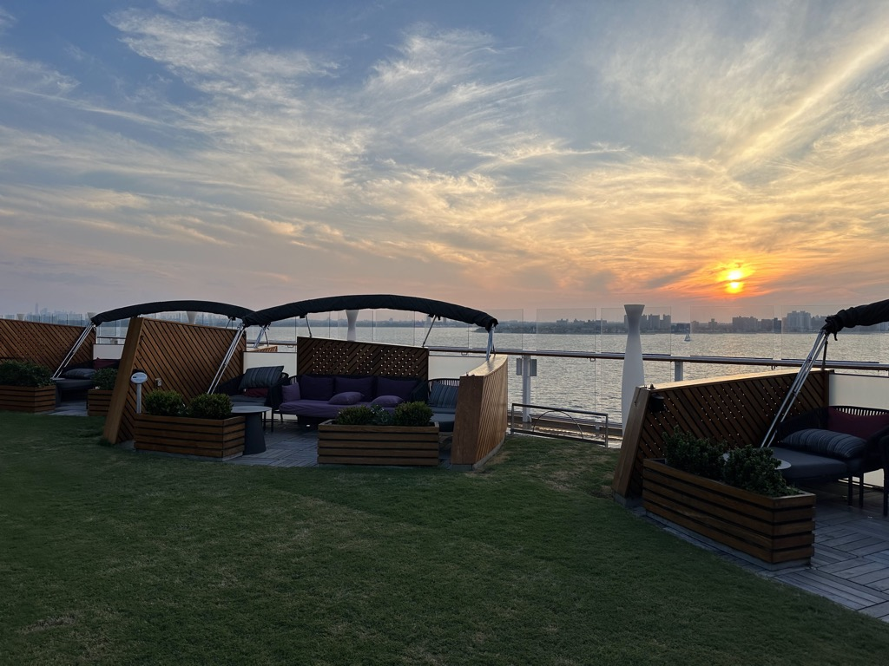
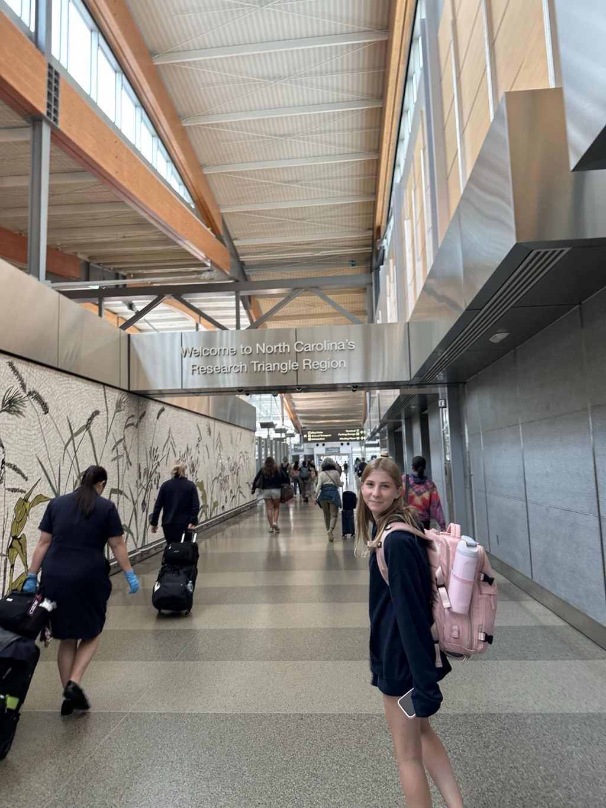

- **Start of day:** Cape Liberty Cruise Port, Bayonne, New Jersey
- **End of day:** Home in North Carolina

The end! I was up early to photograph as we were coming into New York Harbor. 

Here's a video I absolutely love that nobody on YouTube cared about.
<iframe width="315" height="560" src="https://www.youtube.com/embed/MkLTK3B-4y0" title="Early morning in New York Harbor" frameborder="0" allow="accelerometer; autoplay; clipboard-write; encrypted-media; gyroscope; picture-in-picture; web-share" referrerpolicy="strict-origin-when-cross-origin" allowfullscreen></iframe>

We kept our bags from the night before and did self-service disembarkation. Catching an Uber was super easy and not chaotic, which I attribute to us getting off the ship before the masses. 

United flight was thankfully on time and uneventful. Home!

