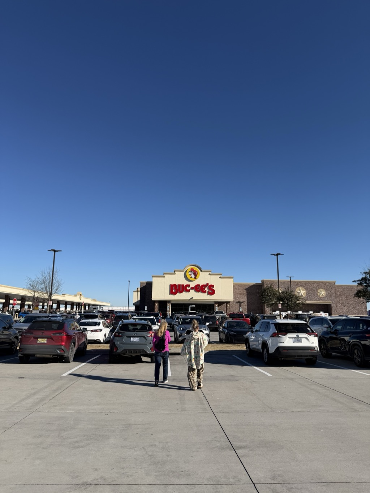
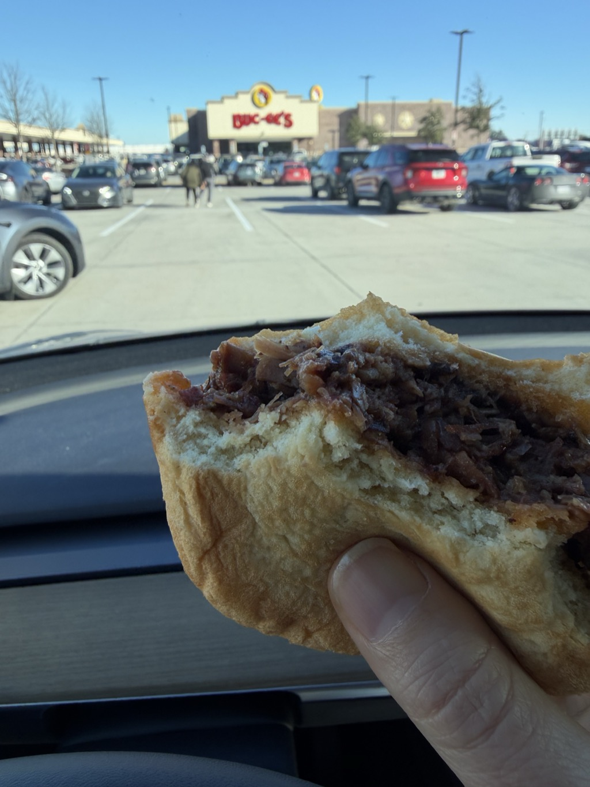
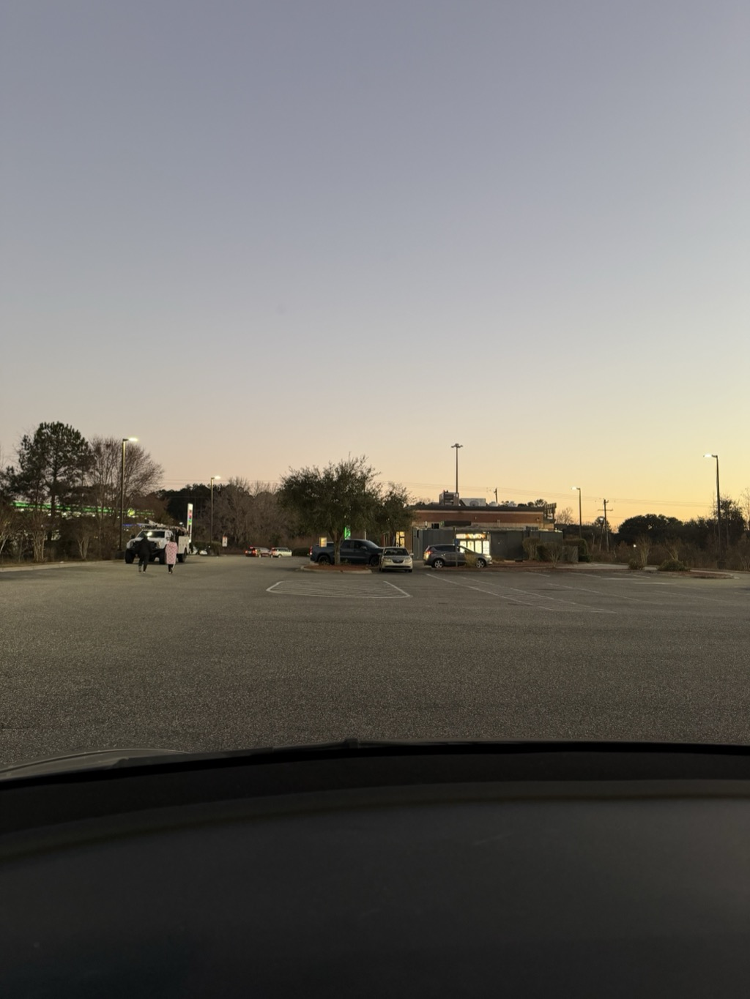
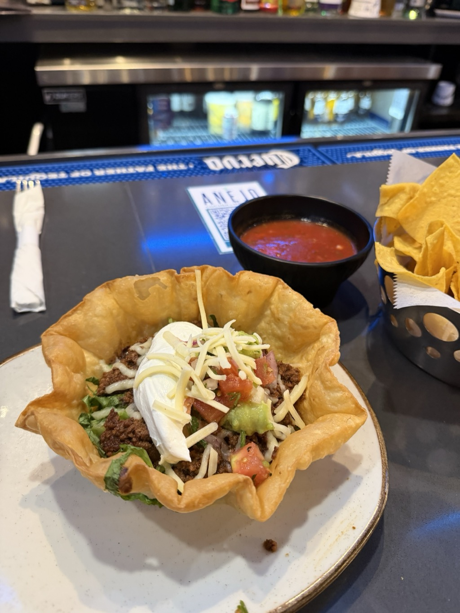

- **Start of day:** Home in North Carolina
- **End of day:** Yulee, Florida

**Surprise cruise!** Through a lot of luck, a gap in the kids' school schedule was created due to them not having to take exams for their classes. We realized we'd have more than a week of time out of school. Naturally, we started looking for cruises and found a great last-minute deal. 

We had to leave the next day in order to make it down to Florida in time _and_ we were too late to fly without taking out a second mortgage, so we hit I-95.

One saving grace for the road trip was that January 16 isn't a popular time to be vacation traveling. We methodically made our way down the coast, dutifully hitting Buc-ee's for food and charging. 

Then another charging stop... somewhere... 

We stayed the night at the [Best Western Plus First Coast Inn & Suites in Yulee](https://www.bestwestern.com/en-us/book/rooms/10395), in two rooms divided between the boys and the girls. This hotel was a great value: clean, friendly front desk staff, and a decent breakfast in the morning. 

The others weren't hungry for a dinner so I hit [Anejo Mexican Restaurant](https://anejococinamexicana.com/) just up the street for some taco salad action, which was fine. This shopping plaza has a Tesla Supercharger around back, too, so I used the opportunity to give the car a big charge. 

