- **Start of day:** Yulee, Florida
- **End of day:** At sea

We finished the drive to Port Canaveral and parked at the port for the week.

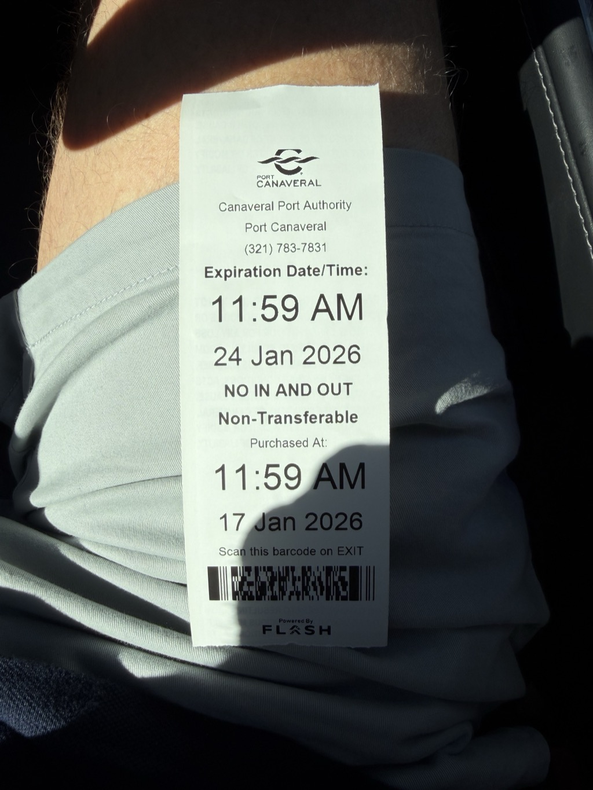

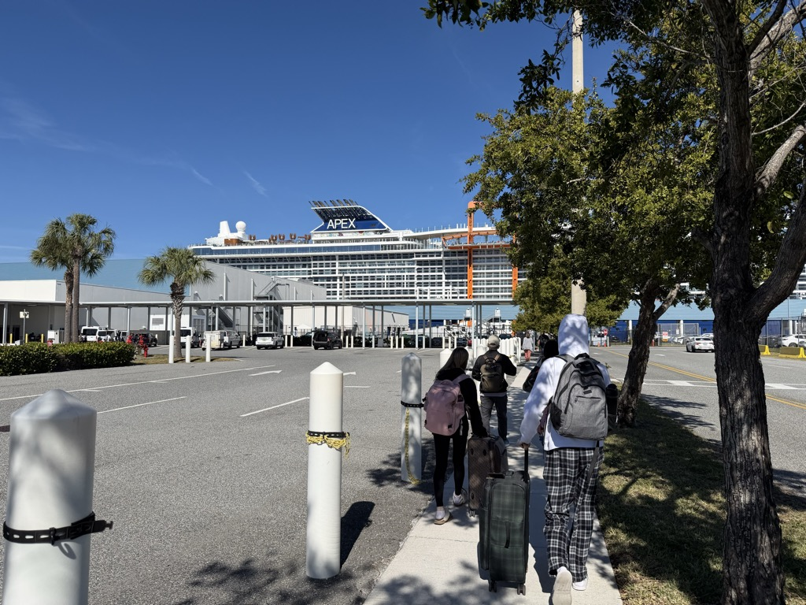

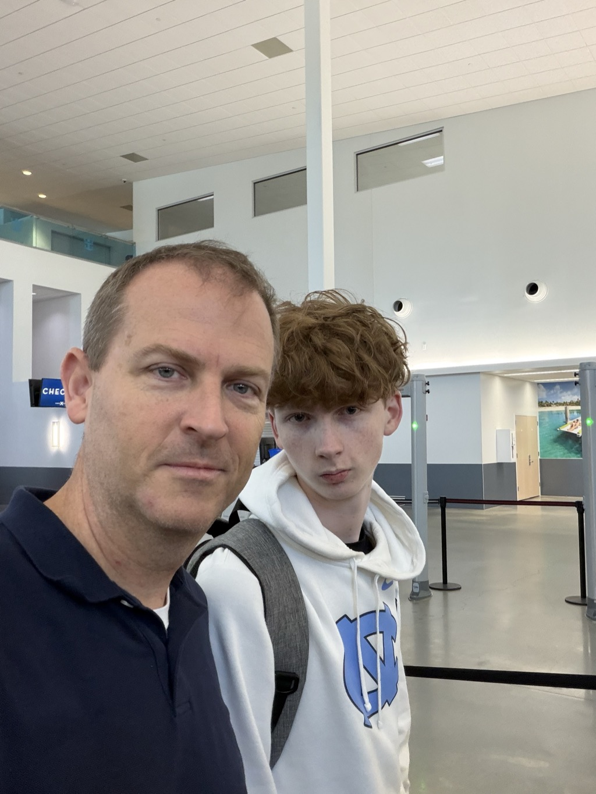

For our family cruises we usually choose one stateroom -- a veranda cabin with an upper berth[^1]. This gives me and Sherri one bed, Rowan a bed, and Siena a bed. This line of Celebrity ships, known as the [Edge class](https://en.wikipedia.org/wiki/Edge-class_cruise_ship), don't have very many staterooms with the upper berth, though.[^2] Given our late booking we didn't have a lot of choices for rooms, so we split up: Rowan and I would be in an infinite verdanda stateroom up on deck 8, with Sherri and Siena in an oceanview room on deck 3.

I have many thoughts about these infinite verandas but that's probably an entire separate post:

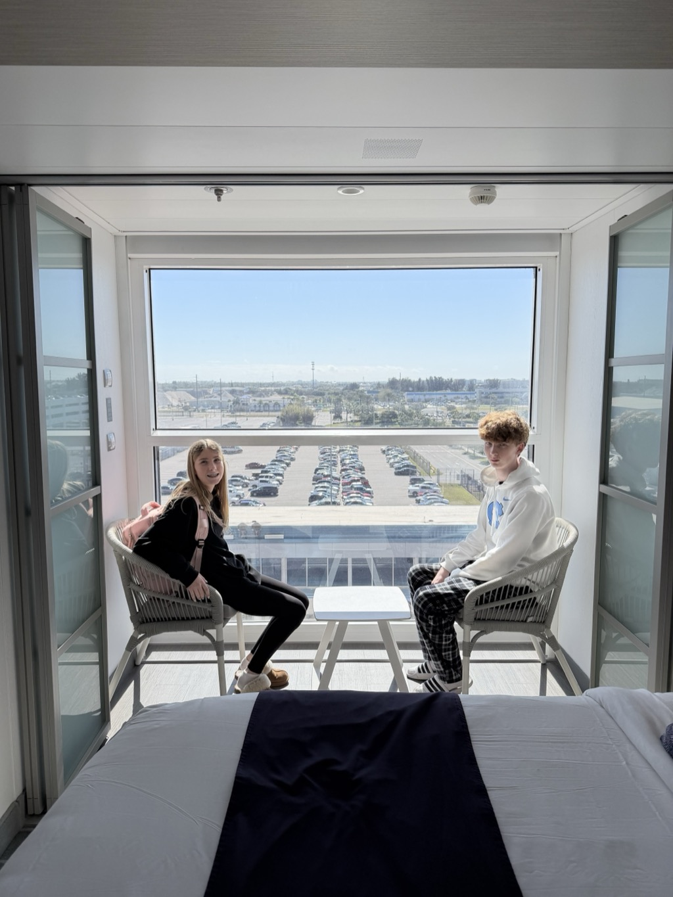

We acquainted ourselves with the Apex. _\[November 11, 2026: little did I know at the time that I'd have two additional Apex cruises this year: a 14 night Iberian Peninsuma, and a 13 night trans-Atlantic. That's 34 nights!\]._

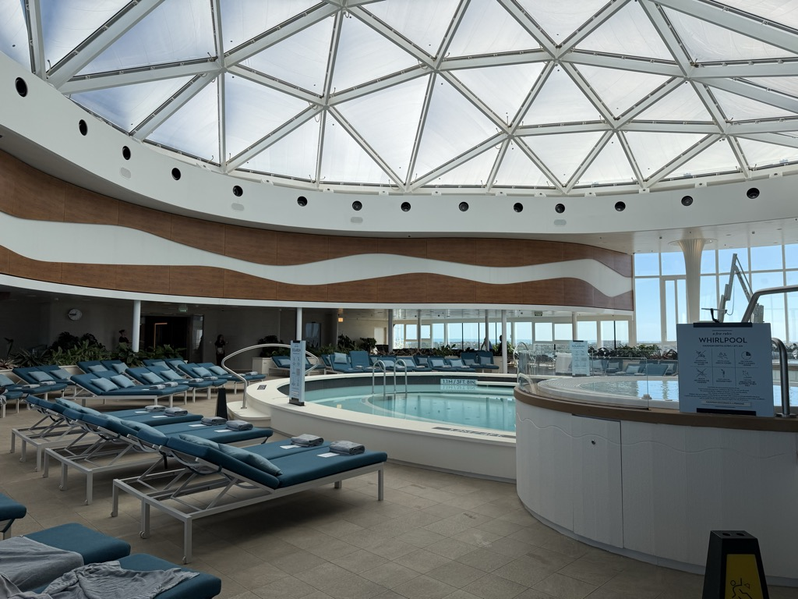

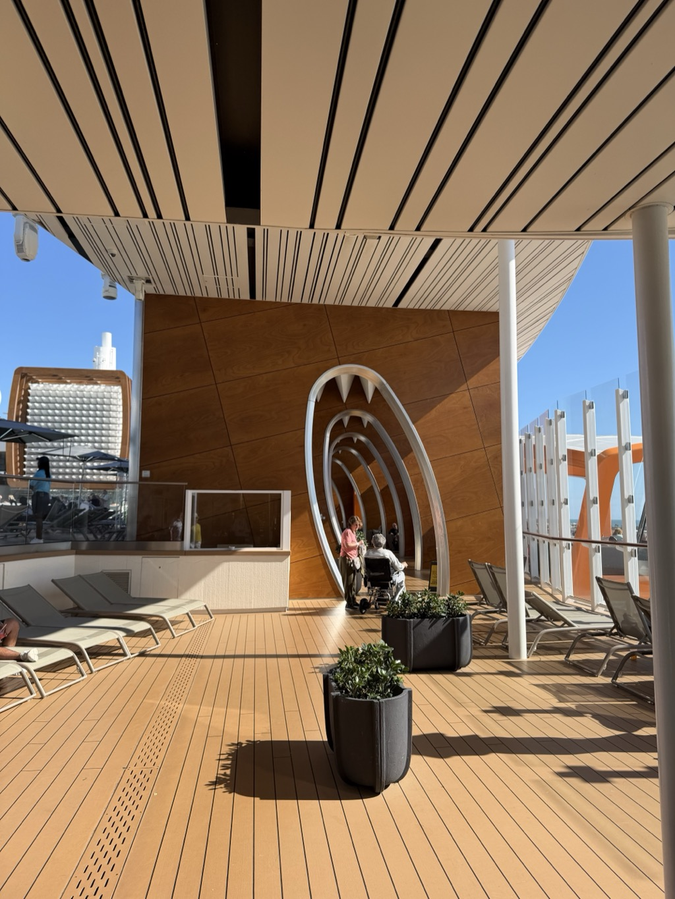

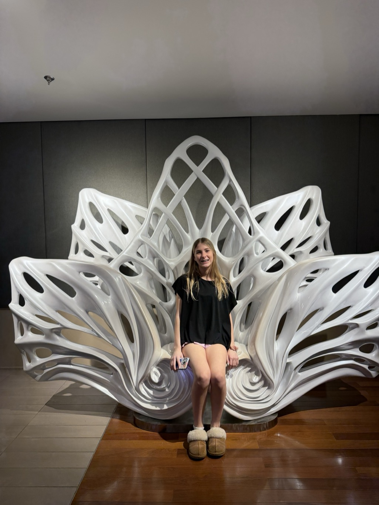

Eden's an interesting space on deck 5 aft.
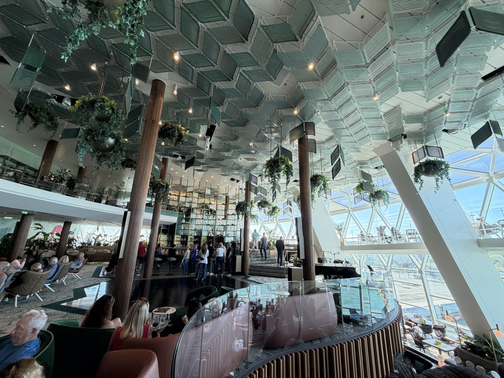

Here's a glimpse of the teen lounge my teens never visit.
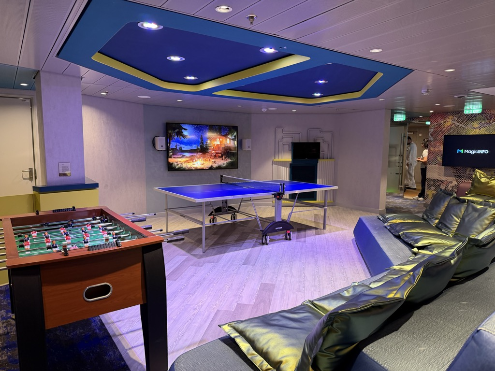

I put Siena to work filming our sailaway.
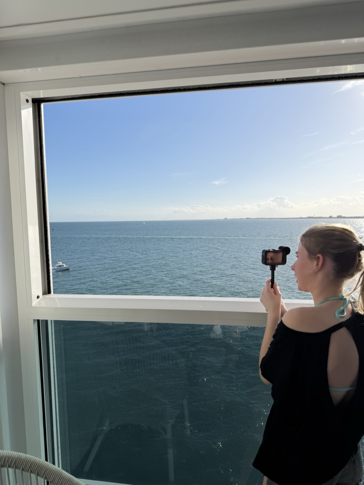

The Rooftop Garden at golden hour:
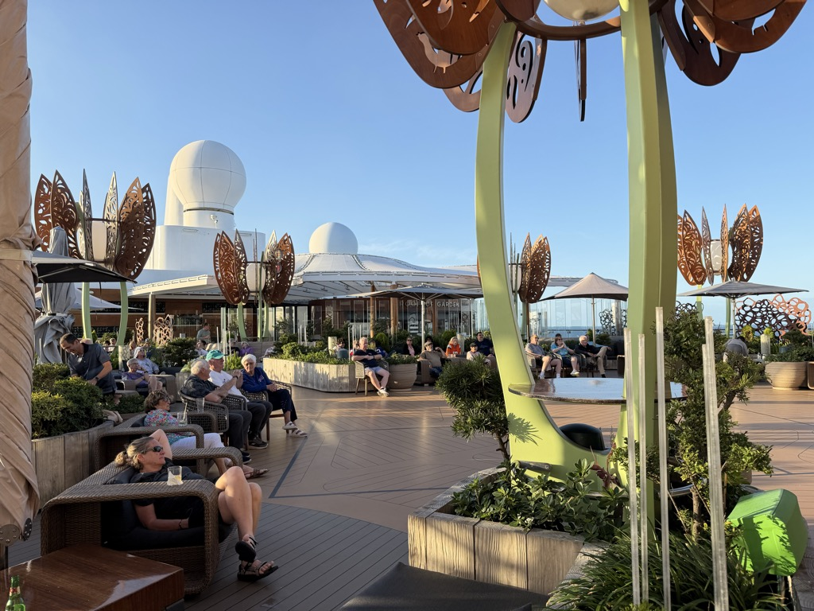

Cruise pizza is a MUST.
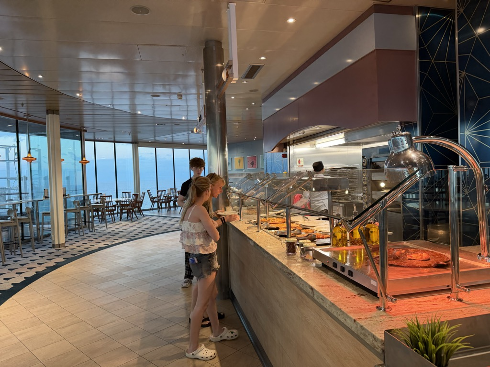

And the Rooftop Garden later, showing a football game:
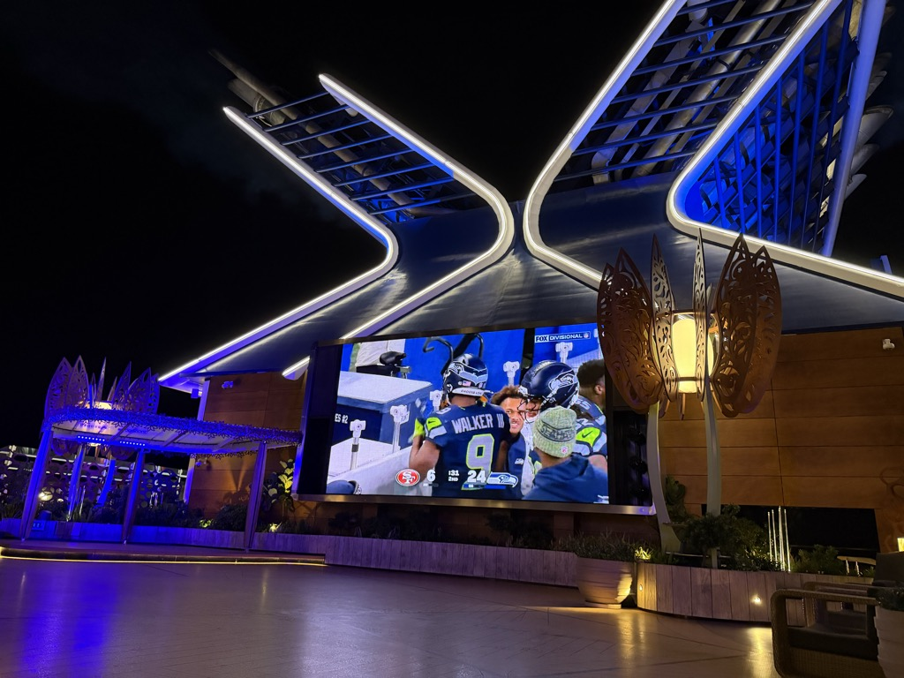

**Footnotes**:

[^1]: This is a twin-sized bed that folds down from the ceiling over a couch that converts into another twin-sized bed. We have the stateroom attendant leave it this way for the duration of the cruise so both kids can have lounging areas. 
[^2]: Contrast this with the Solstice class of ship, on which these rooms are bountiful.
