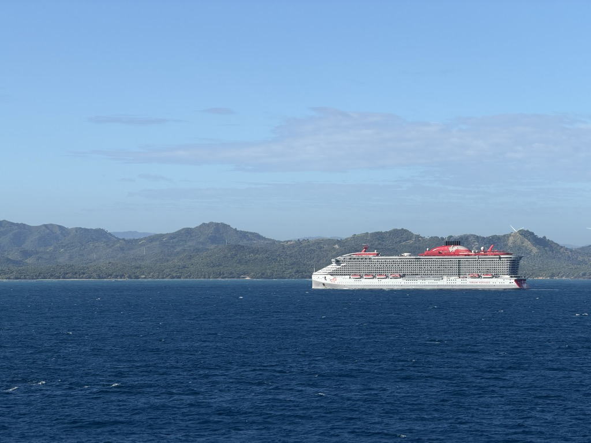
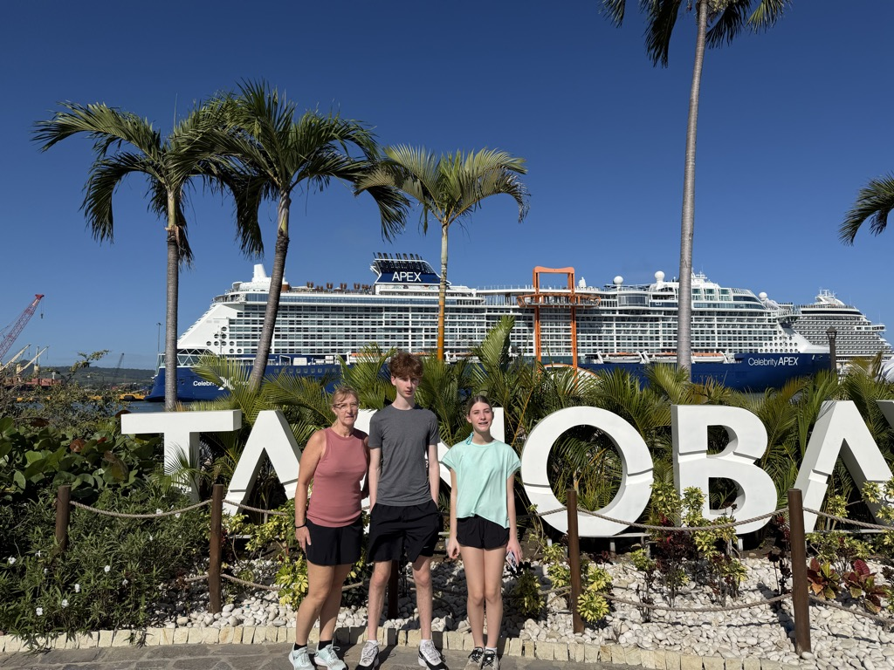
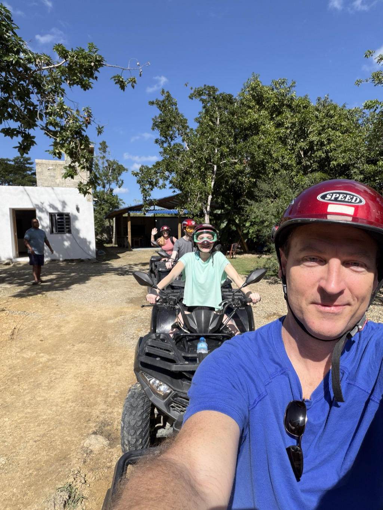
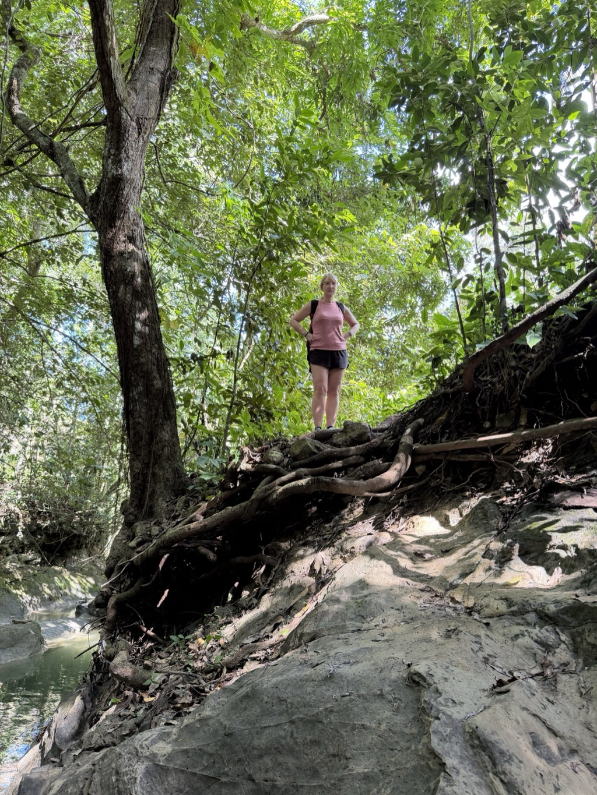
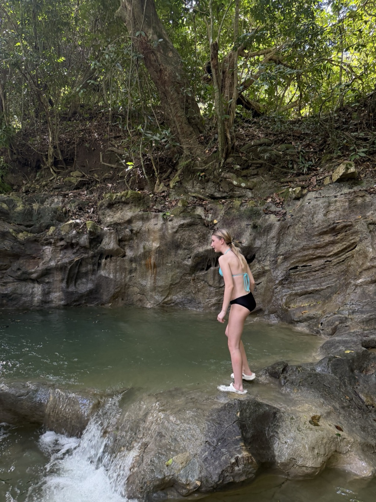
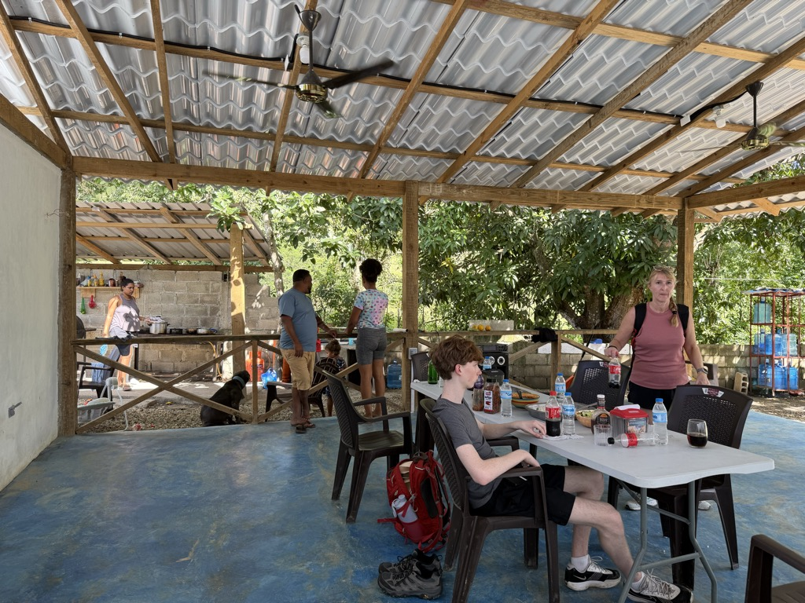
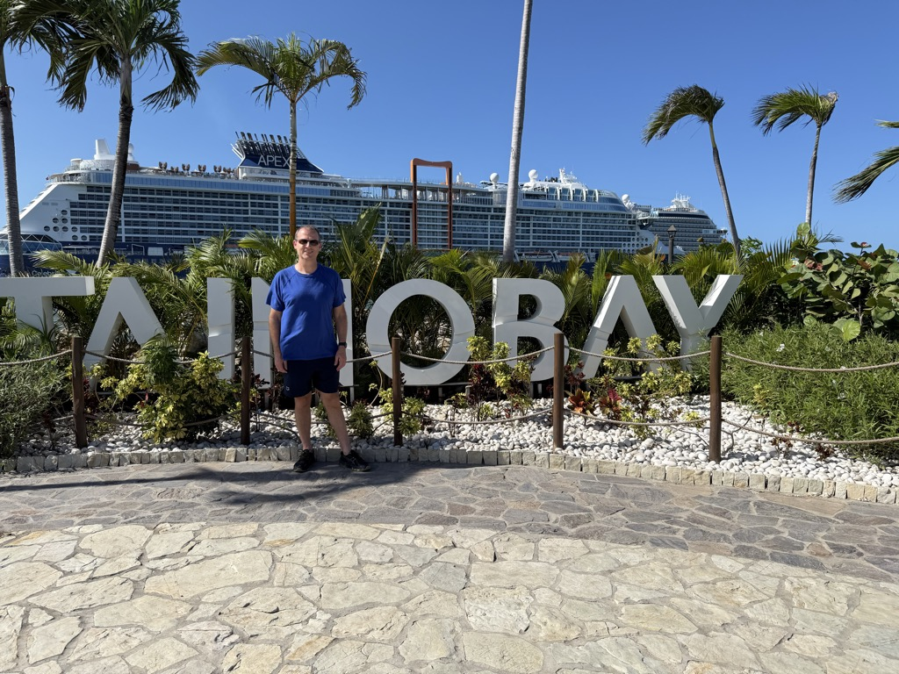
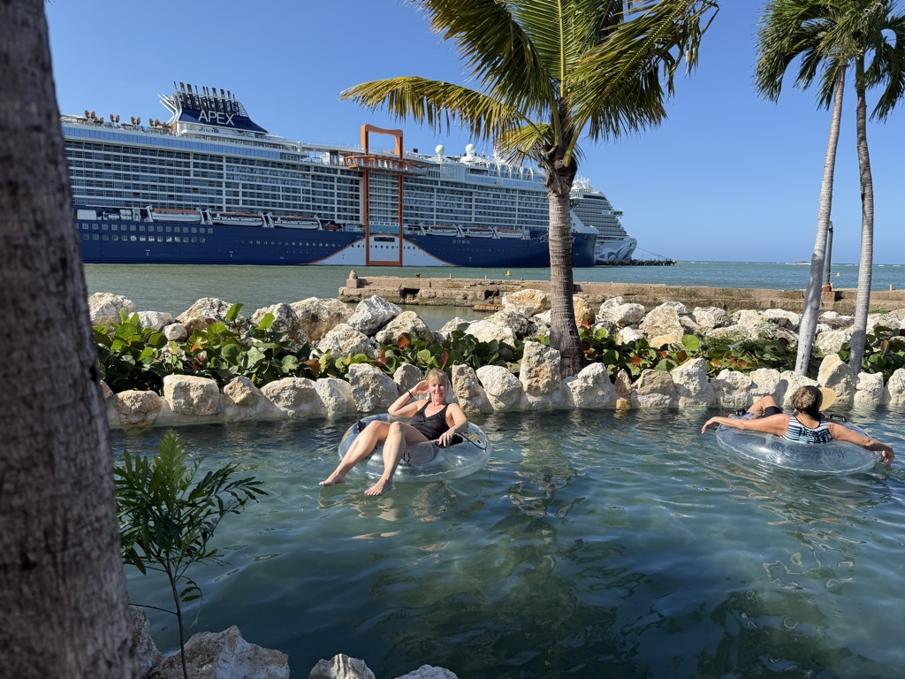

- **Start of day:** Puerto Plata, Dominican Republic
- **End of day:** At sea

Back to Puerto Plata, a little more than a year after our [last visit on the Celebrity Eclipse](/travel/caribbean/2024/Celebrity-Cruise-Day-10-Puerto-Plata.html). On _that_ trip, son rolled his ankle **the first hour** into the cruise, leading to us canceling most of the family shore excursions we had planned; we _were_ able to limp our way to the lazy river built into the cruise port at Puerto Plata called Taino Bay. Sherri and Siena ended up really liking hanging out at Taino Bay and were excited to revisit. 

This time around we had four people in good shape, so I booked an excursion for the day. This booking was an experiment, as it's the first one I've ever done that wasn't arranged through the cruise line. I set this up through [Viator](https://www.viator.com/). For the uninitiated, when you book through the cruise line, part of what you're buying is assurance that the ship will wait for you[^1] should an issue crop up. When you book third party, you're on your own. Granted, it's in the tour operator's very best interests to get you back in time or their reviews will tank, but there's a non-zero chance you'll miss the boat. 

Since it was an experiment, I left a health 3 hour margin between the tour end time and the ship's all-aboard. The long-and-short of it was:
- Viator had lots of different tours shown
- Most of the reviews felt real and not gamed
- The first part of the tour felt a little "off" until we relaxed and trusted the process[^2]
- It cost considerably less than going through the cruise line
- We were in a small group: the four of us, another couple from another ship, and 2 guides

We did the ATV tour (which was longer than I expected, in a good way), had a home-cooked lunch of Dominican specialties, then were transported back to the port. 

First we had to dock. It wsa a beautiful day. 

Walking through Taino Bay to reach the transportation corral outside.

Our excursion was billed as ATV and waterfalls. 

Our lunch:

Once back at port we relaxed at Taino Bay for a few hours. In our experience, this place is pretty busy during the day, and can be hard to find chairs. Later in the afternoon it's more enjoyable as people start to clear out. They offer WiFi but you need to get the code from one of the merchants first. There are free tuktuks at the top of Taino Bay to run you down to your ship, and a tip is appreciated.

**Footnotes**:

[^1]: Or the cruise line is on the hook to arrange for you to meet back up with the ship in extreme cases.
[^2]: There are two cruise ports for this part of the Dominican Republic, around 20-25 mins apart, and our group had people from ships in both ports. To coordinate this, the tour operator taxied us halfway to the other port, and another taxi dropped off a couple from another ship. Then a van took all of us back towards our port and then past it to get out into the country for the tour. Once we understood this was happening it was fine. We didn't speak Spanish and the driver could see our concern (and was empathetic towards that) so he put someone on the phone who explained things. Not once did I feel concerned for my safety, I want to be clear.
