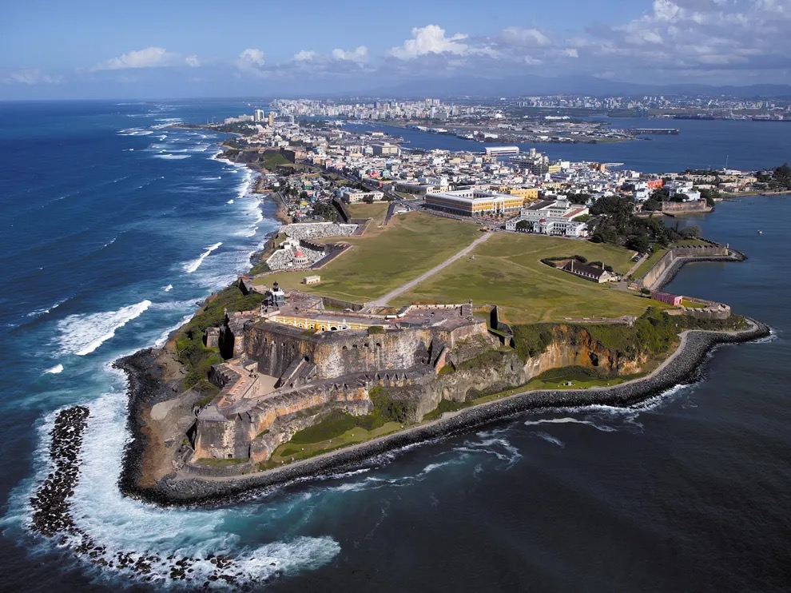
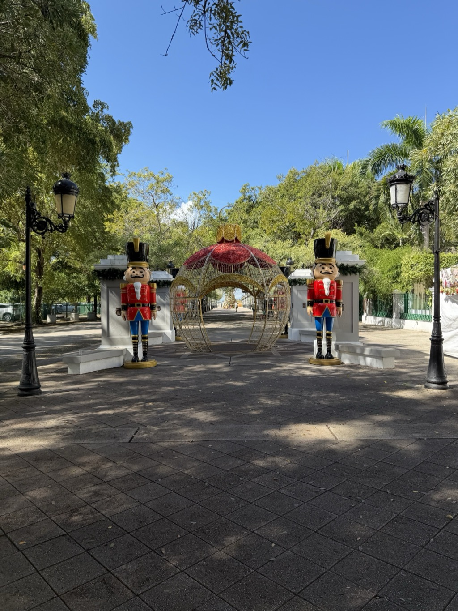
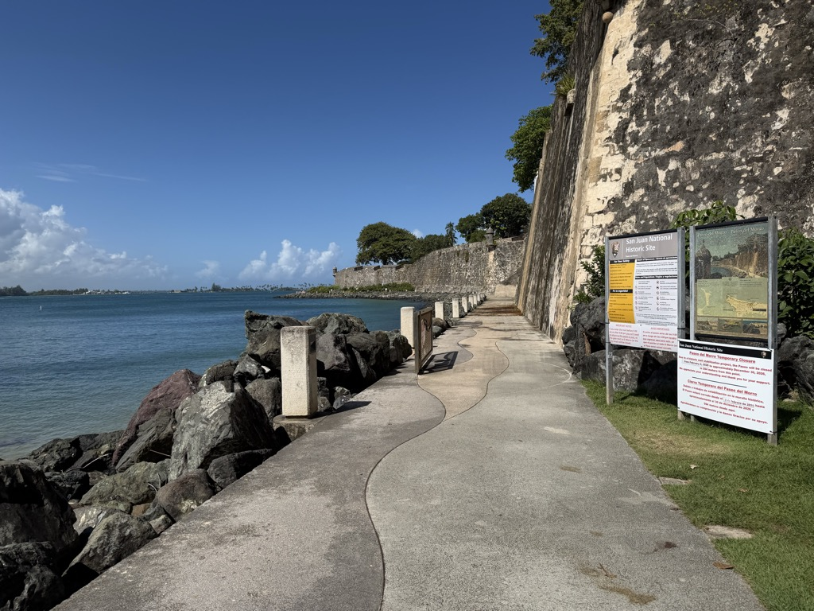
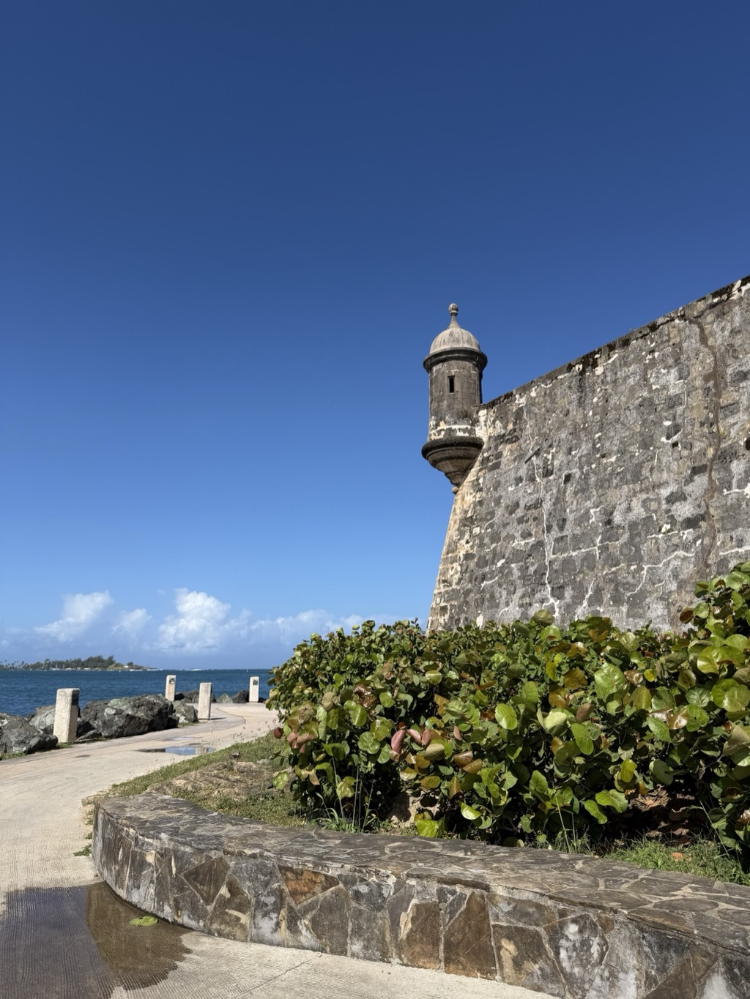
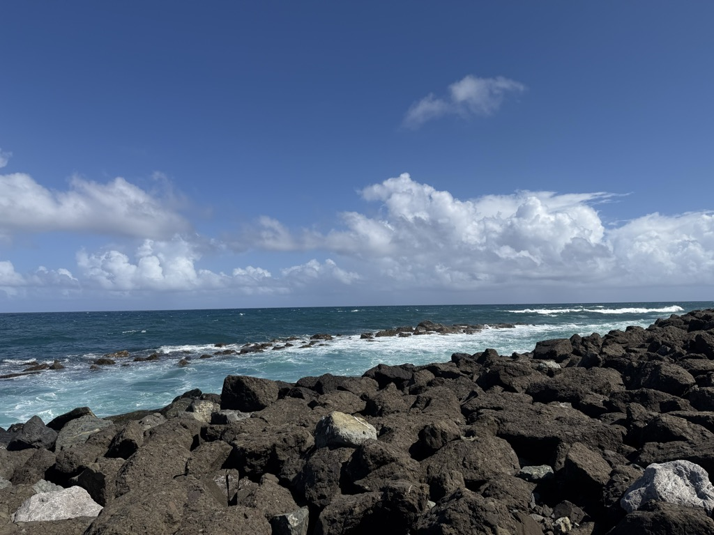
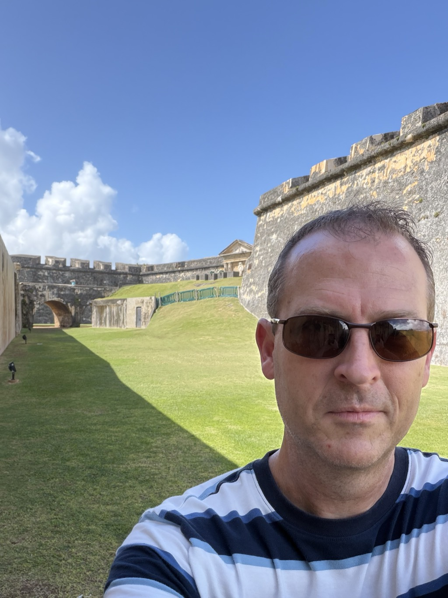
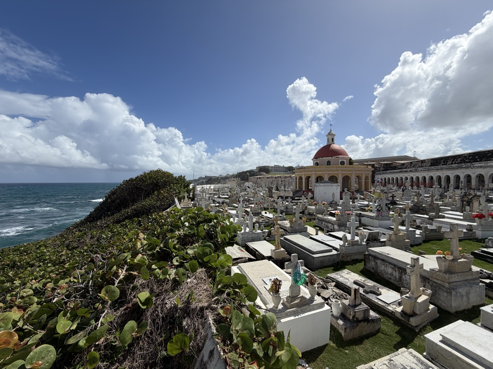
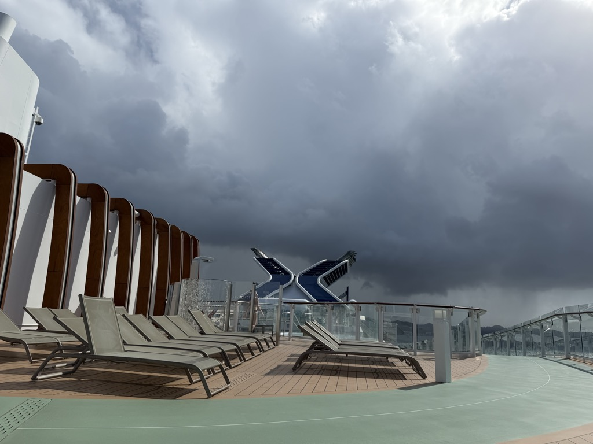
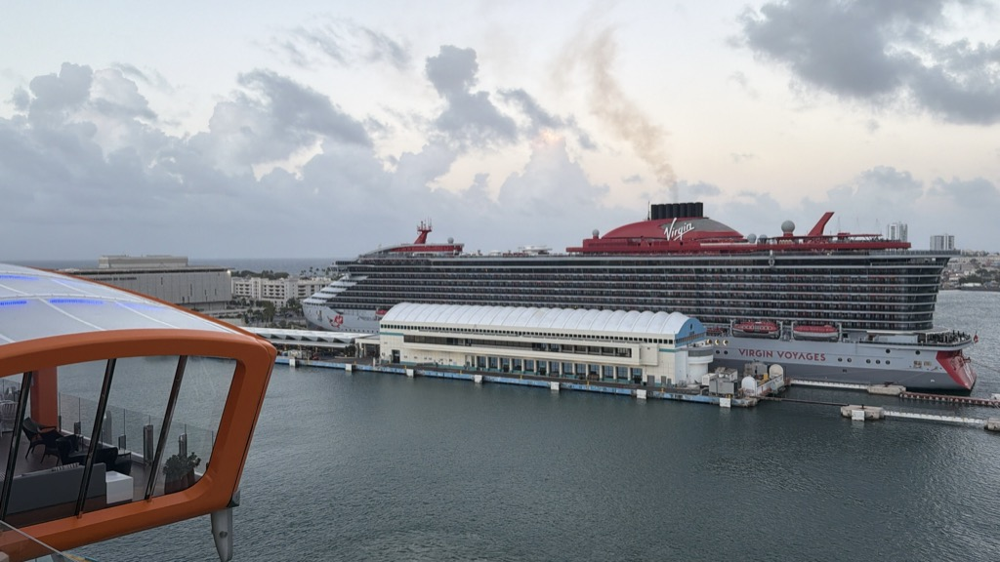
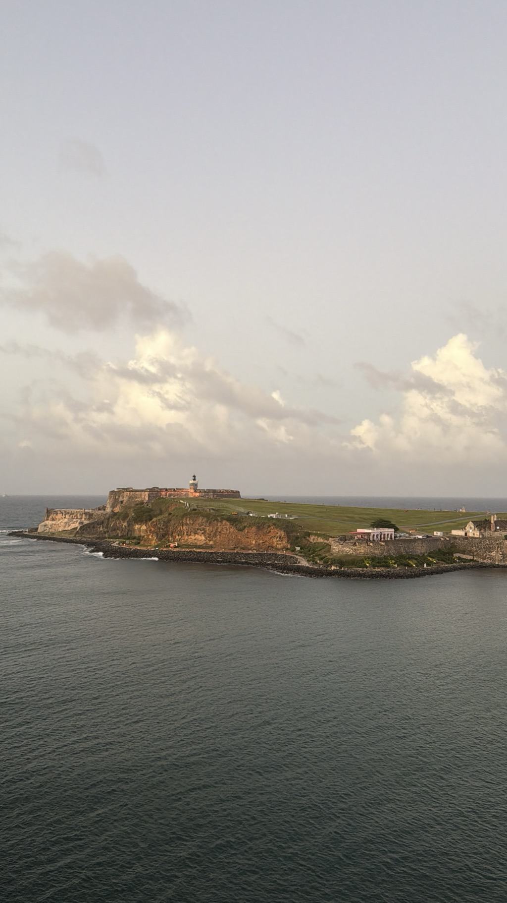

- **Start of day:** San Juan, Puerto Rico
- **End of day:** At sea

I believe this is our fourth visit to San Juan, enough times that we kind of know our way around and have opinions on what we want to see this visit. 

For today, the kids weren't interested in a big walk, so Sherri and I set out to walk the Paseo del Morro, which sits between the water and [Castillo San Felipe del Morro](https://www.nps.gov/saju/index.htm).

<figure>
    
    <figcaption style="text-align: center; font-style:italic;">Castillo San Felipe del Morro from above. Photo: National Park Service</figcaption>
</figure>

To get there, we passed these leftover Christmas decorations.

And made our way around the Castillo. 

Past the Castillo is the [Santa María Magdalena de Pazzis Cemetery](https://en.wikipedia.org/wiki/Santa_Mar%C3%ADa_Magdalena_de_Pazzis_Cemetery).

We then walked through town for a while before making our way back onto the ship ahead of a passing storm.

Here's another shot of [Resilient Lady](https://www.virginvoyages.com/ships/resilient-lady), the same ship shown yesterday approaching Puerto Plata in the Dominican Republic. 

I always love the sailaway from San Juan passing the Castillo.

