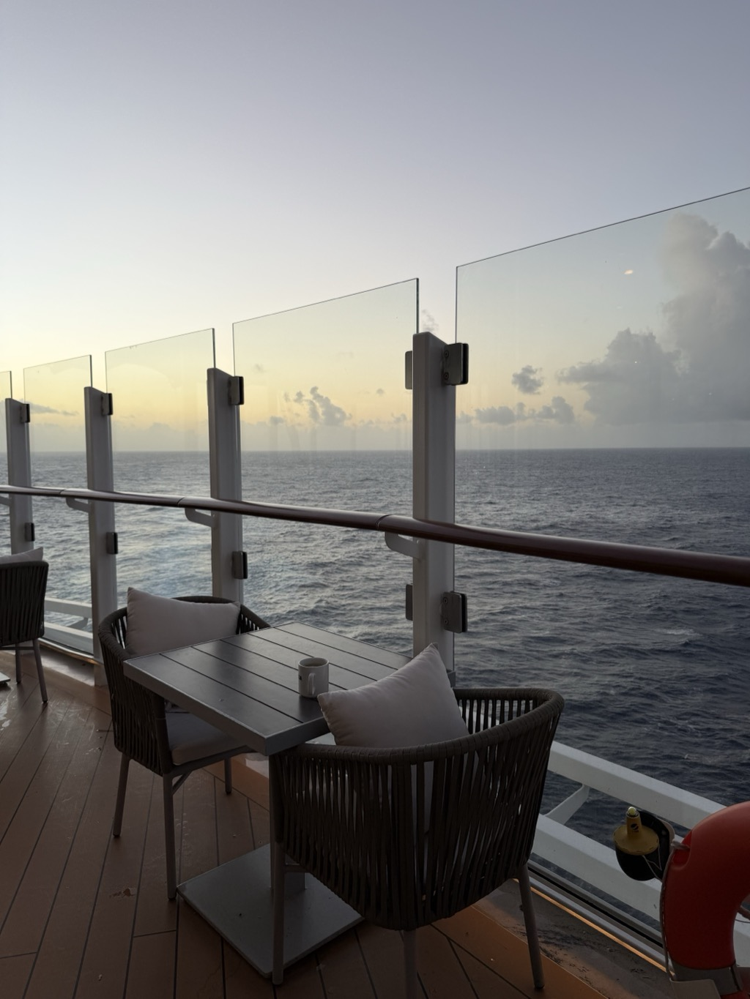
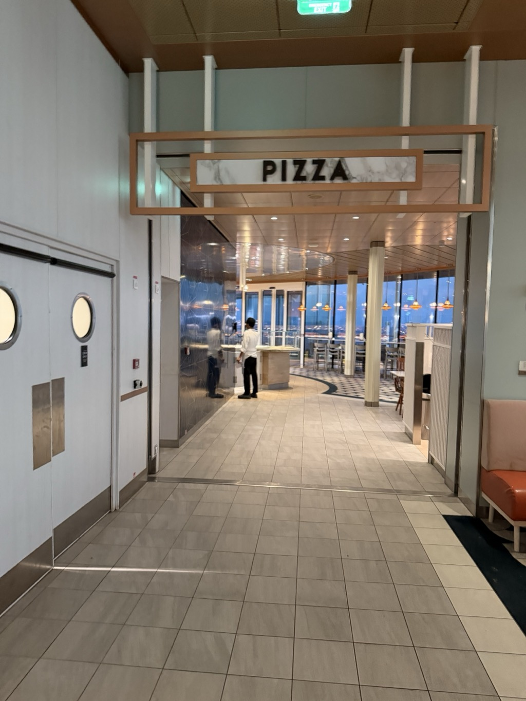
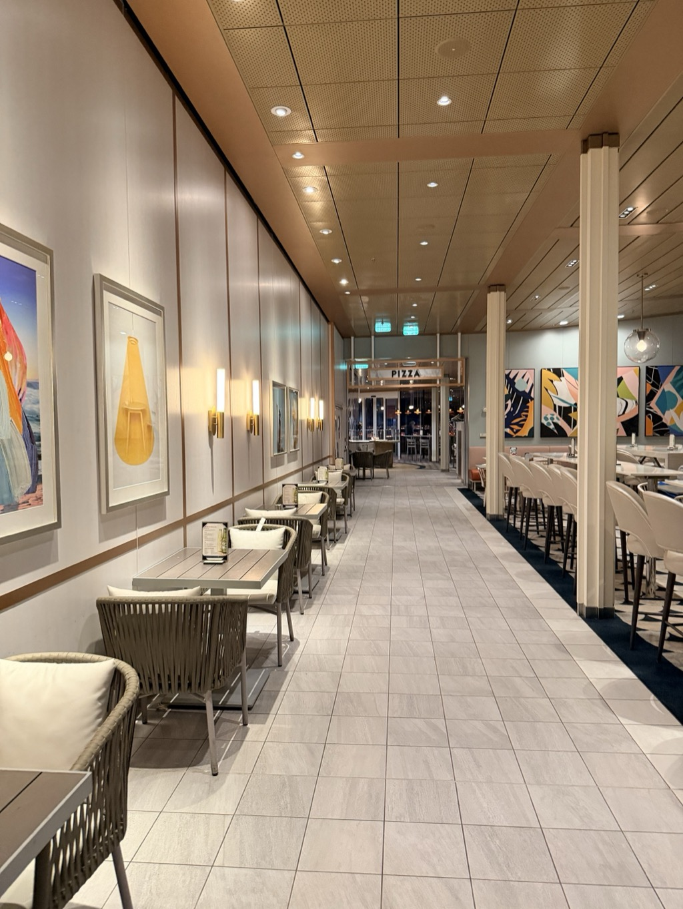

- **Start of day:** At sea
- **End of day:** At sea

The first of two sea days heading back to Florida.

Here's some Celebrity Apex minutiae that I can guarantee almost nobody cares about. This is in the Oceanview Cafe, port side, looking aft, from this trip.

And then, _posting this from the future_, this is the same space in October 2026 on my transatlantic. 

New tables! See, I told you nobody would care about this.
