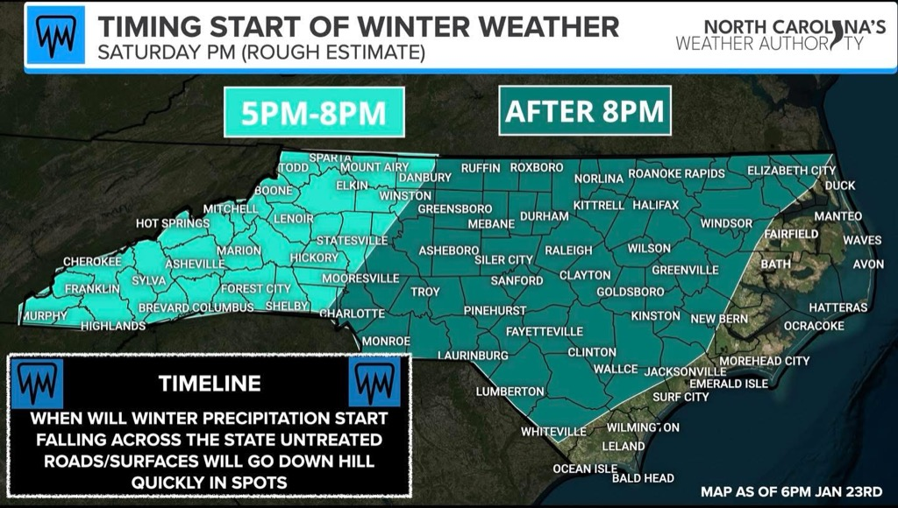
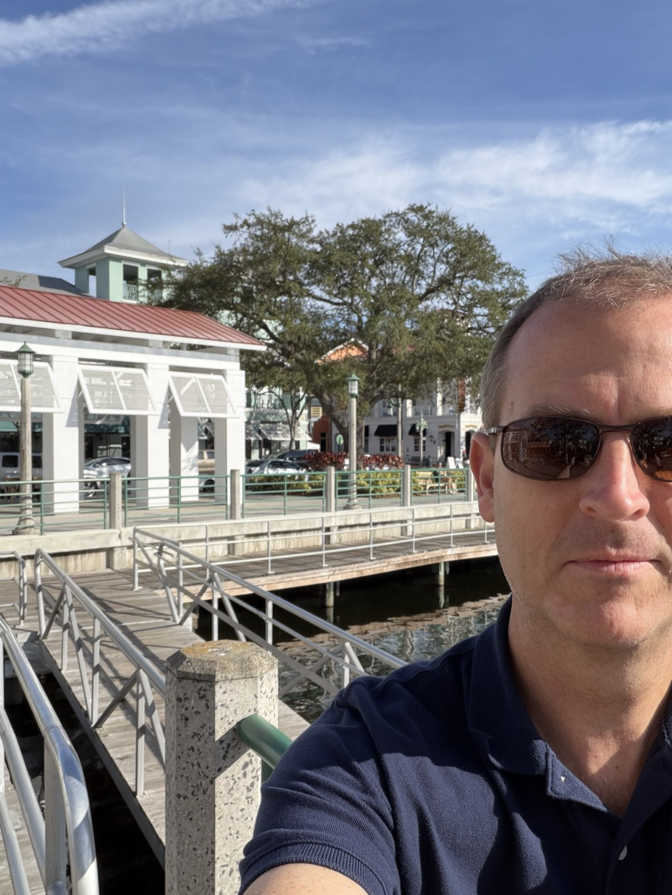
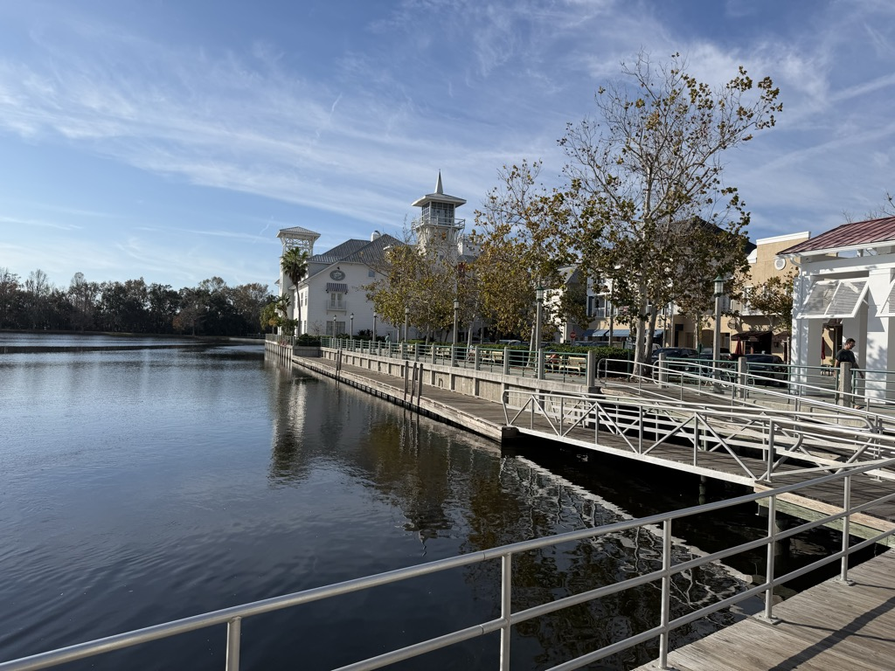
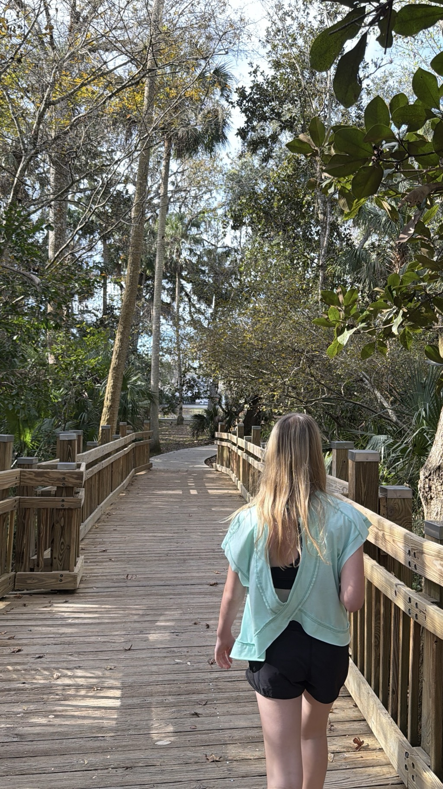
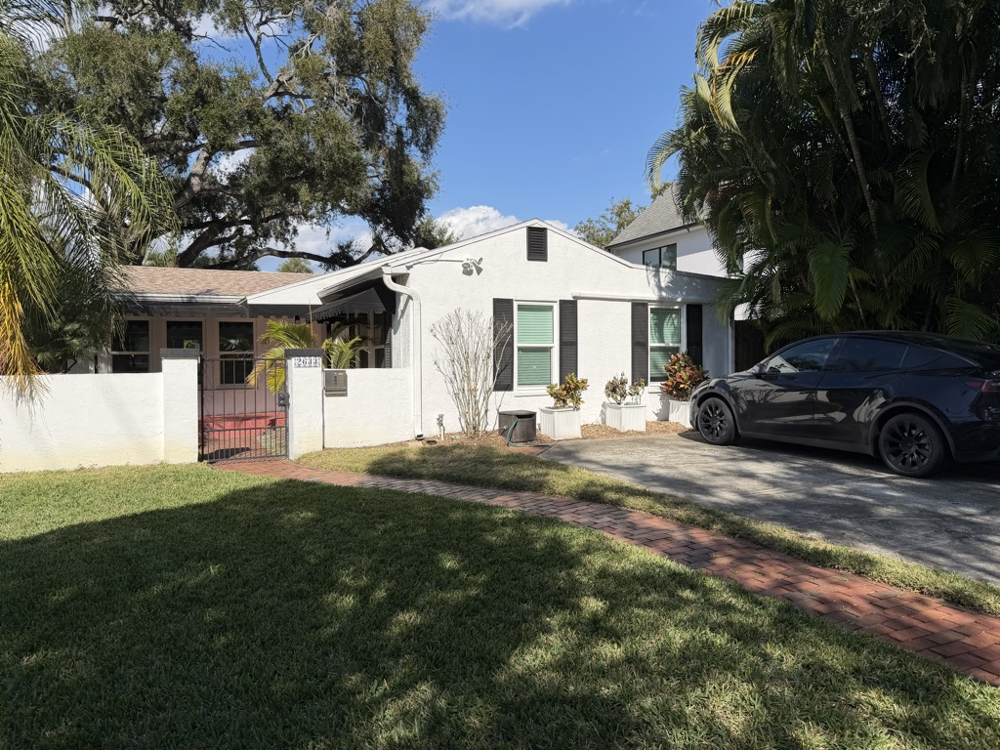
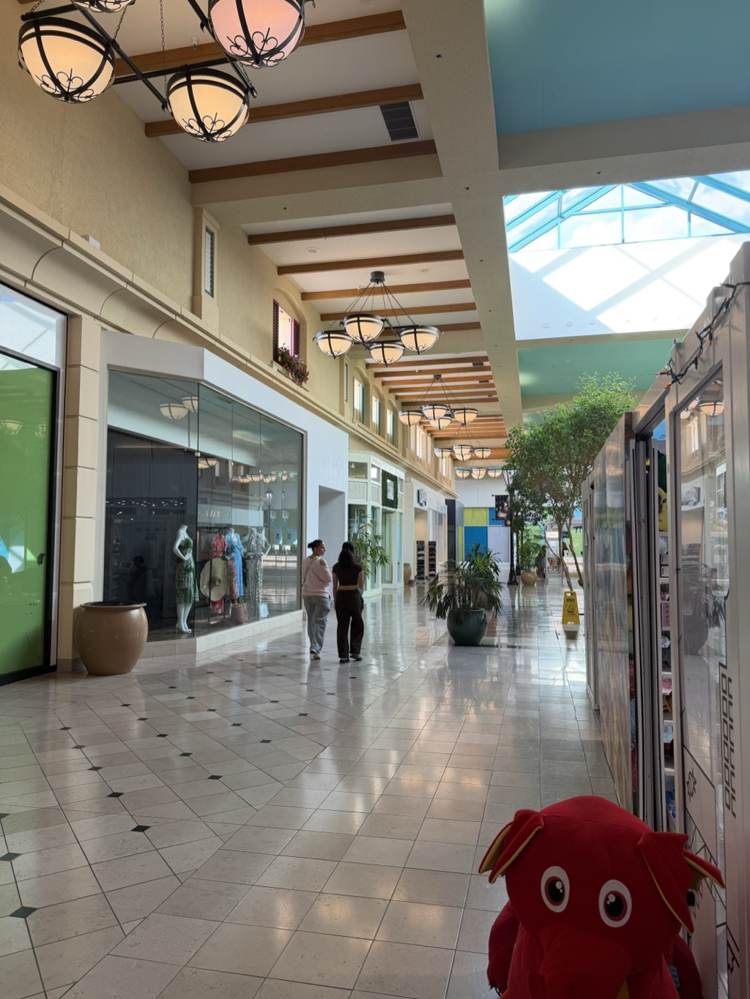
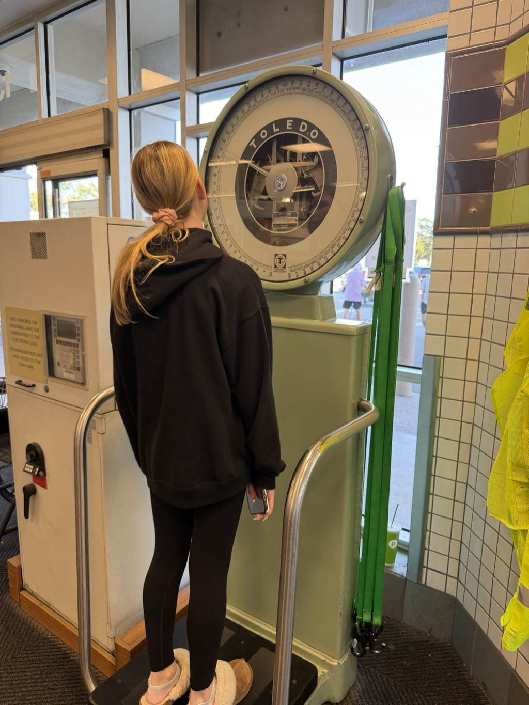

- **Start of day:** Port Canaveral, Florida
- **End of day:** Tampa, Florida

For the last day or two, we'd been monitoring the development of a winter storm that would be impacting both where we live and where we'd need to drive to get back home. 

Even if we were in the first set of people to disembark the ship, by the time we factored in charging stops and probably traffic, we'd be reaching North Carolina after the storm had started to set in. 

North Carolina -- or at least the part we live in -- doesn't handle snow very well. The last thing we wanted was to be stuck on I-95 (in an EV) or waylaid at an Econo Lodge for 2 days. 

Confident that weather would close schools for at least a few days, we decided to wait things out in Tampa.

We stopped at Celebration on the way west.[^1]

Then we hit I-4 West toward Tampa. I'd booked an Airbnb in the neighborhood I grew up in. The rest of the Tampa stay would be a huge nostalgia rush as I walked the streets of my old neighborhoods (Parkland Estates, New Suburb Beautiful), and visited Hyde Park Village and WestShore Plaza. BTW, WestShore isn't doing so hot and has probably run its course.

**Footnotes**:

[^1]: For the uninitiated, we lived in Celebration from 2009-13, and I had offices there when I worked for Walt Disney World Co. and Disney Cruise Line before that. 