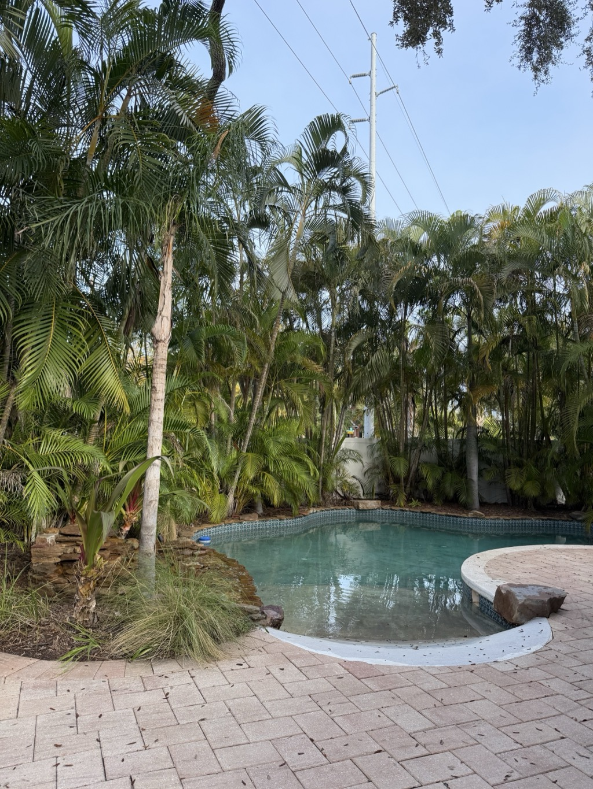
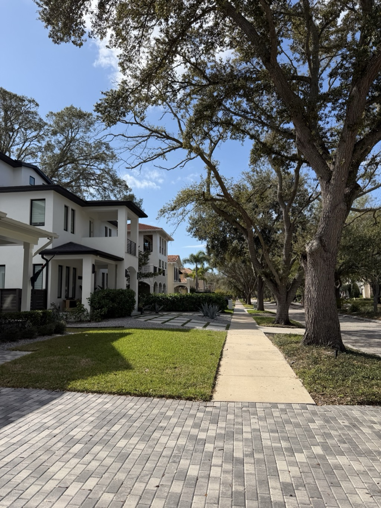
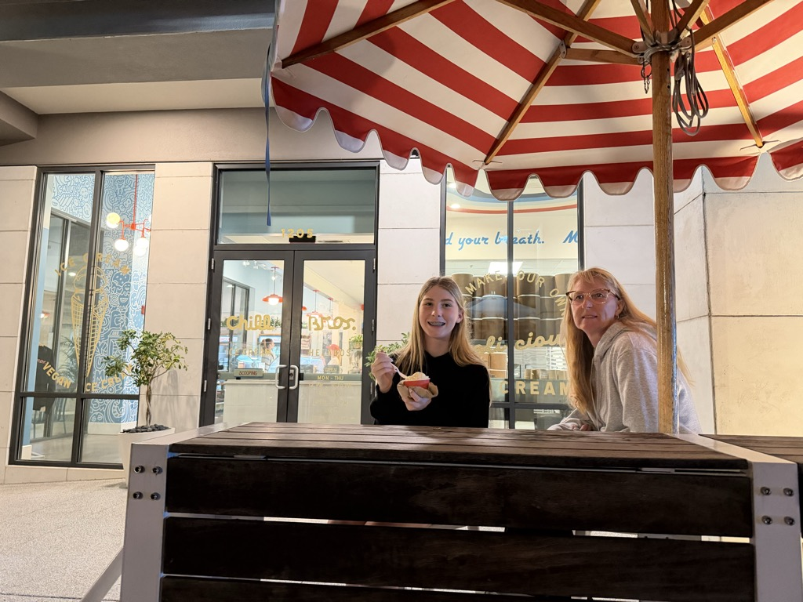
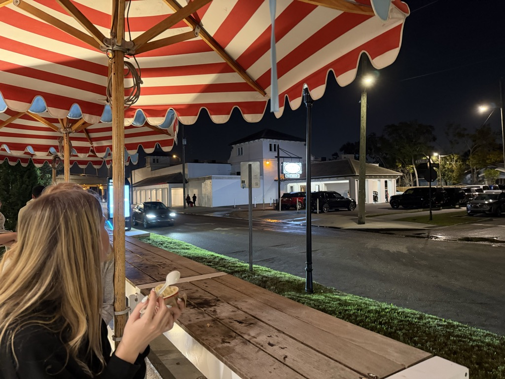
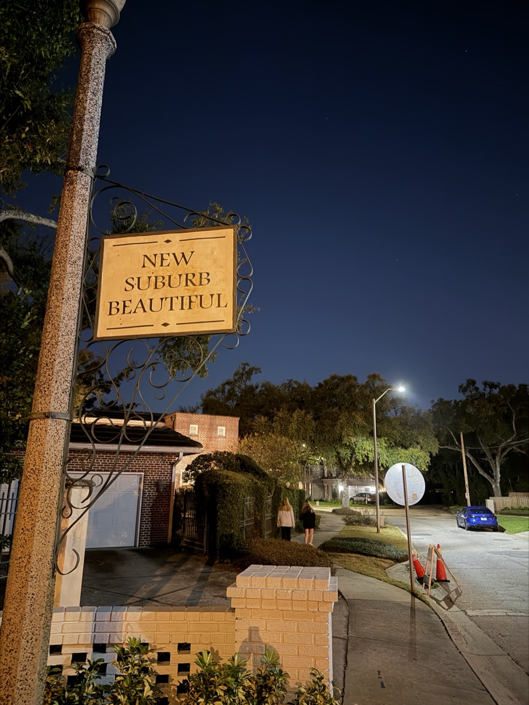

- **Start of day:** Tampa, Florida
- **End of day:** Tampa, Florida

Today we walked around South Tampa. 

<video src="/assets/20260125-tampa-pool-skimming.mp4" width="100%" controls playsinline muted></video>

Dinner was take-out from [4 Rivers Smokehouse](https://www.4rsmokehouse.com/menu/), which seemed understaffed but doing their best with who they had. The food was good once it was ready.

A bit later we walked to South Howard and stopped for ice cream across from [Bern's Steak House](https://bernssteakhouse.com/), a South Tampa icon. 

Meanwhile, in North Carolina, the roads were undergoing a cycle of thawing during the day and freezing at night. We felt we made the right decision.
