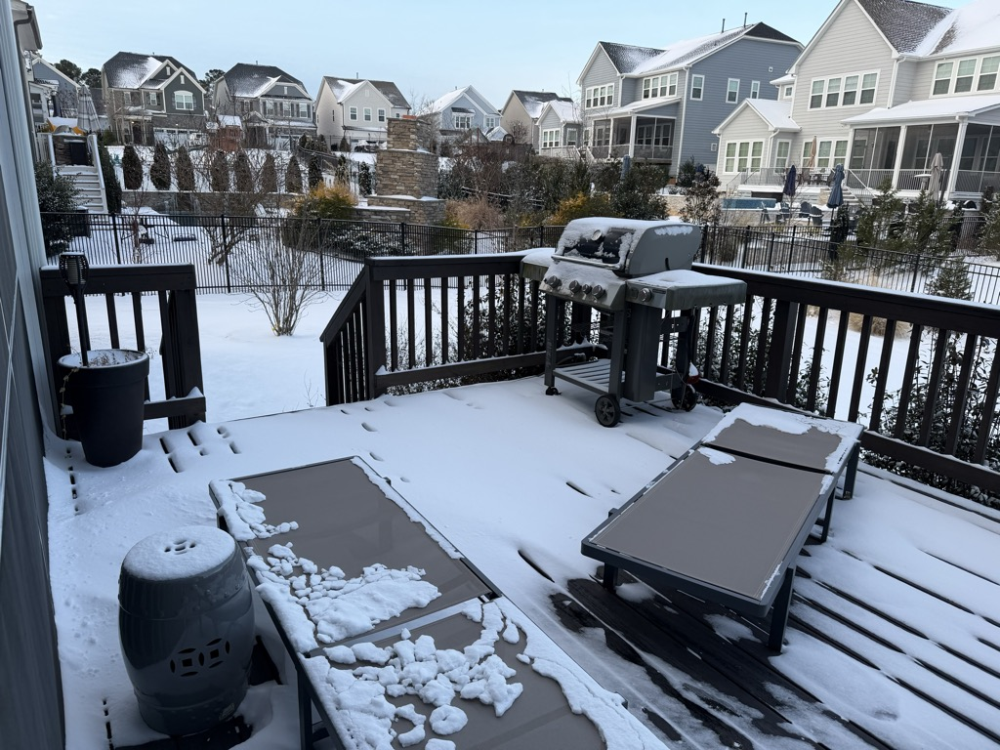

- **Start of day:** Tampa, Florida
- **End of day:** Home in North Carolina

And now it's time to pay the piper. The price for avoiding days of snow and ice is a direct drive from Tampa to Raleigh on I-4 and I-95. 

We said goodbye to [our Airbnb rental](https://www.airbnb.com/rooms/1452137662571096333) and hit the road.

Nothing notable about the trip except for this stop at a Stuckey's, which had clearly seen better times but had Tesla chargers.

One more Buc-ee's in Florence before the last stretch home, which was eerily and unsettlingly calm.

<video src="/assets/20260126-florence-bucees-walk-through.mp4" width="100%" controls playsinline muted></video>

Snow on the back deck at home, a week after we got back:

