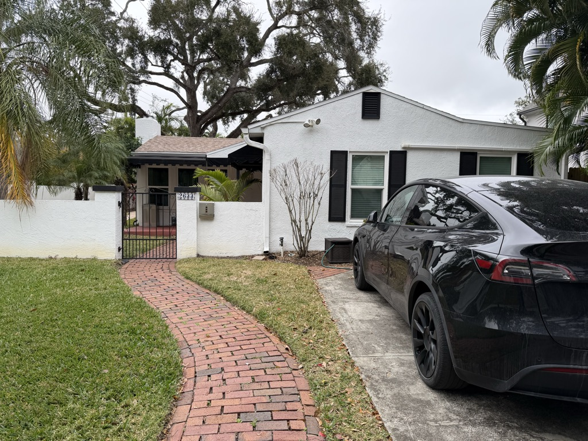
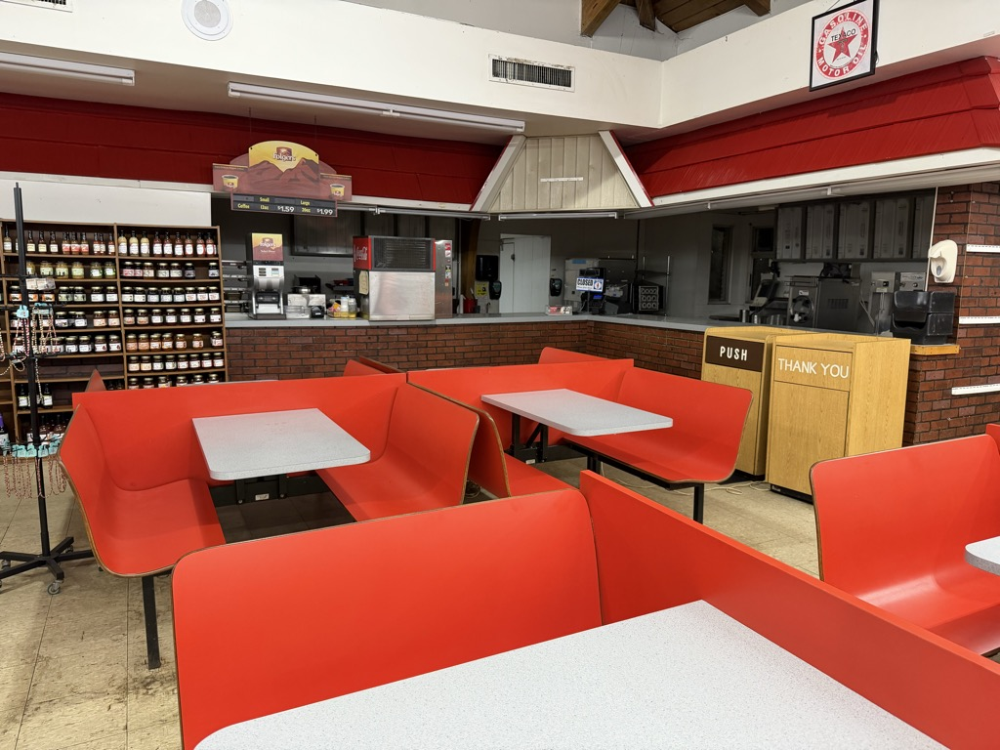
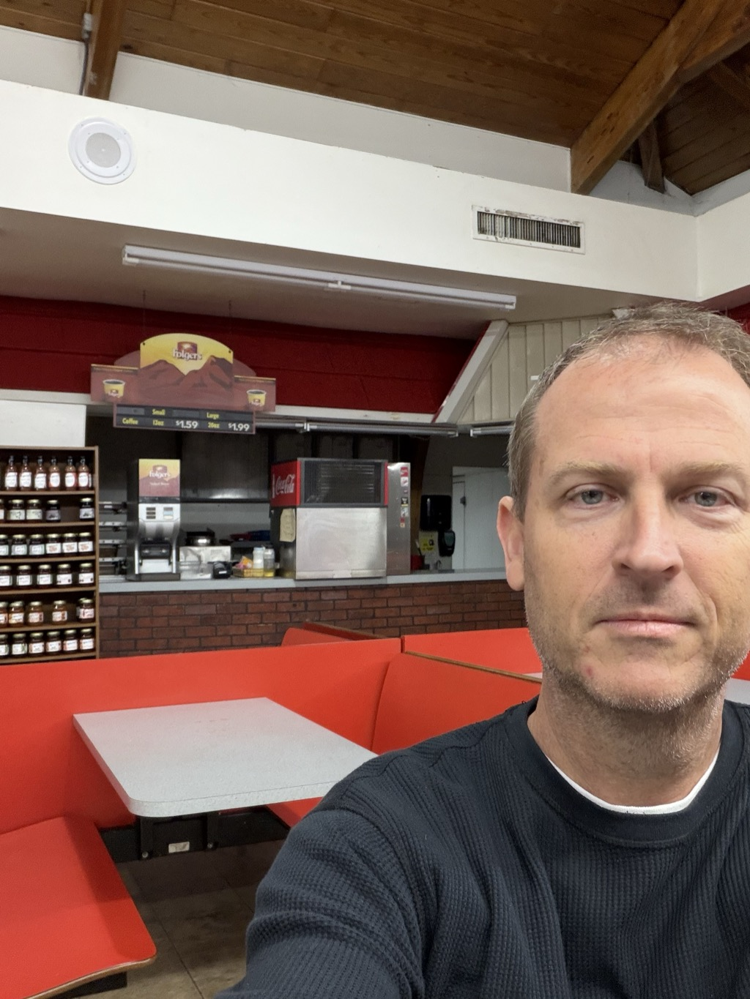

- **Start of day:** Tampa, Florida
- **End of day:** Home in North Carolina

One more Buc-ee's in Florence before the last stretch home.

<video src="/assets/20260126-florence-bucees-walk-through.mp4" width="100%" controls playsinline muted></video>

Snow on the back deck at home, a week after we got back:

