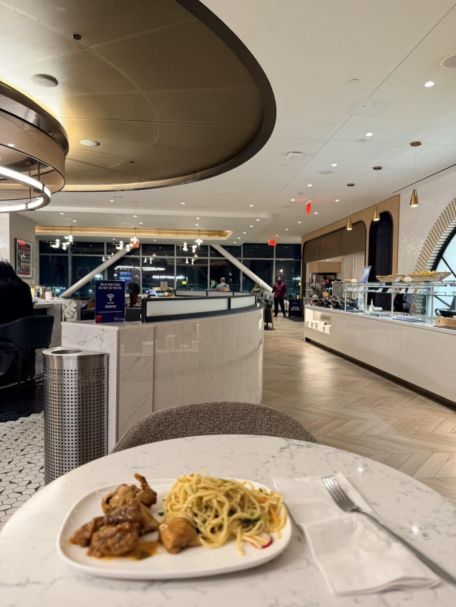
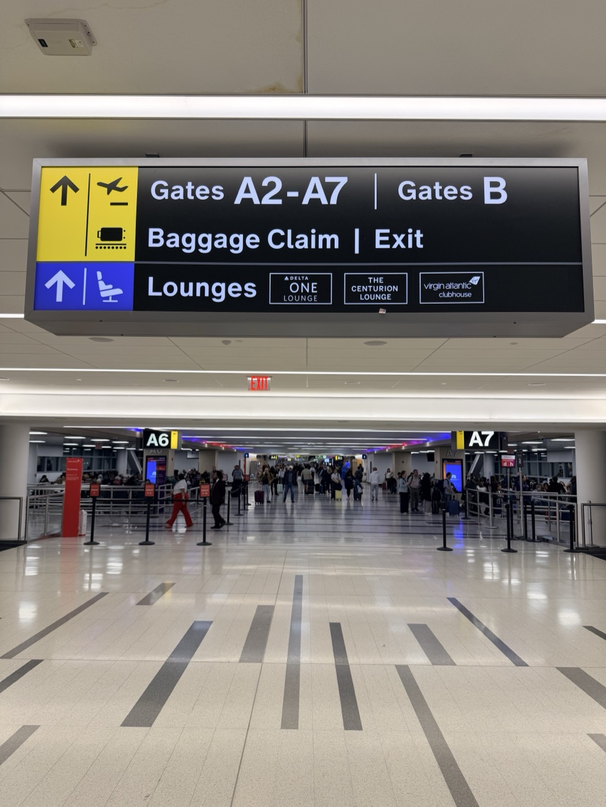
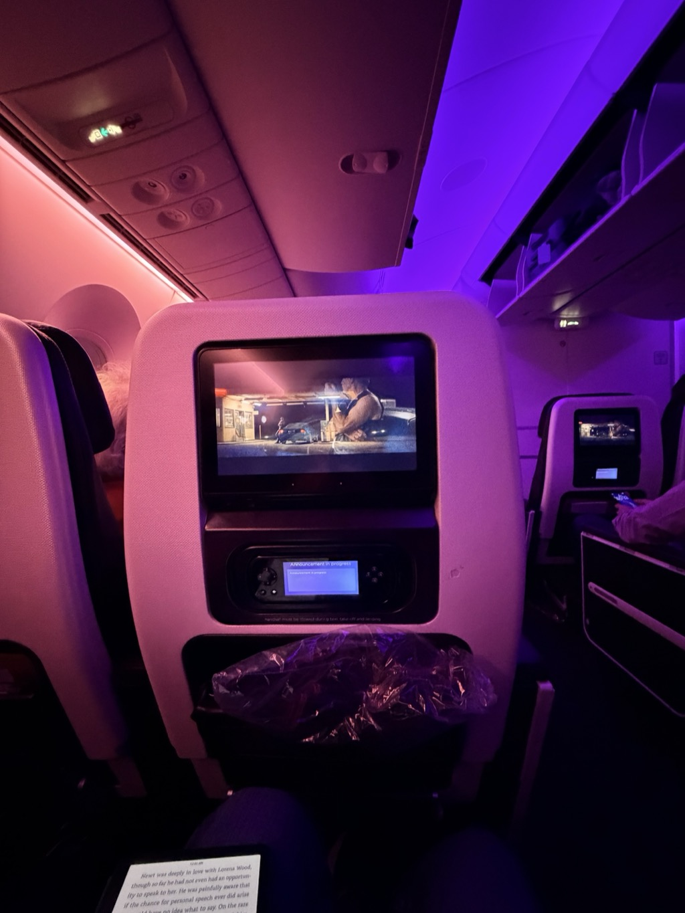

- **Start of day:** Home in North Carolina
- **End of day:** Somewhere over the Atlantic

Time for another solo adventure! You might recall I enjoyed a [solo land+cruise trip earlier this year in May](https://bbhart.com/travel/rollup/2026/Rome-and-Silversea-recap.html), exploring Rome for a few days and then sailing to Spain and Portugal on [Silversea](https://www.silversea.com/). 

For October, I found a trans-Atlantic cruise that had a great last minute rate with a desirable stateroom and jumped on it. And when I say "last minute", I mean: I booked the cruise on Monday afternoon and then flew to London on Thursday! 

I _did_ confirm there were some acceptable flight options before clicking the Book It button on the cruise. Delta, my preferred airline, had a fine flight to JFK; from there I'd take a Virgin Atlantic codeshare flight to London-Heathrow. 

This was my first experience with Virgin Atlantic, flying Premium Economy. It was _okay_. It was a little chaotic at the gate at JFK. The inbound aircraft had a problem at Heathrow that forced Virgin to swap the aircraft type from an Airbus A350 (IIRC) over to a Boeing 787 Dreamliner, meaning they had to move some seats around. If you'd printed a boarding pass at home or had it in your Apple Wallet, you needed to visit the desk and get a paper boarding pass, as your seat may have changed. It happens, but the gate staff's communication about what passengers needed to do[^1] could've been better. We boarded about an hour late but made up the time in the air.

I popped into the Delta Sky Club about 30 minutes before close. This is the one in Terminal 4, Concourse A, near Gate A8. What a treat an almost-empty lounge is.

The boarding process aside, the vibes once onboard were decent, and I liked my seat...

... but these redeyes that depart at midnight and land at noon are a special kind of hell. I need to start doing the 7pm->7am ones instead, and then just eat the price of a destination hotel room the night before.

*Part of the [Transatlantic Crossing 2026 trip]({{ ta_recap.url }}).*

**Footnotes**:

[^1]: Mine was up-to-date in the Delta app.