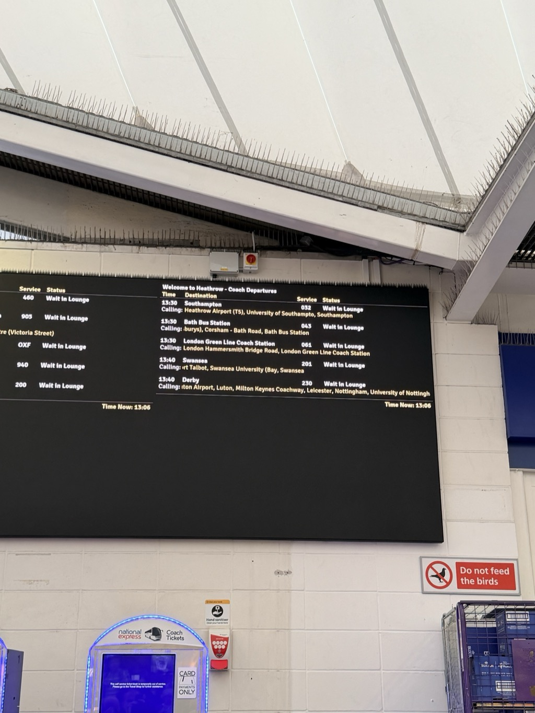
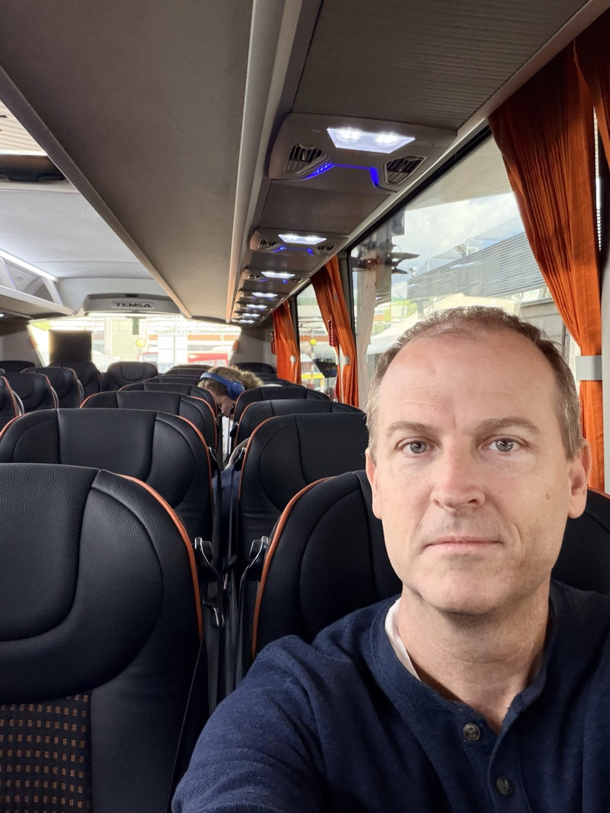
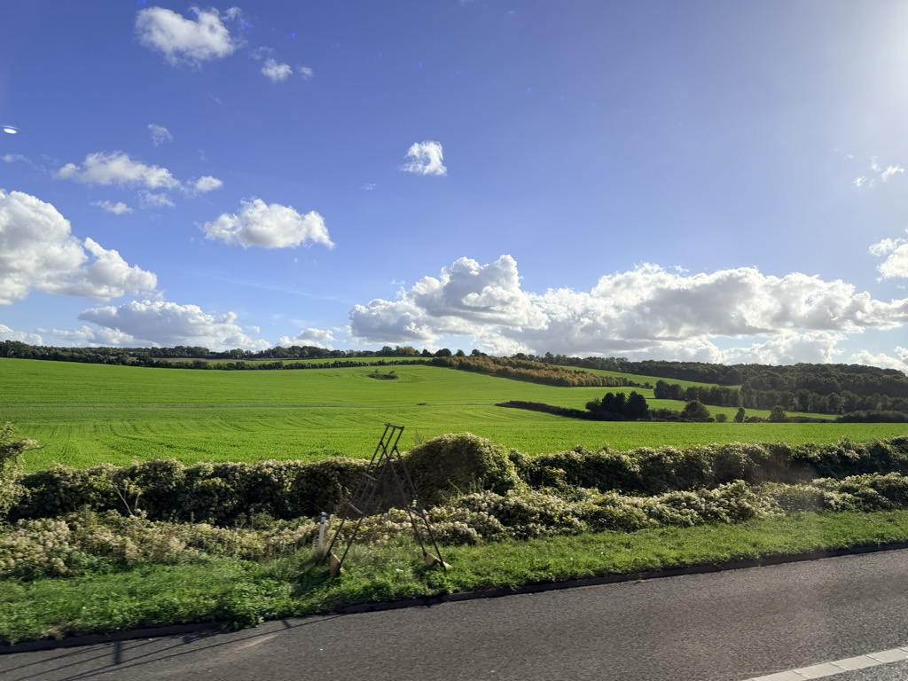
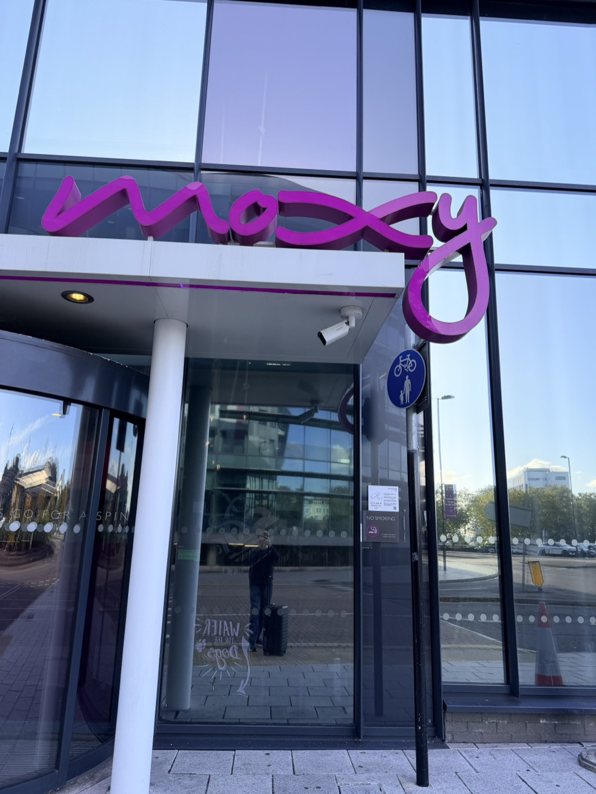
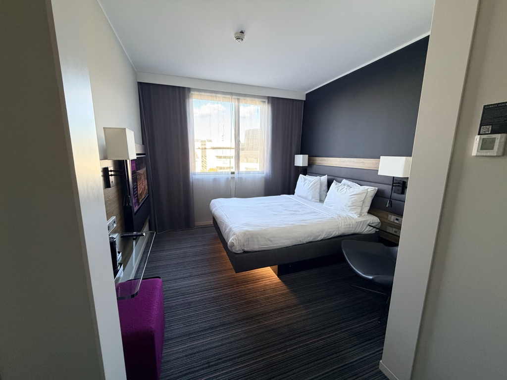
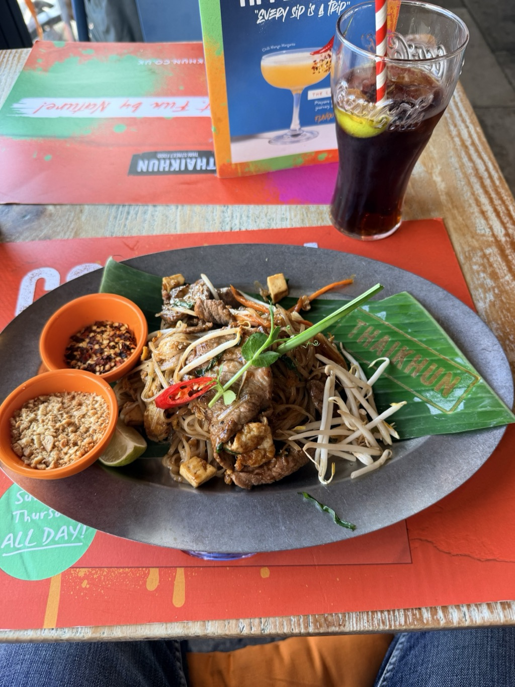
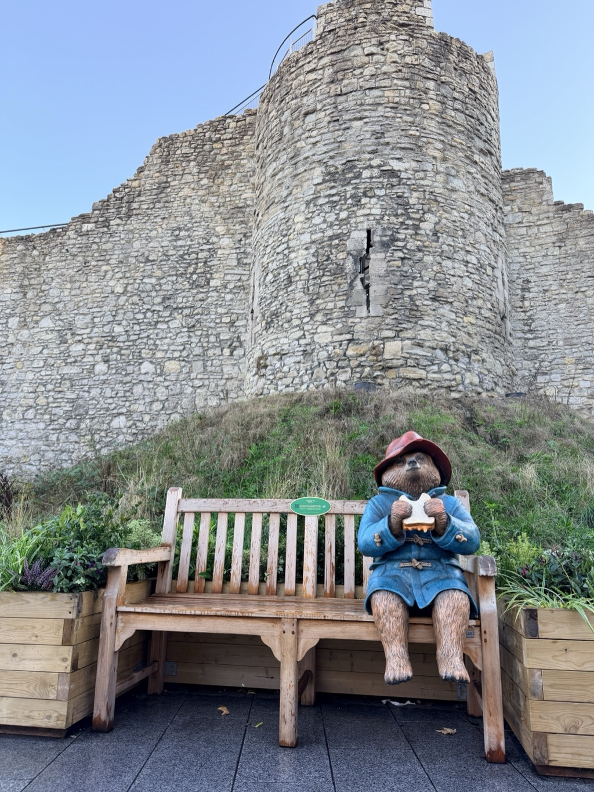
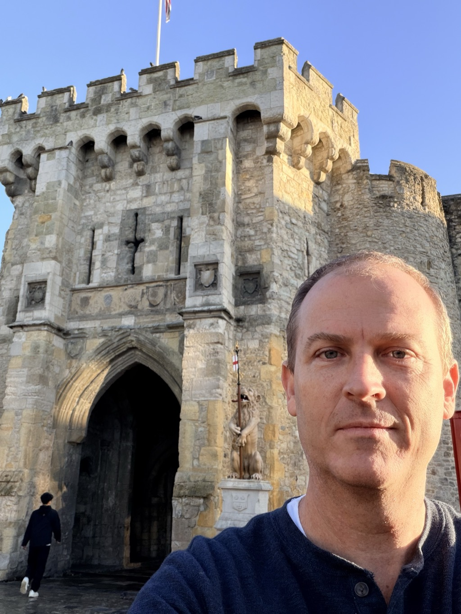

- **Start of day:** Over the Atlantic
- **End of day:** Moxy Southampton

There's not much to write about the flight. I was incredibly tired and also couldn't get into a comfortable enough position to sleep, so I just did the head bob thing for like 6 hours.

When planning the trip I wanted to give myself some buffer time before Sunday's embarkation, partly to play tourist, partly to hedge against travel problems. I debated spending the time in London and then making my way to Southampton after 2 nights, or going right to Southampton. Given we'd just spent two nights in London as a family about two months prior, I opted to go directly to Southampton and stay there. 

I decided to try [National Express](https://www.nationalexpress.com/en) this time. They offer direct Heathrow to Southampton coach bus service. The duration was comparable to taking the train, while the fare was a little bit cheaper. However, the convenience was higher, as I wouldn't have to manage my checked bag down to a train platform or find room on the train itself. Nor would I have to transfer. 

At Heathrow I had some confusion figuring out where to actually _find_ the bus until I learned (by having to ask a random airport employee) that I was looking for the **Heathrow Airport Central Bus Station**. Makes sense in hindsight but this information wasn't readily available on the docs I had. 

It was a ~10 minute fast-walk to the bus station. I found a seat in front of the board and watched to see which stall my 13:30 (1:30pm) bus would be in. I had about 30 minutes before the 1:30 bus so I was only glancing at the board every few minutes. At 1:20 the board updated and it showed my bus was now loading at stall 7. I hastily went outside, found the stall, passed my bag to the driver, and then we left... at 1:22. **Eight minutes early**. Oh and at no point did they look at my ticket. 

What bus leaves **eight minutes early**, especially when you're not tracking the number of people who have pre-purchased tickets and whether everyone's arrived? 

And it was _maybe_ 1/8th full when we left, though we'd pick up some more people at Heathrow Terminal 5.

It was an easy, ~90 minute ride over to Southampton, with some Windows XP nostalgia along the way:

And then from there it was an easy ~10 minute walk towards the water and my hotel.

<video src="/assets/20261016-southampton-autumn-leaves-path.mp4" width="100%" controls playsinline muted></video>

With only a few days' notice there weren't a lot of hotel choices. I noticed one of the hotels, the Moxy, was well-located and a Marriott Bonvoy property to boot.

Overall I was pleased with my two nights at the Moxy. The bar/restaurant area was cozy, the bar food decent, and the staff friendly -- if a bit overworked at times. Given the hotel's proximity to the cruise terminal, there were lots of cruise passengers there, which was great for chatting people up at the bar or in the lobby. 

Once checked in, I wandered around the [Westquay Shopping Center](https://www.westquay.co.uk/) across from the hotel...

<video src="/assets/20261016-westquay-terrace-walk.mp4" width="100%" controls playsinline muted></video>

...and ended up having [Thai](https://www.thaikhun.co.uk/thai-restaurant/southampton) during a random afternoon rainstorm.  

The rest of the day was spent wandering around and trying to stay ahead of jet lag. I finally succumbed at 9pm or so.

