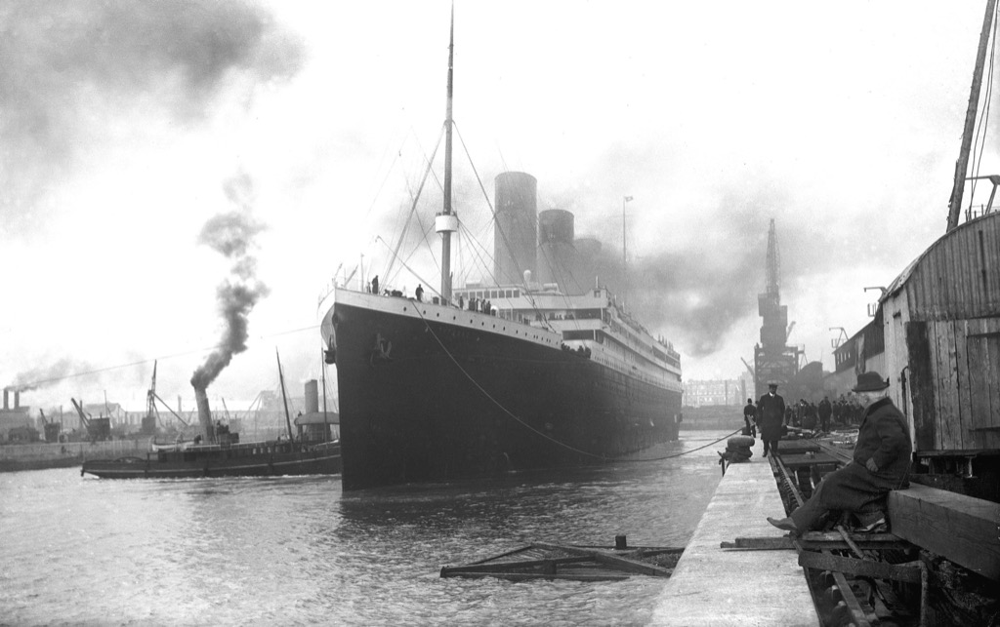
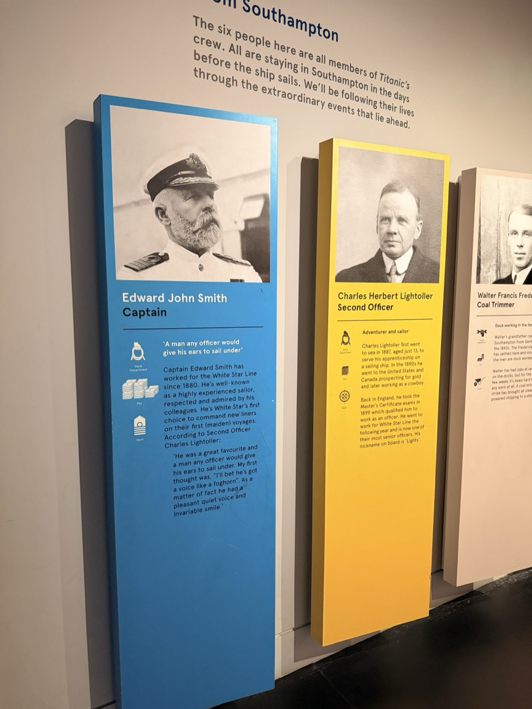
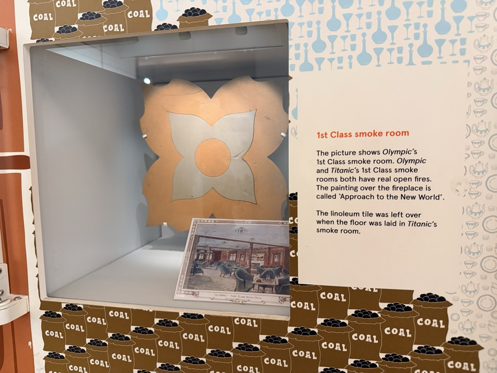
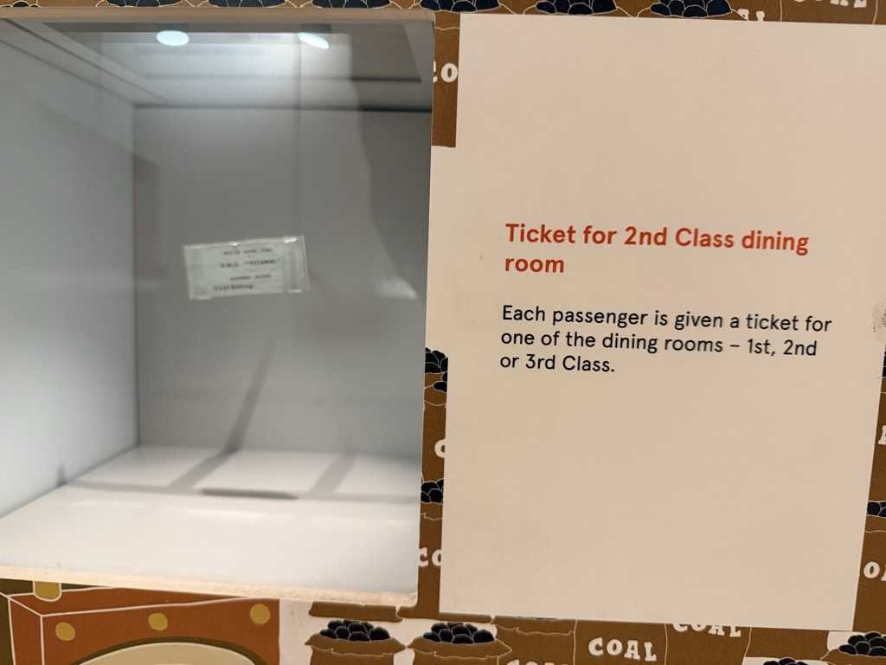
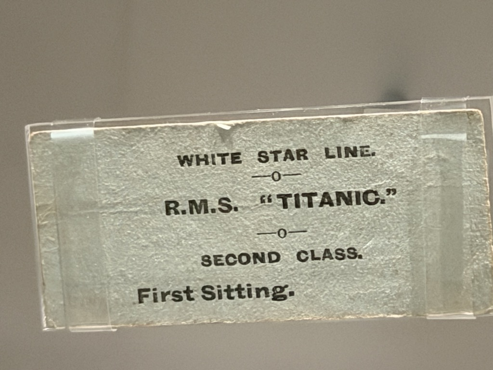
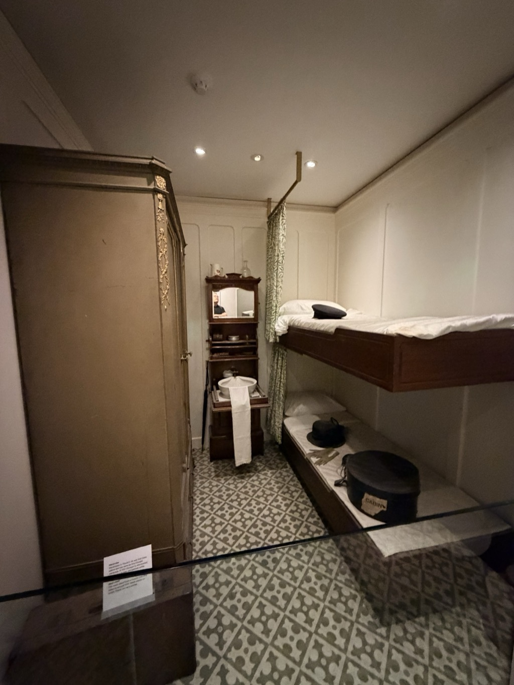
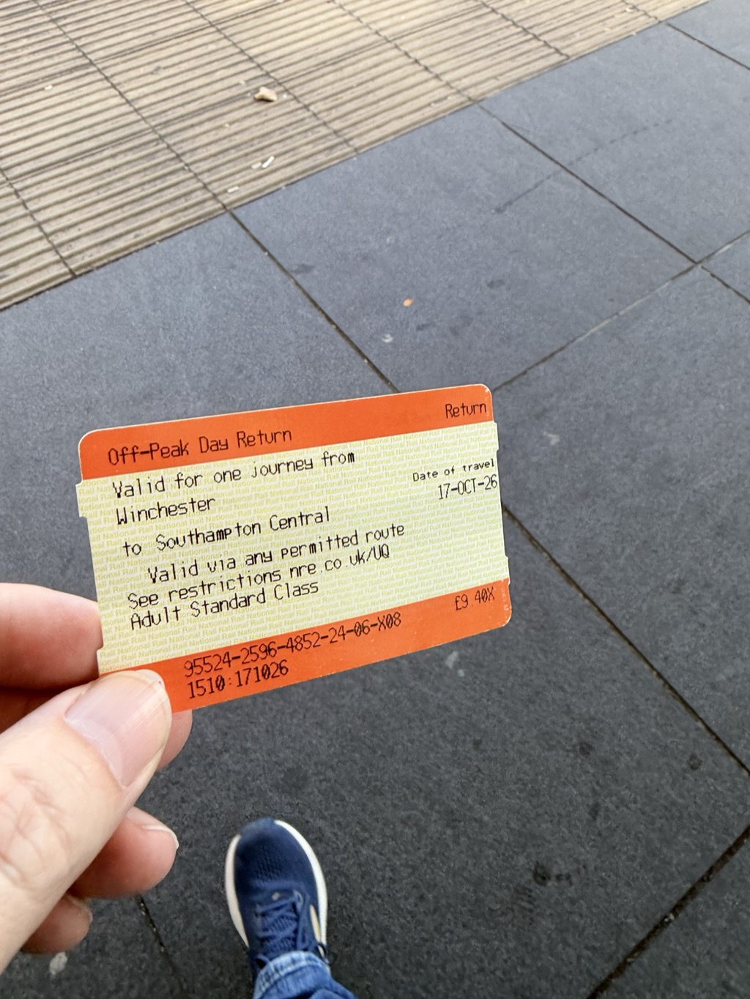
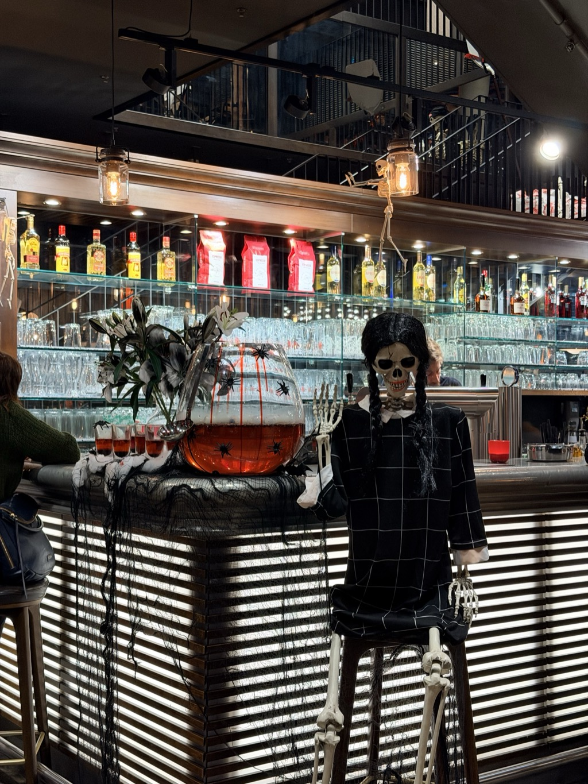
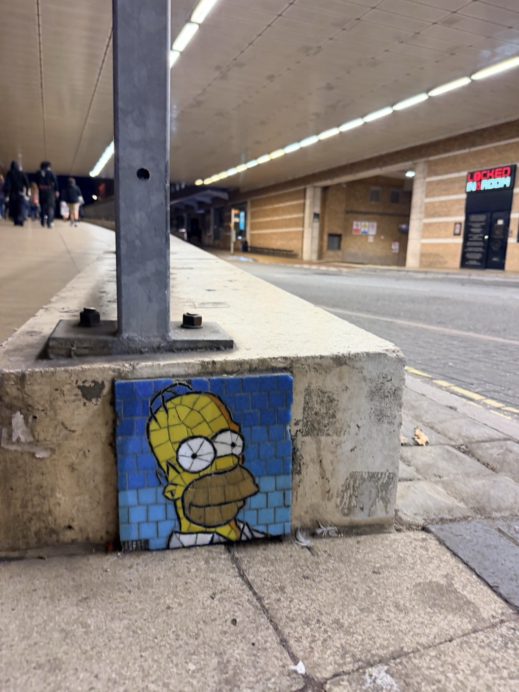

- **Start of day:** Southampton, England
- **End of day:** Southampton, England

The maiden voyage of the RMS Titanic departed Southampton April 10, 1912.

<figure>
    
    <figcaption style="text-align: center; font-style:italic;">Titanic in Southampton</figcaption>
</figure>

You know the rest of the story. 

About 80% of the crew were natives of Southampton. As such, the sinking of Titanic had an outsized impact on the city. I spent a few hours that morning at the [SeaCity Museum](https://seacitymuseum.co.uk/) learning some of their stories.  

In the mid-afternoon I decided to check out the town of [Winchester](https://en.wikipedia.org/wiki/Winchester), located a short 20-minute train ride away. 

I miscalculated my timing: the [Winchester Cathedral](https://www.winchester-cathedral.org.uk/) and [The Great Hall](https://historicwinchester.co.uk/our-attractions/the-great-hall-with-westgate-museum/) were both set to close shortly after I arrived. I walked a large loop through town and found my way back to the train station about a minute before the next train. 

One note on the ticket shown above: magnets will eat these. Magnets like the cell phone we all carry in our pockets. Of the 4 times I needed to use the ticket, it failed 3, each time requiring human intervention. Something to be mindful of so you don't repeat my mistake.[^1]

Once back in Southampton, I wandered around for a bit looking for a dinner place, encountering this spooky patron at [L'Osteria](https://losteria.net/de-en/restaurants/restaurant/southampton/)...

... and Homer ...

... before settling on dinner at the hotel bar.

Tomorrow: the cruise begins!

**Footnotes:**

[^1]: I would've preferred an electronic ticket. The quality of my cell coverage was conspiring against me, however. I keep buying and then being disappointed by the providers that Airalo has chosen to contract with. 

*Part of the [Transatlantic Crossing 2026 trip]({{ ta_recap.url }}).*
