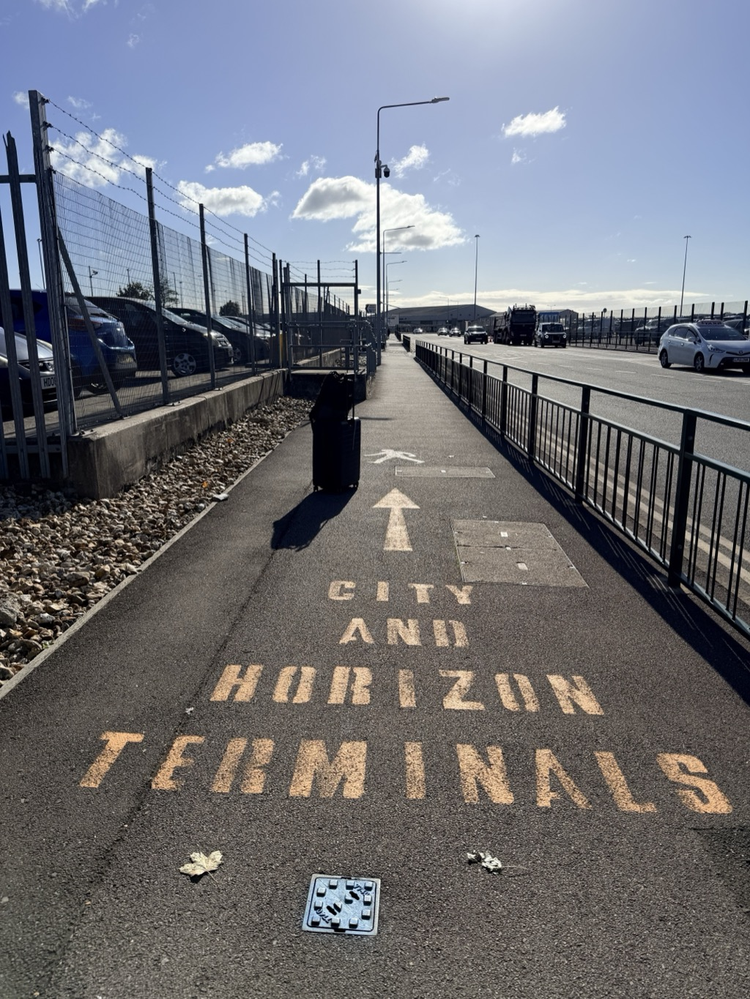
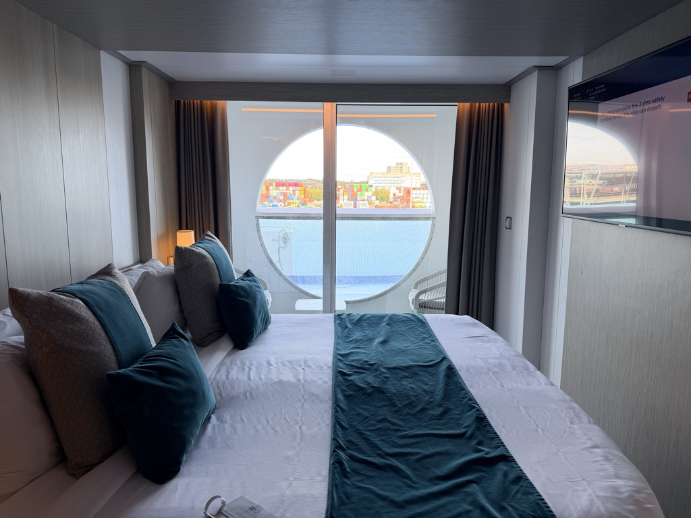
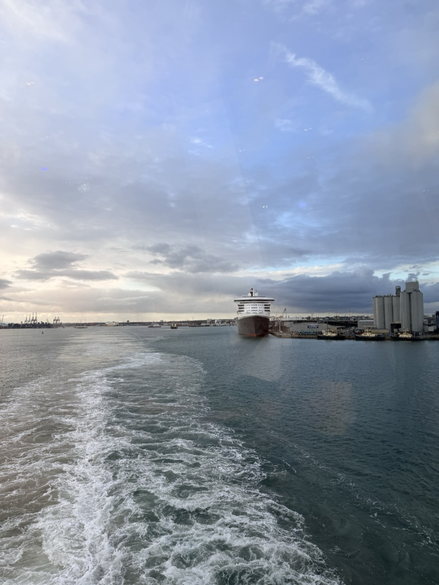

- **Start of day:** Moxy Southampton
- **End of day:** At sea

Cruise embarkation day! Over the next two weeks I'll visit 4 ports and try to be OK with 8 (!!) sea days.

The itinerary:

| Date | Place | About |
| ---- | ----- | ----- |
| Sunday, October 18 | Southampton, England | Embarkation, 5:00pm sailaway |
| Monday, October 19 | [At Sea]() | |
| Tuesday, October 20 | [Vigo, Spain]() | Galicia, 9:30am to 5:00pm |
| Wednesday, October 21 | [Lisbon, Portugal]() | Portugal's capital, 8:00am to 5:00pm |
| Thursday, October 22 | [At Sea]() | |
| Friday, October 23 | [Ponta Delgada, Azores]() | São Miguel island, 10:00am to 6:00pm |
| Saturday, October 24 | [At Sea]() | |
| Sunday, October 25 | [At Sea]() | |
| Monday, October 26 | [At Sea]() | |
| Tuesday, October 27 | [At Sea]() | |
| Wednesday, October 28 | [Royal Naval Dockyard, Bermuda]() | 8:00am to 5:00pm |
| Thursday, October 29 | [At Sea]() | |
| Friday, October 30 | [At Sea]() | |
| Saturday, October 31 | [Port Canaveral, Florida]() | Disembark |
{: .itinerary-table}

The weather was cool and crisp, perfect for a walk. In the Moxy lobby, I passed a crowd of 20 people or so waiting for their bus transfer and made my way to the sidewalk outside. From the Moxy it's around a 20 minute walk along flat ground to the cruise terminal; it's really not bad at all. 

If walking to the City or Horizon terminals in Southampton is interesting to you, I did a [brief writeup of the route](https://bbhart.com/travel/england/2026/Walking-from-Southampton-Central-Station-to-the-Cruise-Terminal.html) back in August. 

My home for the next 13 nights: 

This is stateroom 6102 onboard the Celebrity Apex. It's a category P2 (Deluxe Porthole View with Veranda) which I, if I'm being honest, wasn't aware was a thing.

<figure>
    
    <figcaption style="text-align: center; font-style:italic;">Deluxe Porthole View with Veranda (image: Celebrity Cruises)</figcaption>
</figure>

It was great! It has a narrow but functional veranda, plus all the light the sliding doors let in. I didn't use the veranda as often as I likely would have on a different cruise. Part of that was the weather (it was cool or cold the first half of the cruise), part of it was the uncomfortable chairs, but it was nice stepping out there to get some fresh air and check the temperature.

The location, all the way forward, did mean I felt a lot more ship motion than if I'd been perched midship. While we did have a few days with a lot of movement, it was the type of movement that didn't trigger seasickness. 

I went to the top deck to watch sailaway. Neither of this year's sailaways from Southampton yielded good photos. I missed my chance to photograph our passing by the Queen Mary 2, also. 

I finished the day with some cruise ship pizza and a book. 

