- **Start of day:** Vigo, Spain
- **End of day:** At sea

Good morning from Spain! If you'd asked me at the beginning of 2026 how many times I thought I'd visit Spain and Portugal that year, the answer _would not_ have been three. And all three trips happened somewhat spontaneously, with little time to properly prepare -- learning travel-sized doses of Castilian and Portuguese and brushing up on history, for two. 

I'm grateful for these experiences, as Spain has rocketed to the top of my list of places to visit more in retirement. 

While Vigo is not one of the major Iberian cruise ports, I still had an enjoyable day here. It was my second visit to Galicia, after visiting [La Coruña]() in August.

First off, it's hilly. So much so that they have escalators and moving sidewalks in places:

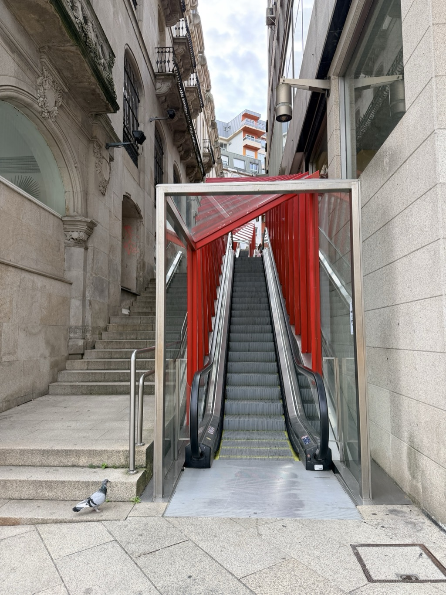

The naval power on display was a little intimidating...

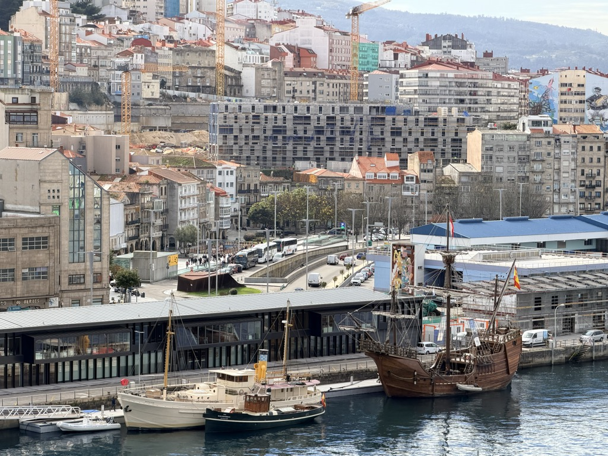

... but I decided to take my chances ashore anyway.

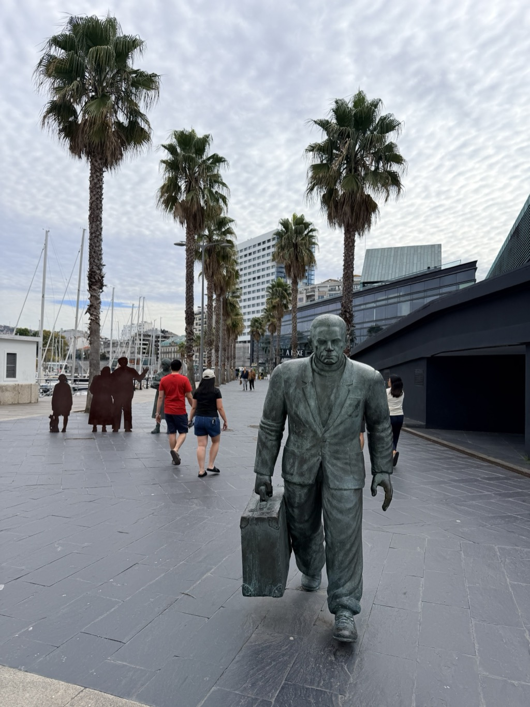

I didn't have much of a plan for the day. I'm always up for an uphill walk or a fortress, though, and Spain has them in spades. For today I wandered my way up to [Castelo do Castro](https://en.wikipedia.org/wiki/Castro_fortress); my fitness tracker showed this as a ~450 ft vertical ascent from the ship. The views were well worth the effort.

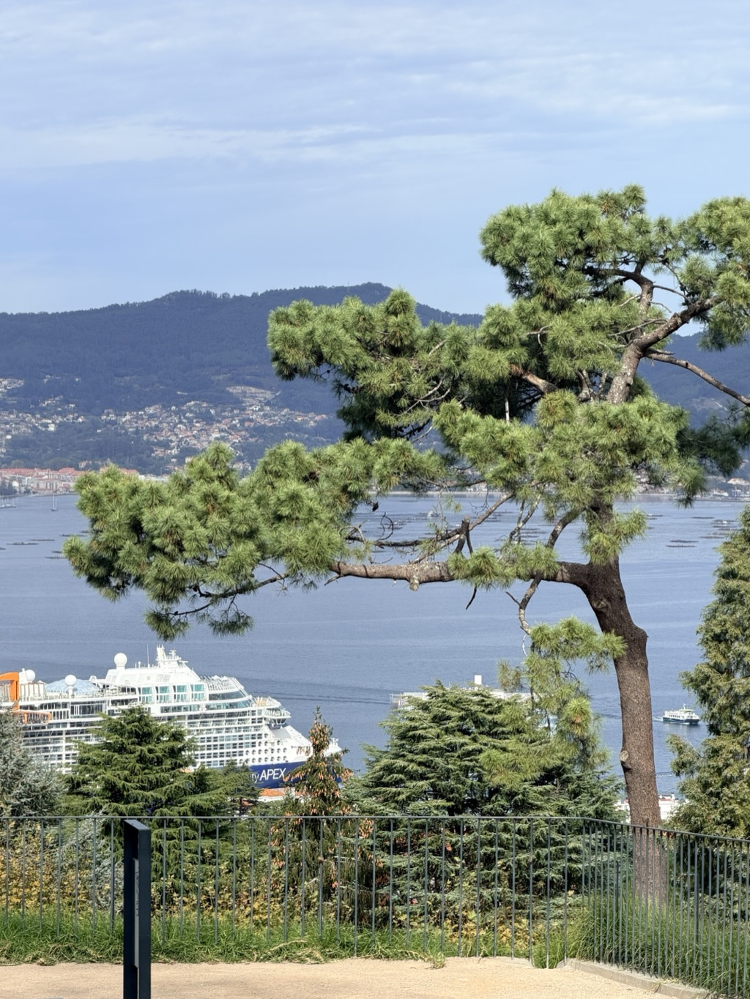

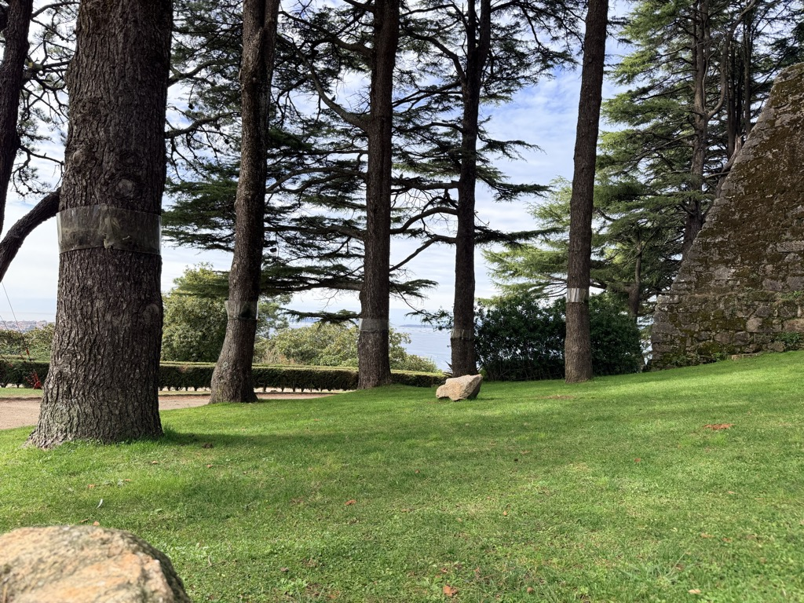

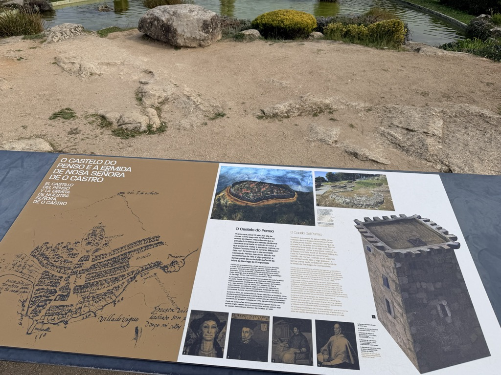

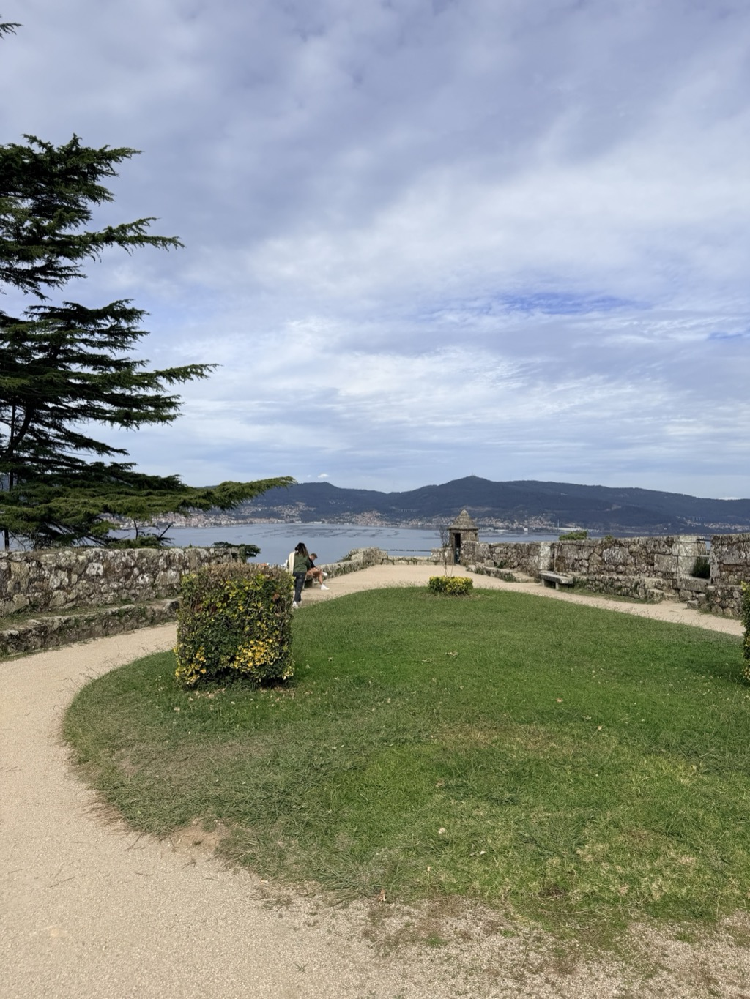

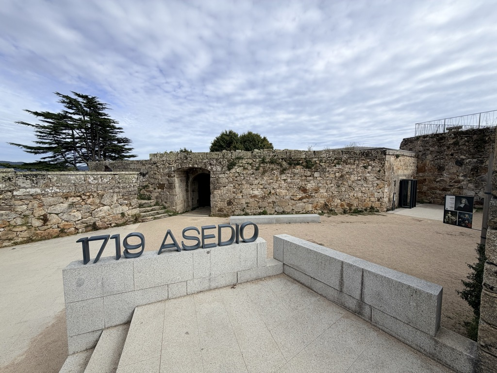

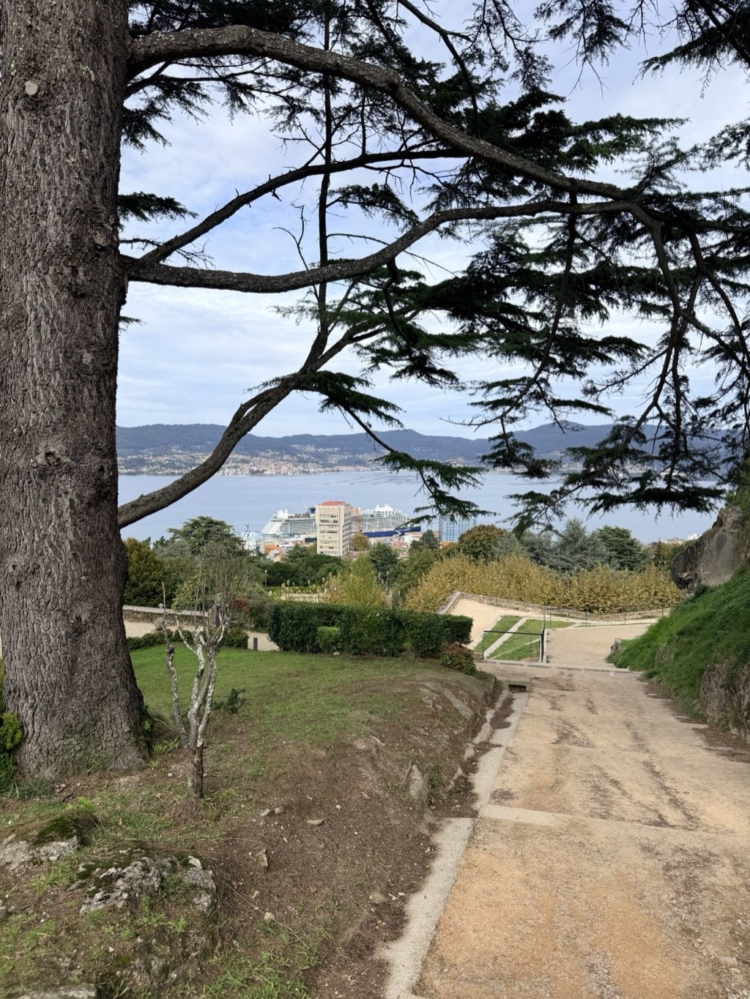

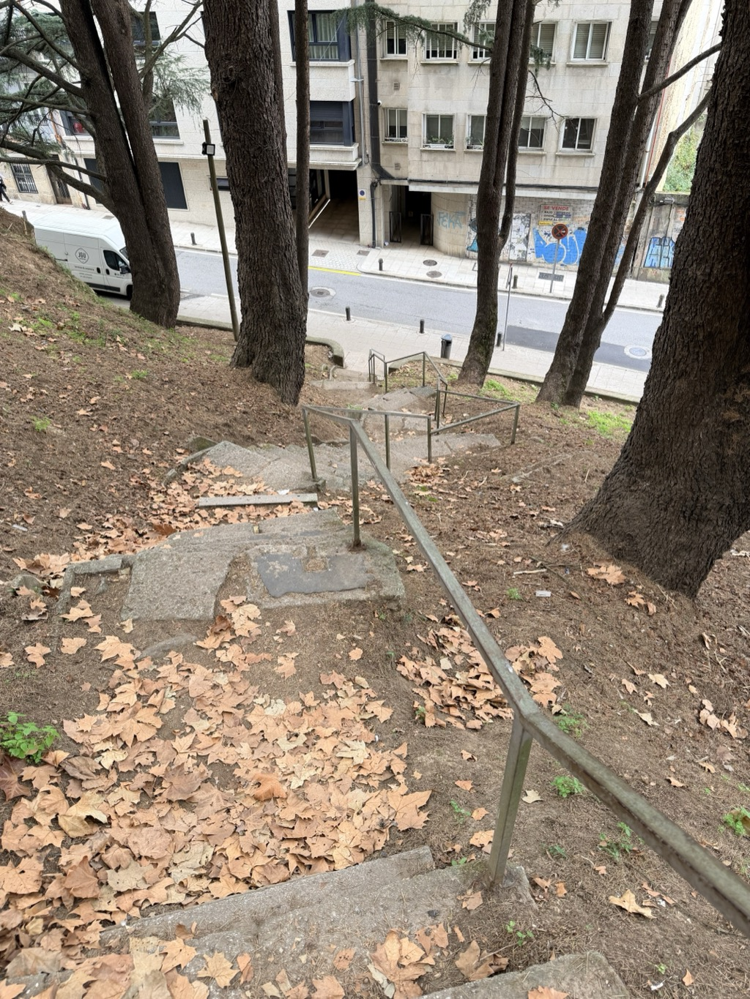

I took the long way back to the ship, wandering one of the main market streets. 

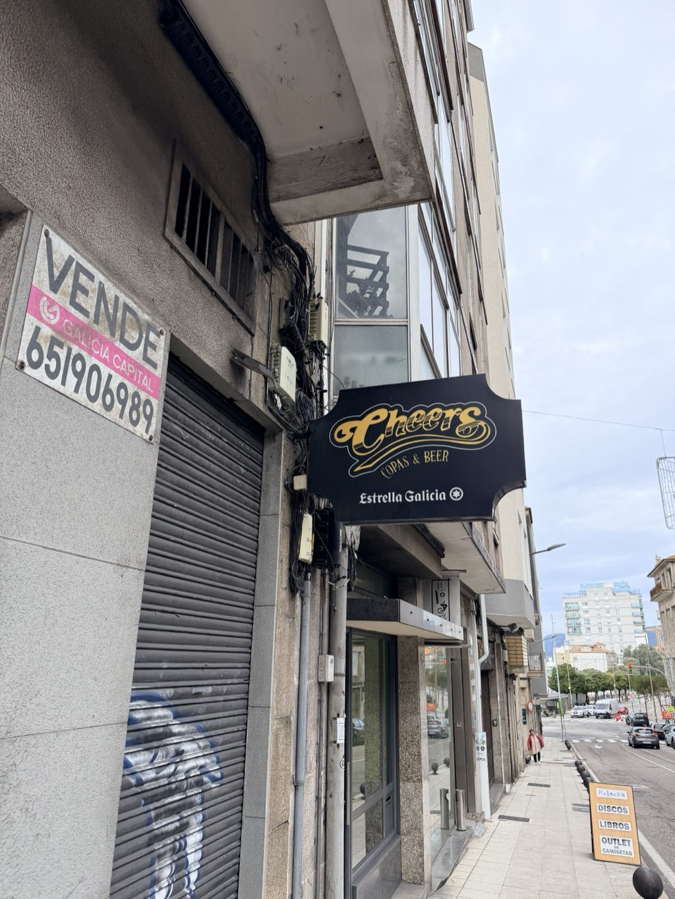

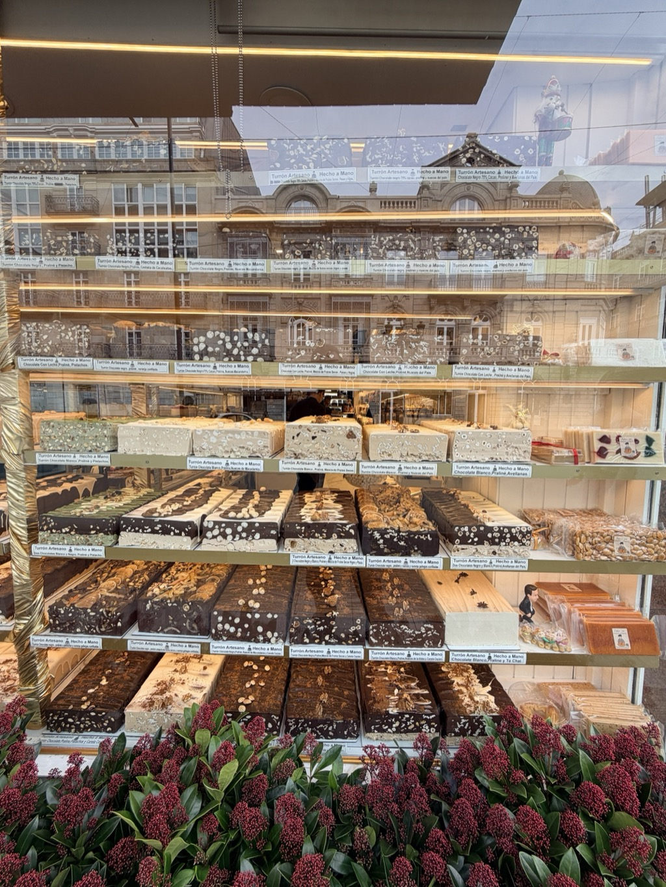

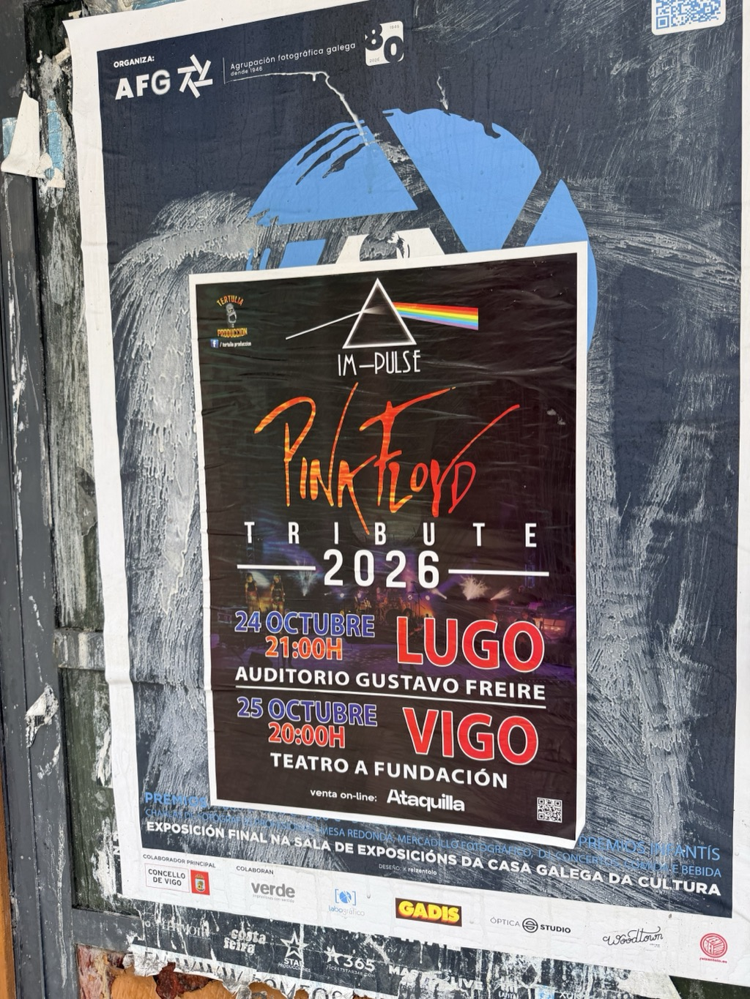

<video src="/assets/20261020-vigo-ria-ferry-sailaway.mp4" width="100%" controls playsinline muted></video>

*Part of the [Transatlantic Crossing 2026 trip]({{ ta_recap.url }}).*
