- **Start of day:** Lisbon, Portugal
- **End of day:** At sea

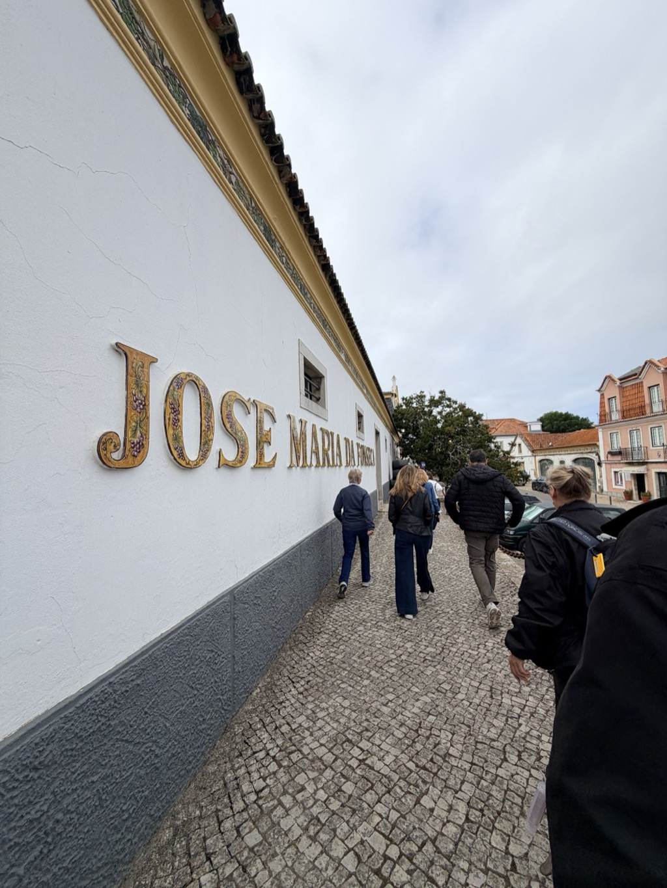

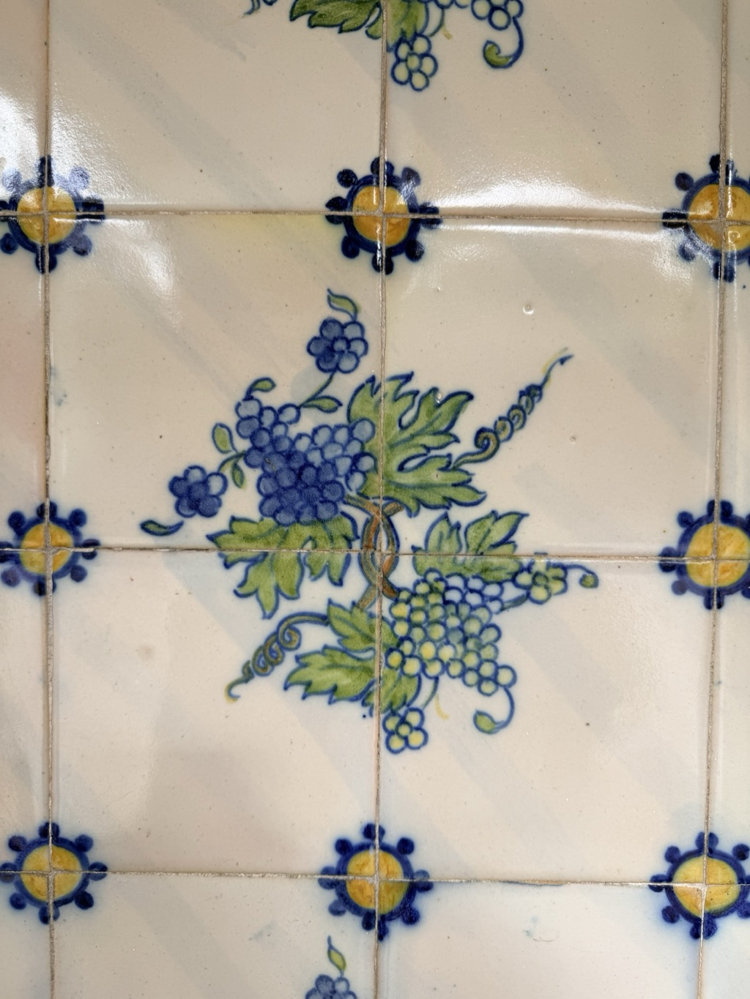

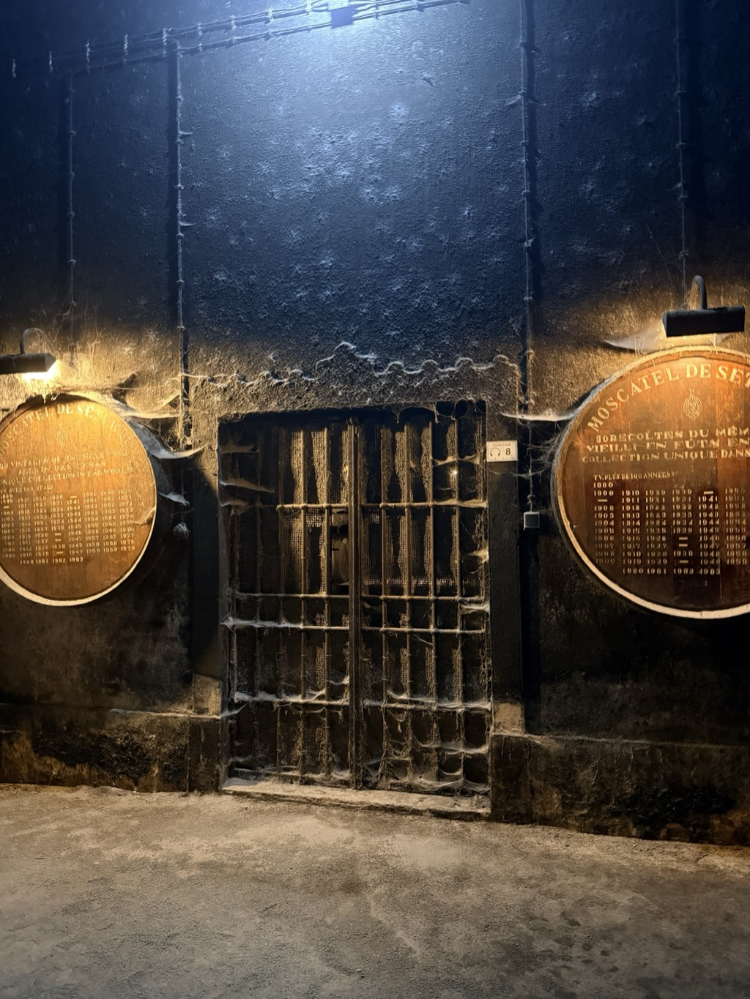

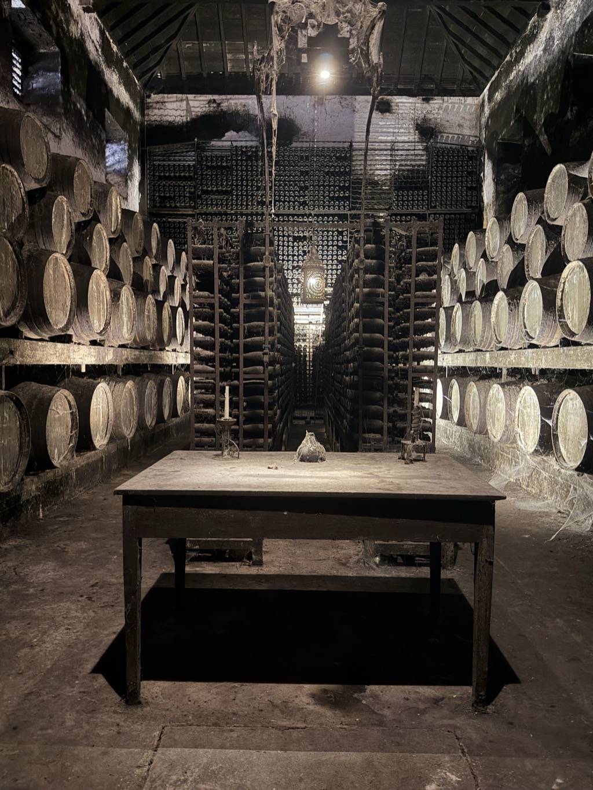

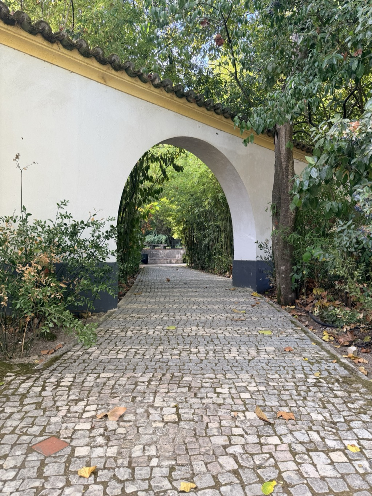

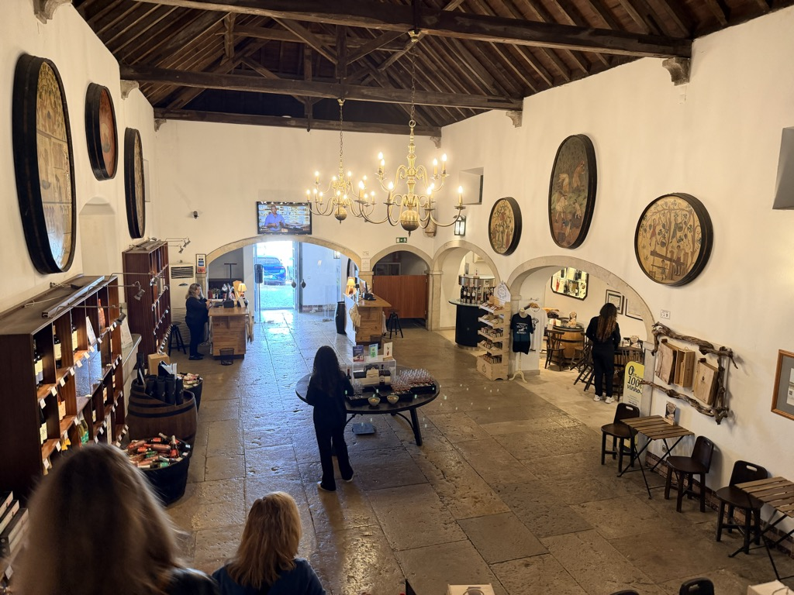

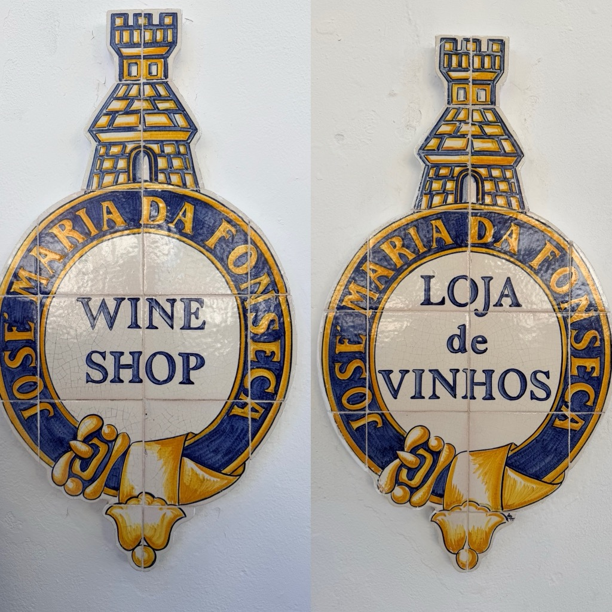

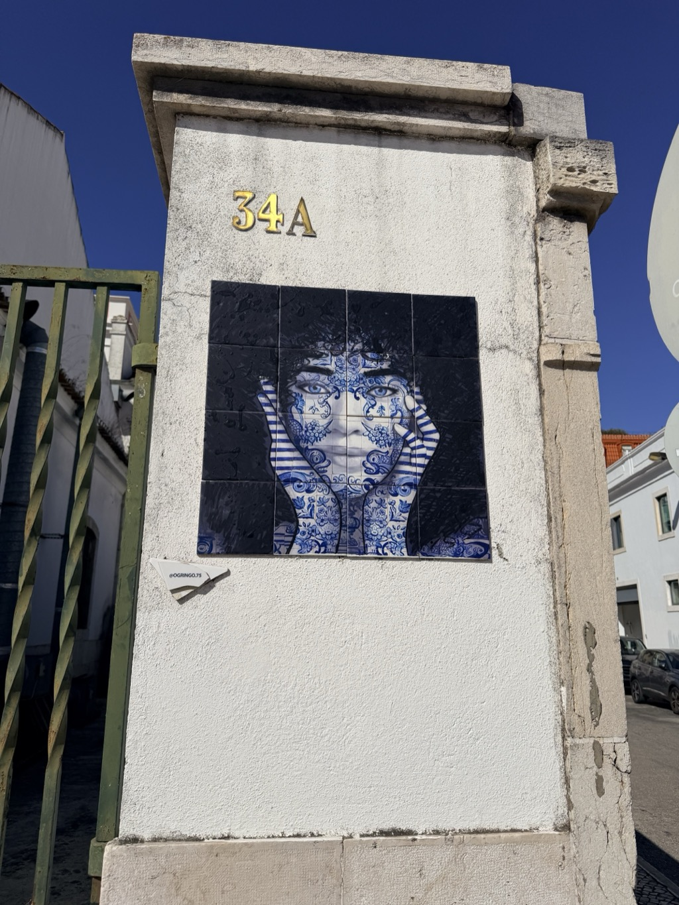

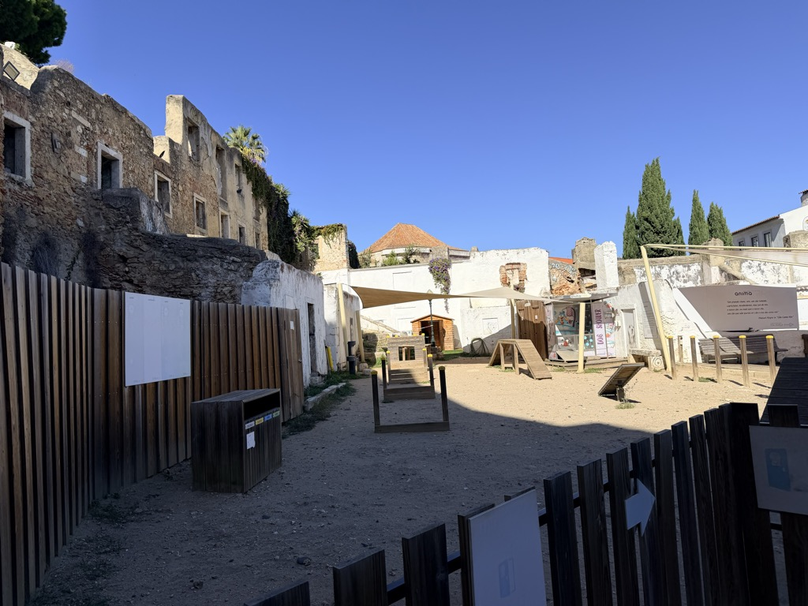

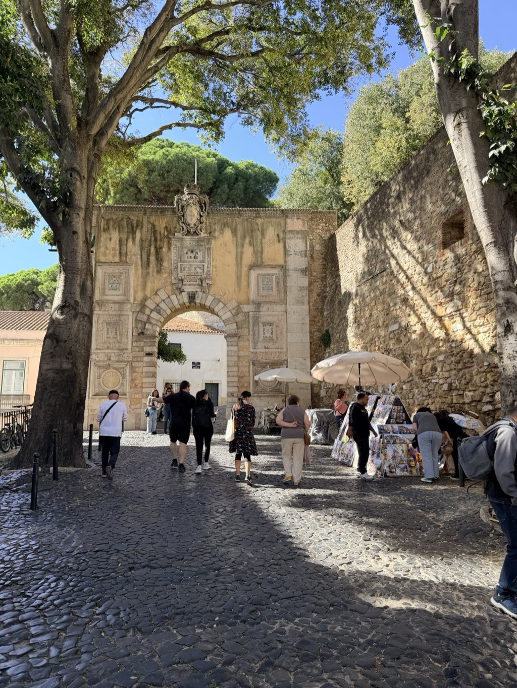

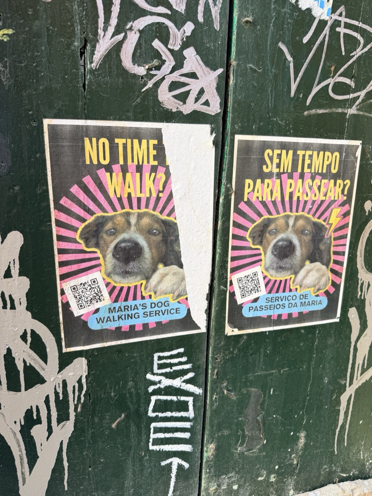

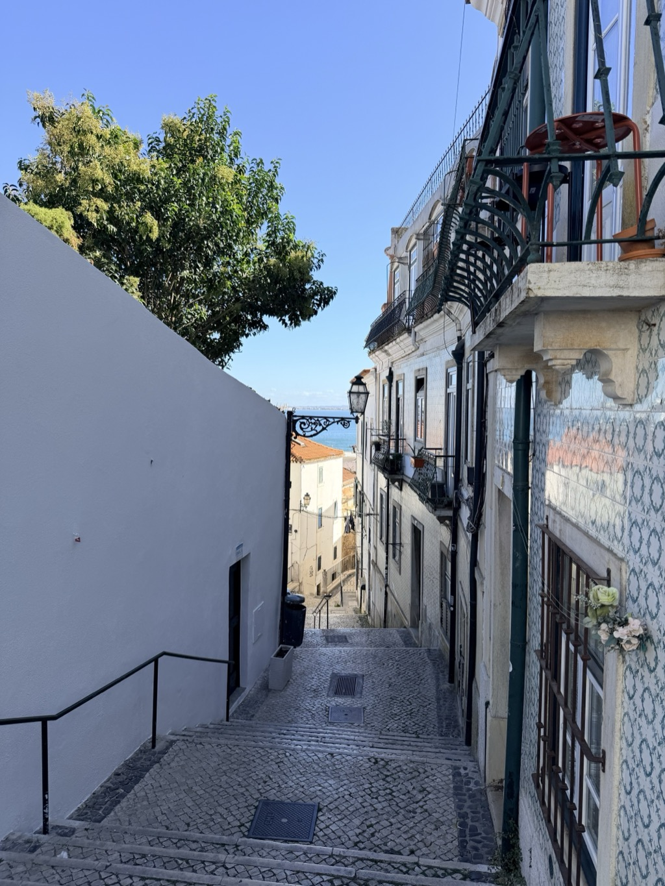

<video src="/assets/20261021-lisbon-sailaway-25-de-abril-bridge.mp4" width="100%" controls playsinline muted></video>

*Part of the [Transatlantic Crossing 2026 trip]({{ ta_recap.url }}).*
