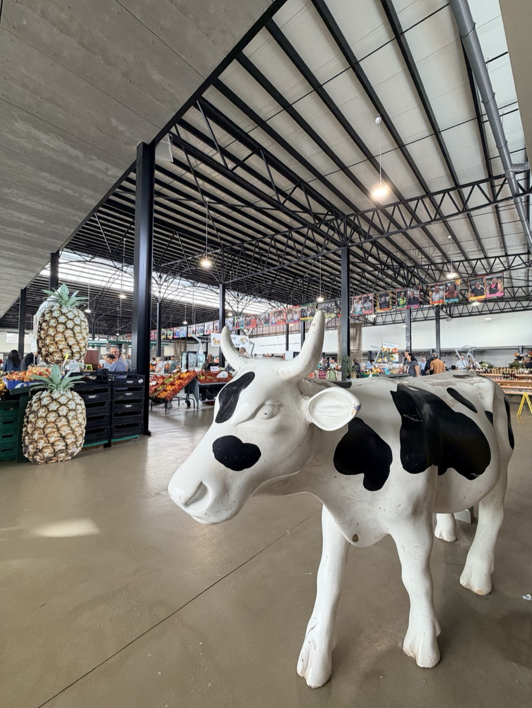
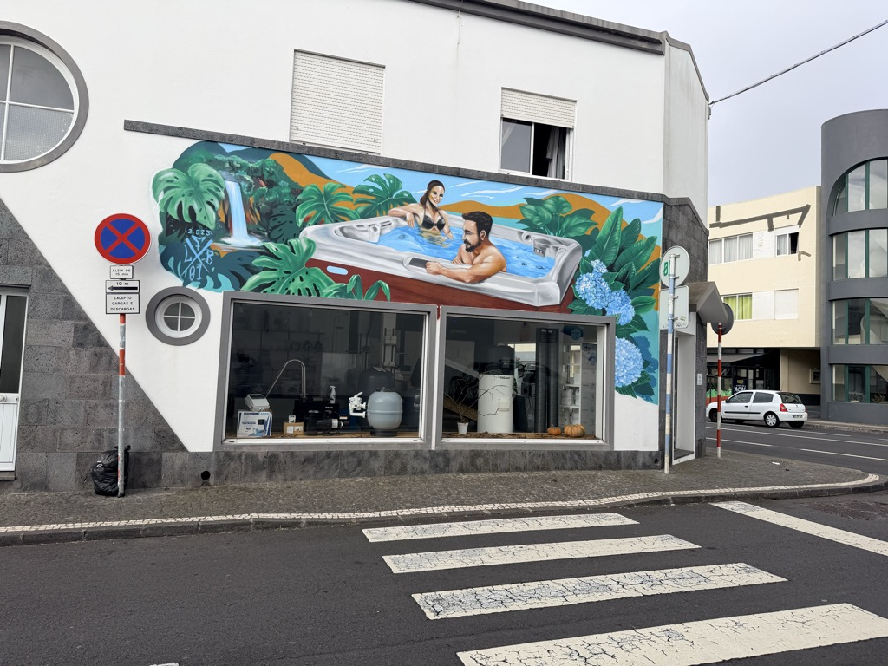
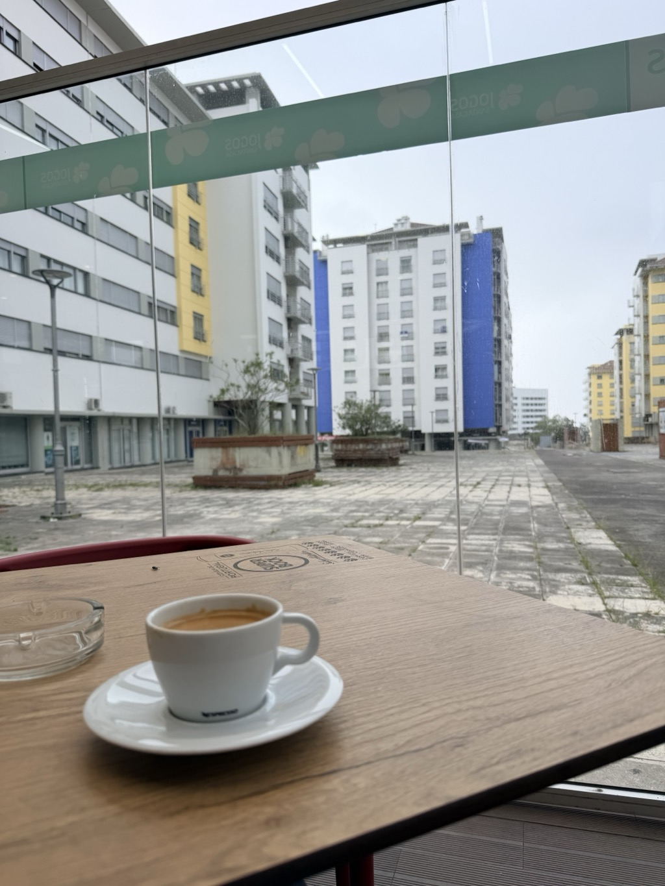
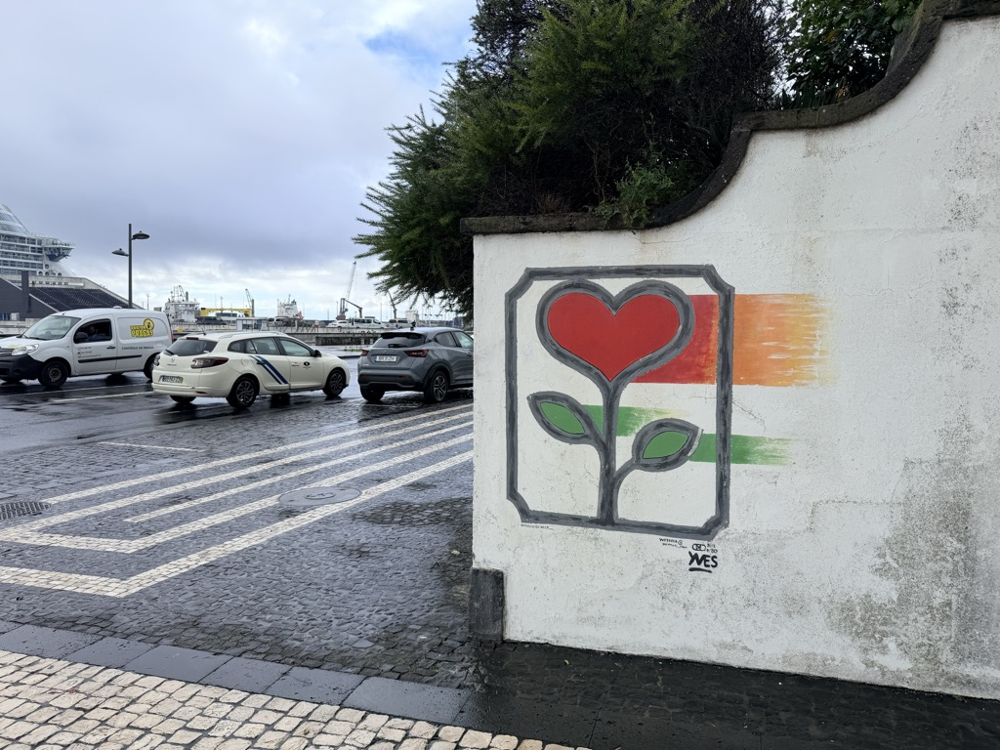
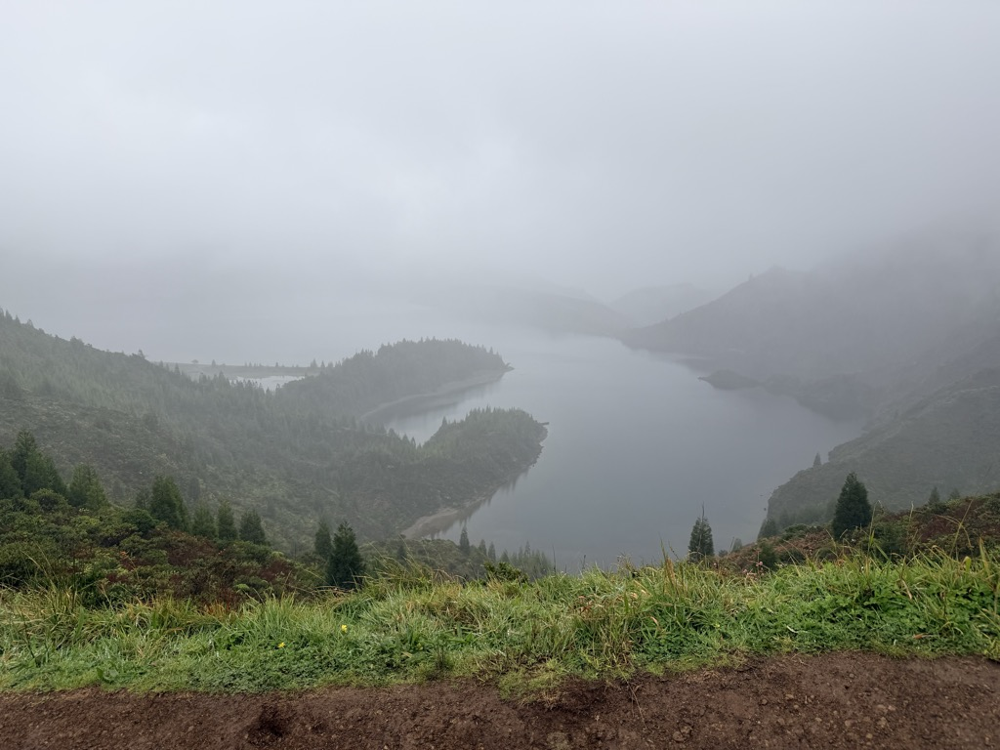
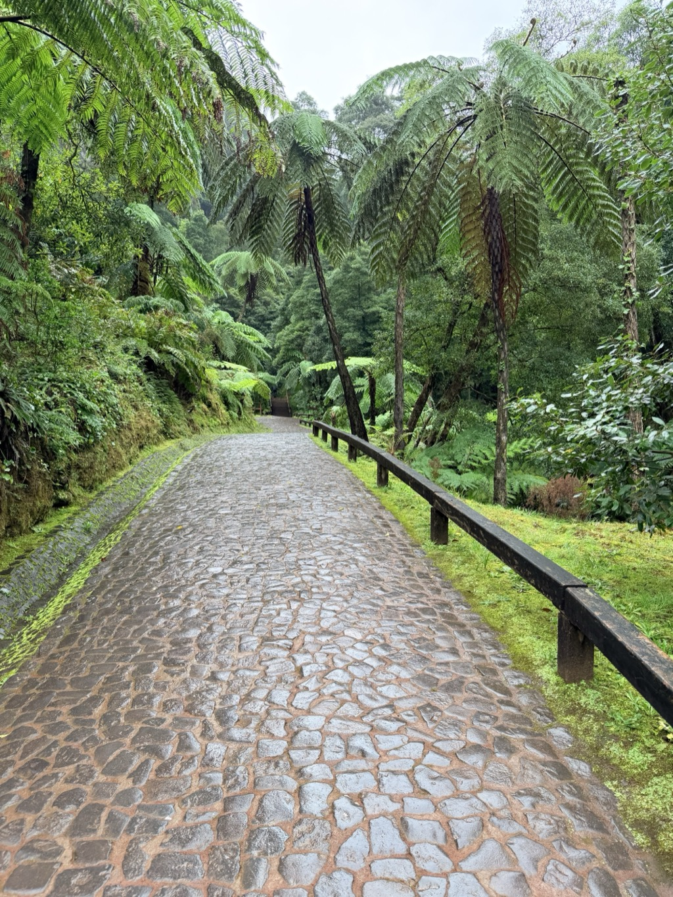
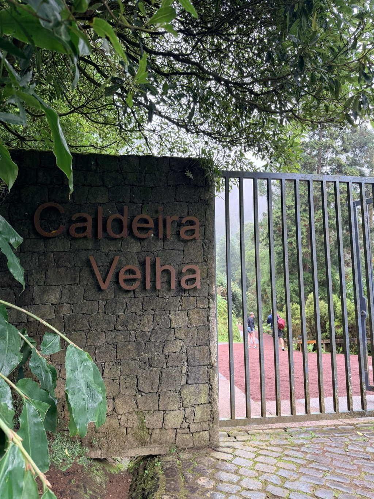
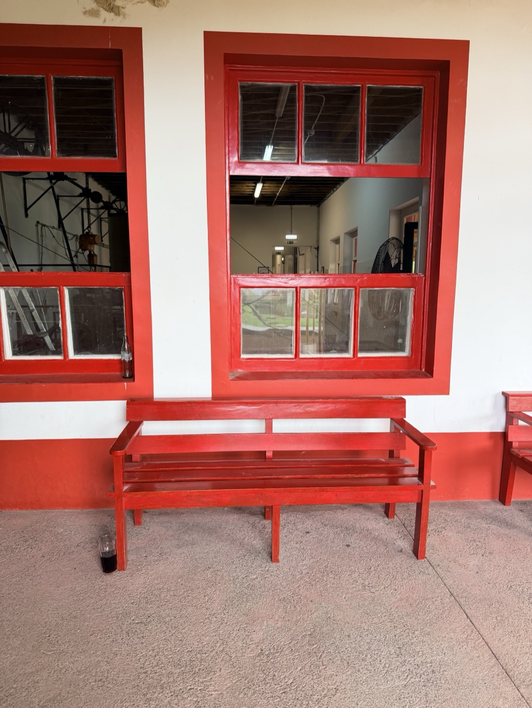
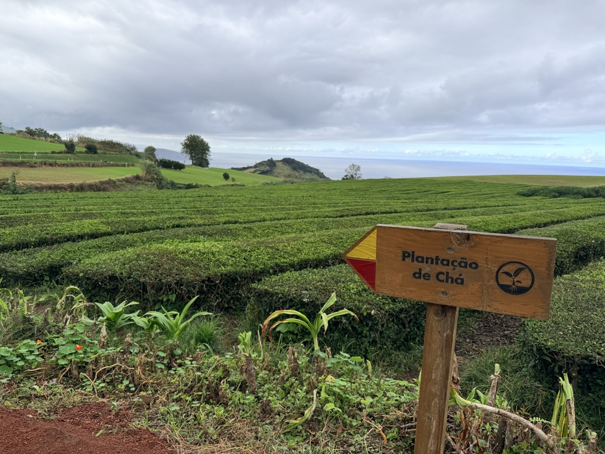
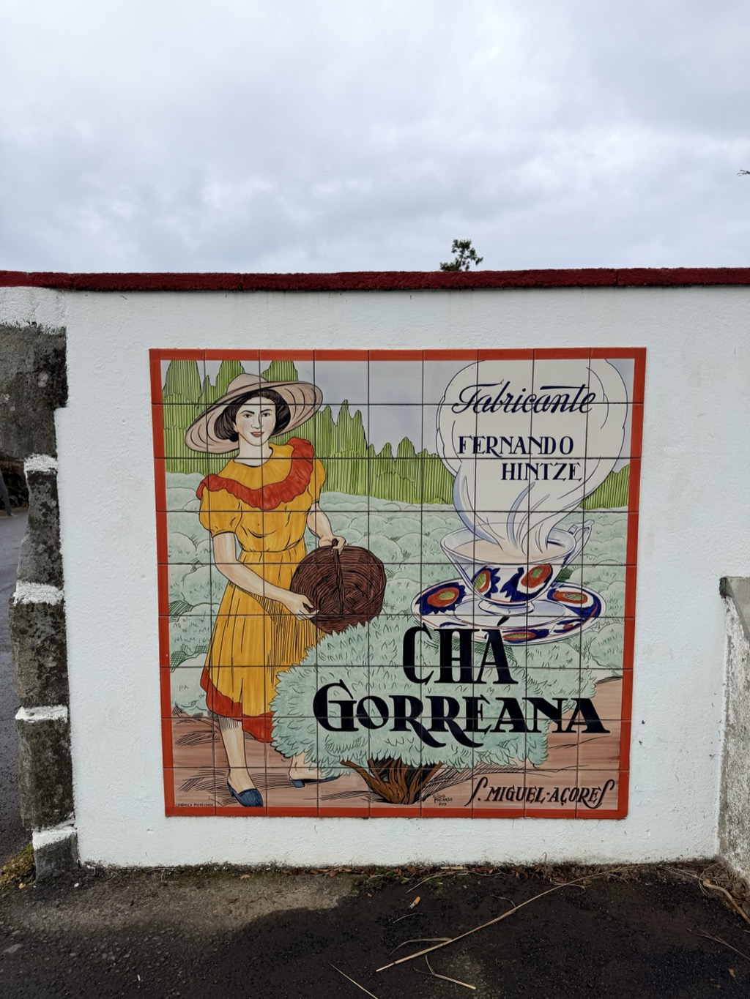

- **Start of day:** Ponta Delgada, Azores
- **End of day:** At sea

<video src="/assets/20261023-ponta-delgada-calcada-pavement.mp4" width="100%" controls playsinline muted></video>

*Part of the [Transatlantic Crossing 2026 trip]({{ ta_recap.url }}).*
