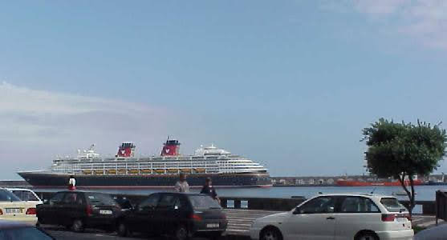
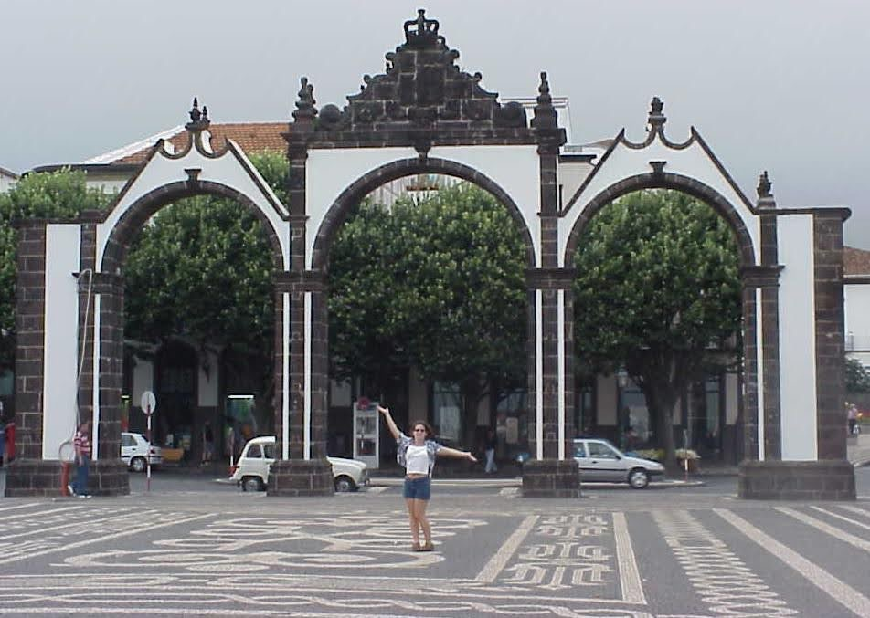
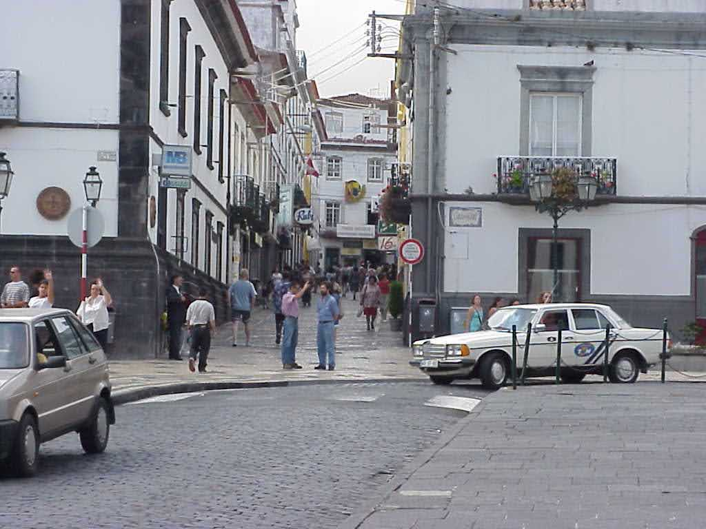
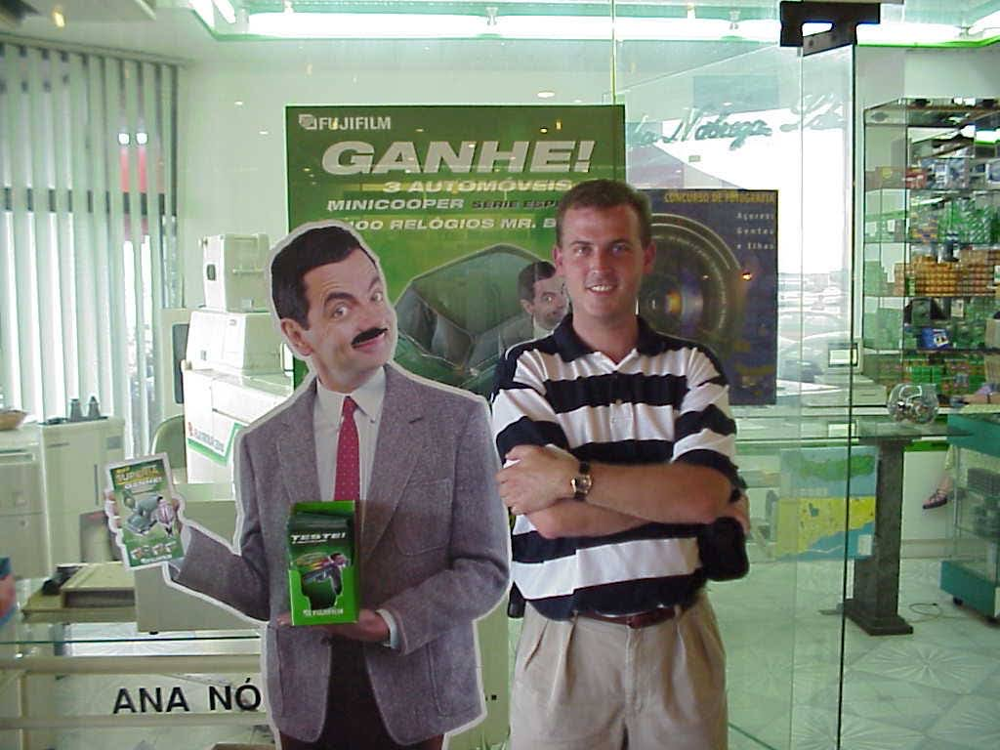
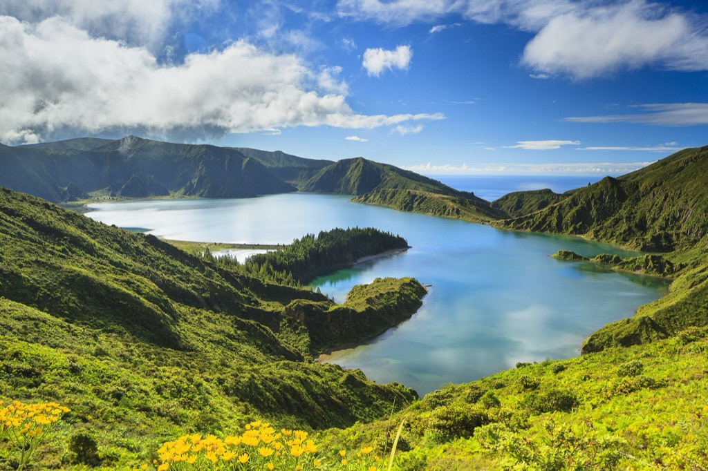

- **Start of day:** Ponta Delgada, Azores
- **End of day:** At sea

## Some background
Early in my career, 1999-2000, I worked for Disney Cruise Line, first as a shoreside person and then as an officer living and working onboard the Disney Wonder. As part of that, I spent 5-6 weeks at the Fincantieri shipyard in Marghera, Italy, only a few miles away from Venice. Once the ship was done[^1], we sailed to Southampton in England for the christening hoopla, and then from there we started to make our way across the Atlantic to Port Canaveral. Along the way, we had an afternoon stop in Ponta Delgada, Azores. 

Too much time has passed and I don't remember a lot about this stop. At that point all of my international travel consisted of one or two trips to Toronto, and the preceding 5-6 weeks in Italy -- which barely counts, as I was living and working in the shipyard most of the time. What I do remember is Ponta Delgada's interesting architecture, and that the city was a little gritty and hectic. 

When I saw this standee in a mall I had to get a photo:

Otherwise, the rest of that day was drinks and then dinner with three friends from the ship. 

## Present day

I booked an excursion for the afternoon. In the morning I headed off the ship shortly after arrival, intending to get my steps in and see a lot more of the town than on my first visit. 

Many of the sidewalks have interesting textures:

<video src="/assets/20261023-ponta-delgada-calcada-pavement.mp4" width="100%" controls playsinline muted></video>

My obligatory visit to the local farmers market (moo):

A hot tub store:

I ducked into a coffee shop when it started to drizzle. 

I _thought_ the rain had passed when I left the coffee shop and started making my way back to the ship, but it very much had NOT. I walked for 10 or 15 minutes in a heavy drizzle, annoyed but thankful the weather wasn't colder. 

Naturally the rain let up right as I was nearing the ship. 

I boarded, had a free lunch onboard, then left again for my 4.5 hour shore excursion. 

## Shore Excursion

The weather was foggy with spitting rain, hard at times. Again, thankful it wasn't _cold_ rain. Our first stop was Lagoa do Fogo, a crater lake a ~45 minute ride from the cruise port. Here's my photo:

... and one by Veloso Patacas (via Wikimedia Commons) showing what it looks like on a clear day. 

<figure>
    
    <figcaption style="text-align: center; font-style:italic;">Lagoa do Fogo on a clear day. Photo: <a href="https://commons.wikimedia.org/wiki/File:A%C3%A7ores_lagoa_fogo-0140.tif">Veloso Patacas</a>, <a href="https://creativecommons.org/licenses/by-sa/4.0/">CC BY-SA 4.0</a>, via Wikimedia Commons (resized)</figcaption>
</figure>

Our next stop was [Caldeira Velha](https://parquesnaturais.azores.gov.pt/en/), a protected national monument and geothermal reserve that, frankly, looks _a lot_ like Hawai'i to me. With the moody foggy rain and the hot thermal pools, it was killing me that I wasn't equipped for bathing.

Our final stop was the [Gorreana tea plantation](https://gorreana.pt/en/), Europe's oldest. We sped through the factory part of the tour here so that we could have more time for tea and pineapple cake in the tasting room. 

Note to self for next time: rent a car and tour on your own. The roads and signs are good, there's not a lot of traffic outside of Ponta Delgada, and Portugal drives on the right-hand side of the road. I believe there are car rental agencies right on the cruise pier. Book ahead online for Caldeira Velha. 

**Footnotes**:

[^1]: OK so the ship isn't "done" when you sail away from the shipyard, but there's a schedule so off you go.

*Part of the [Transatlantic Crossing 2026 trip]({{ ta_recap.url }}).*
