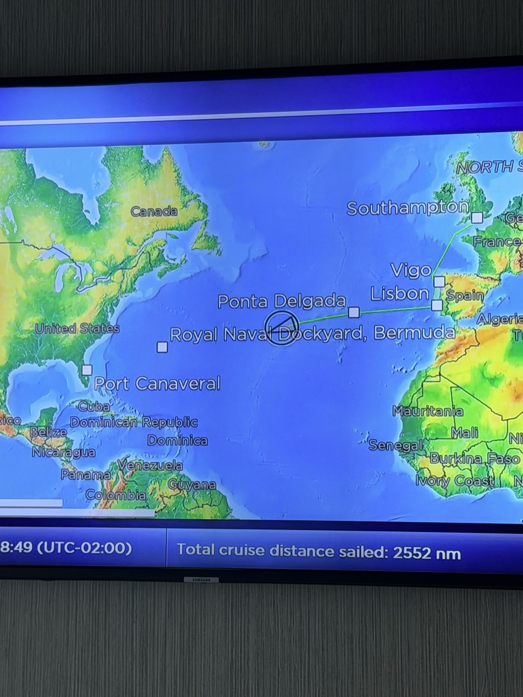
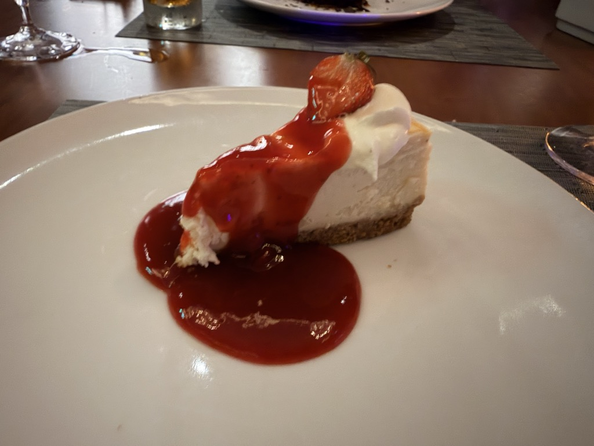

- **Start of day:** At sea
- **End of day:** At sea

Another lazy day at sea, starting with a wicked rainstorm first thing in the morning.

<video src="/assets/20261025-at-sea-rainy-pool-deck.mp4" width="100%" controls playsinline muted></video>

Here we are somewhere in the middle of the Atlantic.

For dinner, four of us from the solo travelers group decided to peel off and try the [Fine Cut Steakhouse](https://www.celebritycruises.com/things-to-do-onboard/eat-and-drink/restaurants-and-cafes/fine-cut-steakhouse-restaurant). It was great! Not only was it a nice change of pace from main dining, but the food and service really did feel elevated. I'll spare you from all the low light food photos of my crabcakes and Filet Mignon but I have to include the cheesecake:

