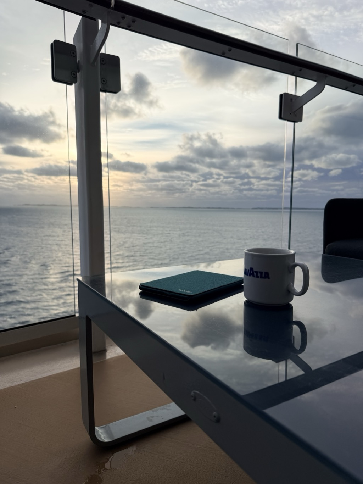
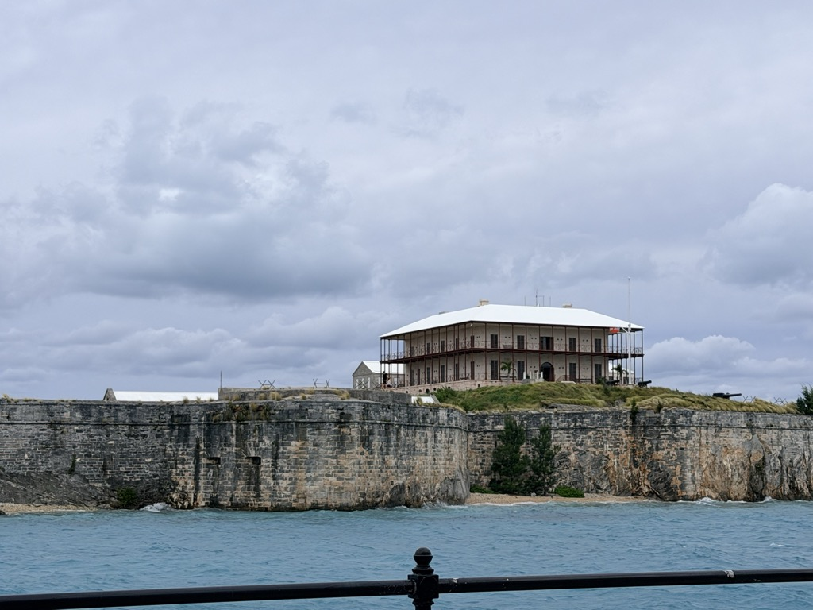
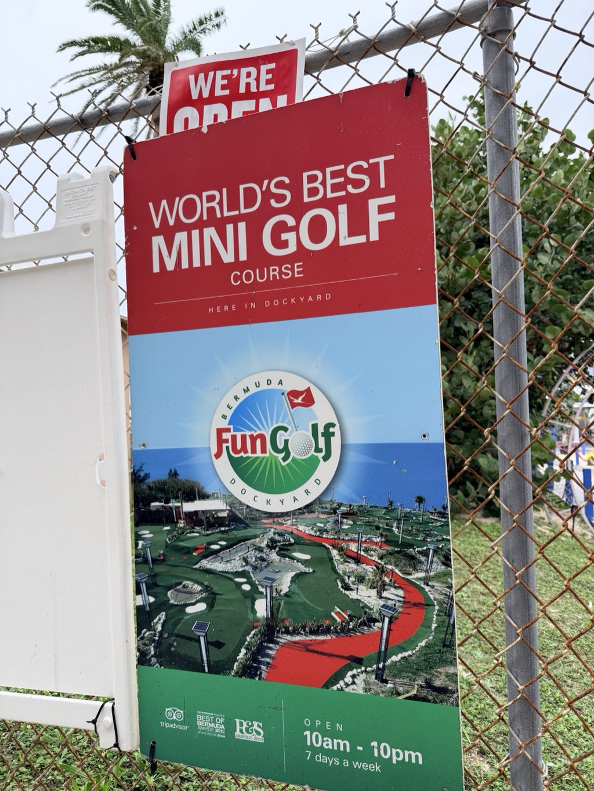
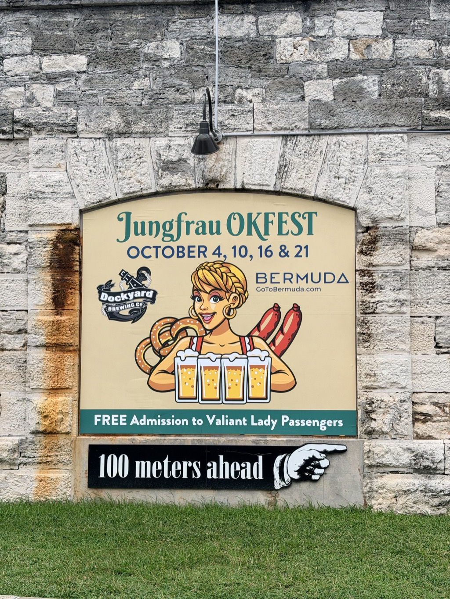
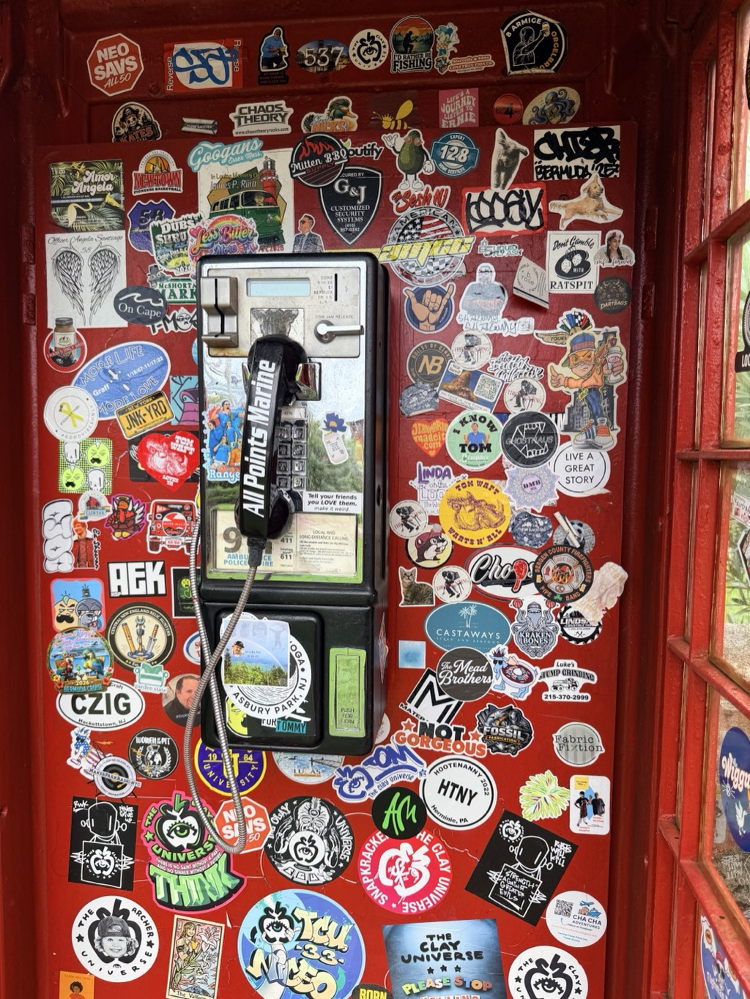
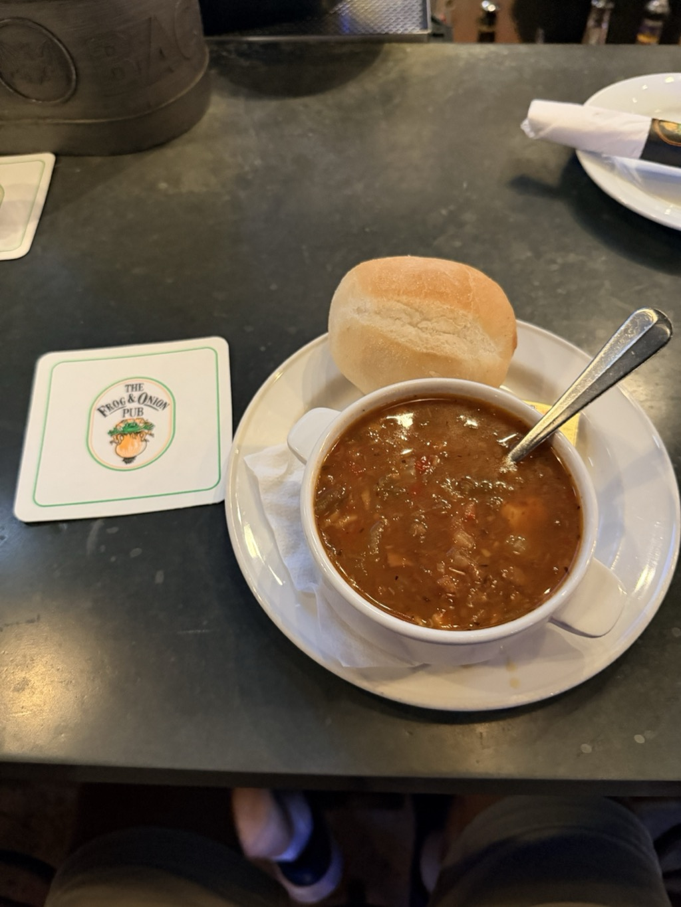
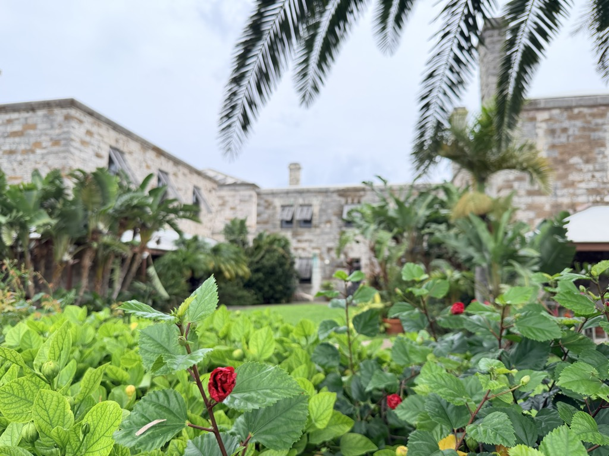
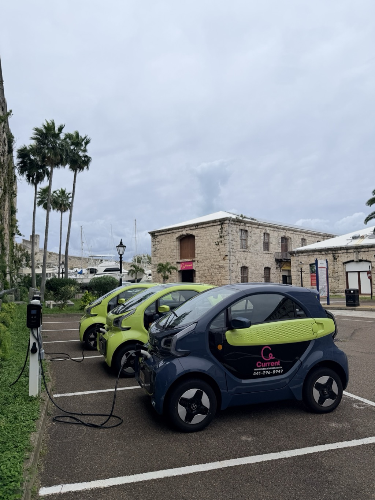
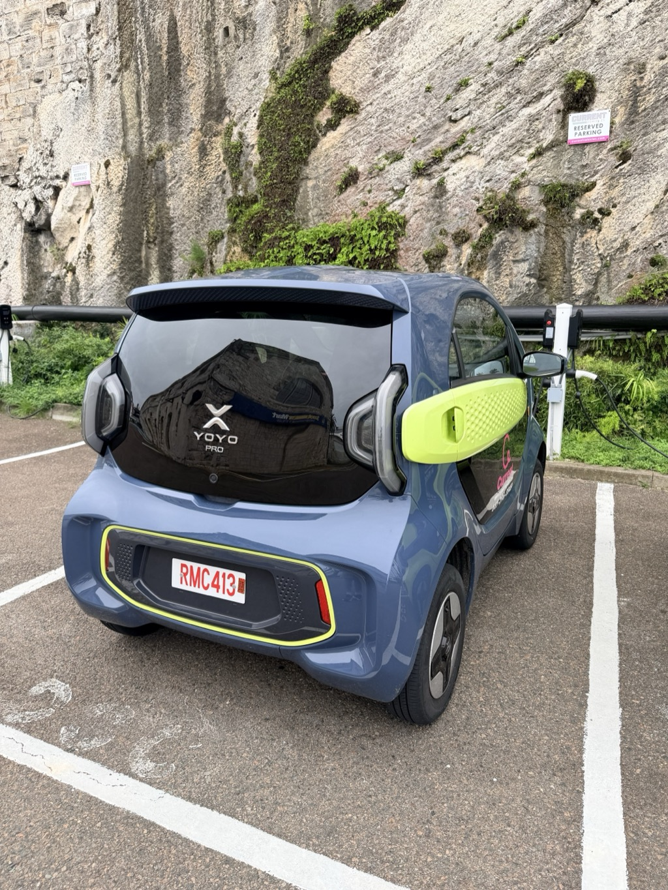
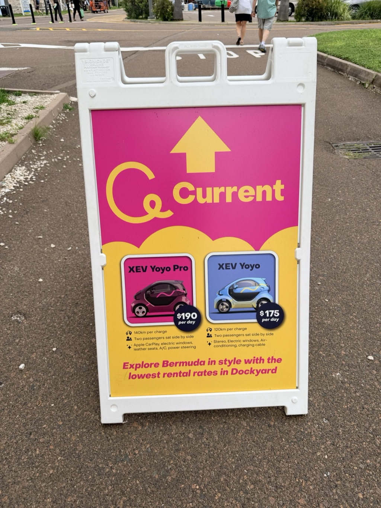

- **Start of day:** Royal Naval Dockyard, Bermuda
- **End of day:** At sea

<video src="/assets/20261028-st-georges-fort-st-catherine.mp4" width="100%" controls playsinline muted></video>

<video src="/assets/20261028-dockyard-boat-apex-view.mp4" width="100%" controls playsinline muted></video>

*Part of the [Transatlantic Crossing 2026 trip]({{ ta_recap.url }}).*
