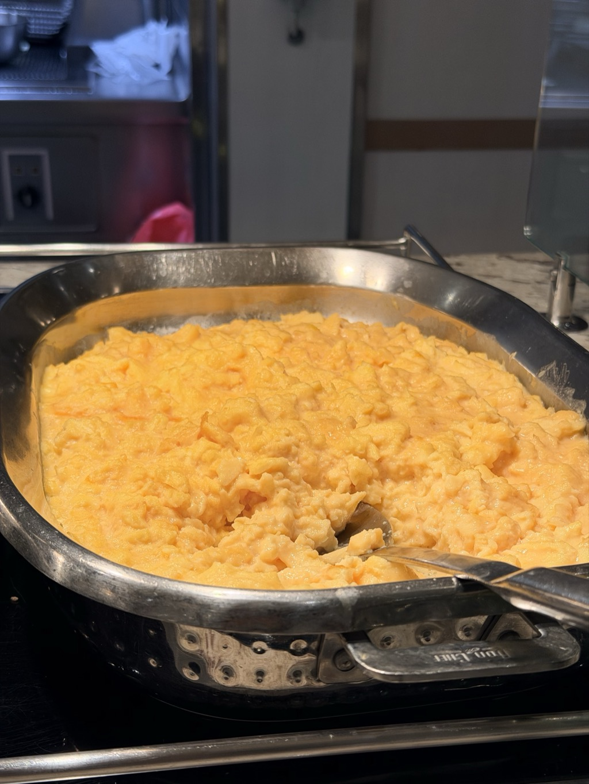
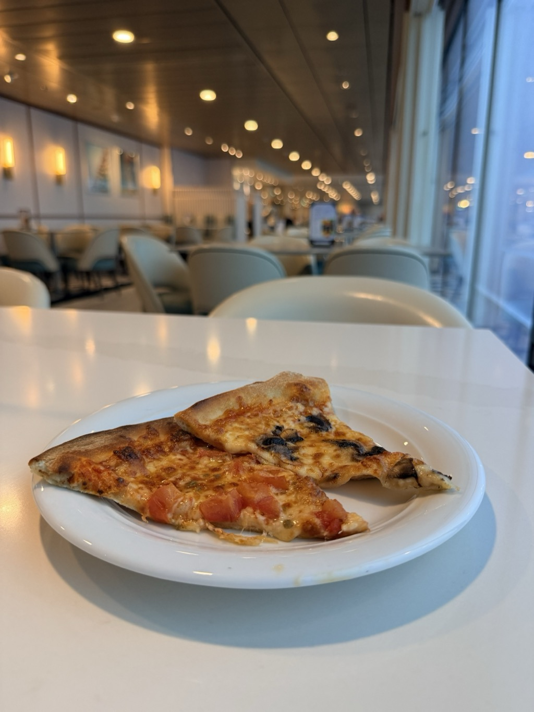
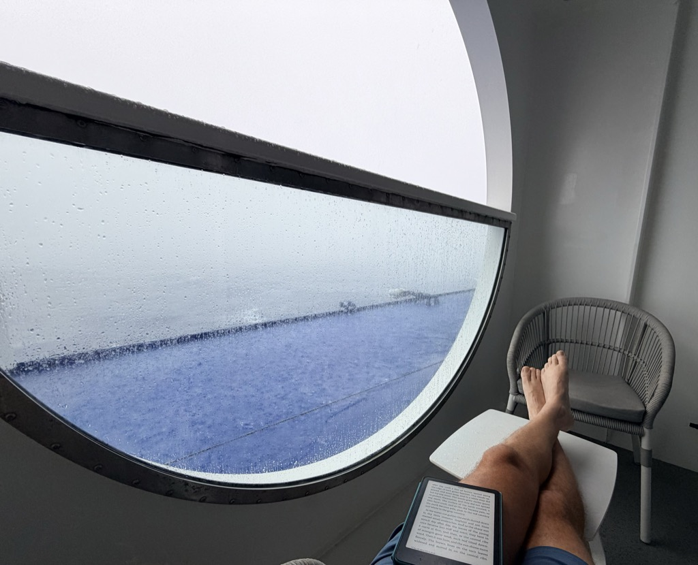

- **Start of day:** At sea
- **End of day:** At sea

<video src="/assets/20261029-at-sea-rain-on-balcony.mp4" width="100%" controls playsinline muted></video>

*Part of the [Transatlantic Crossing 2026 trip]({{ ta_recap.url }}).*
