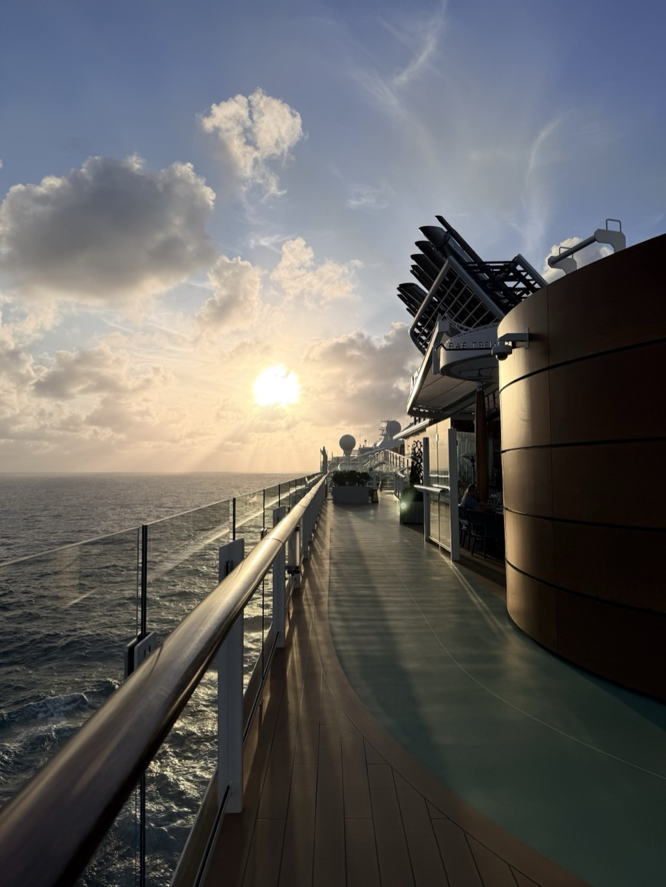
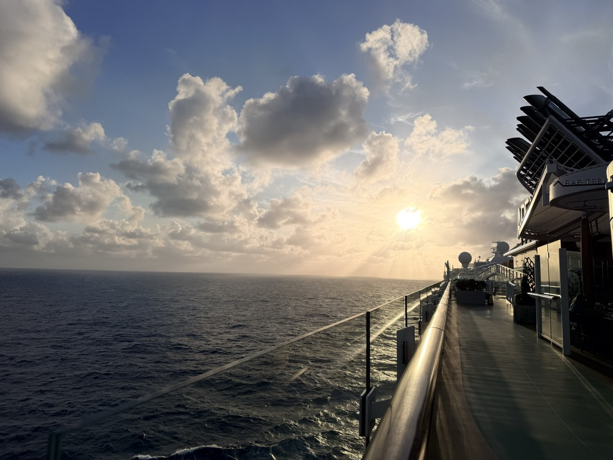
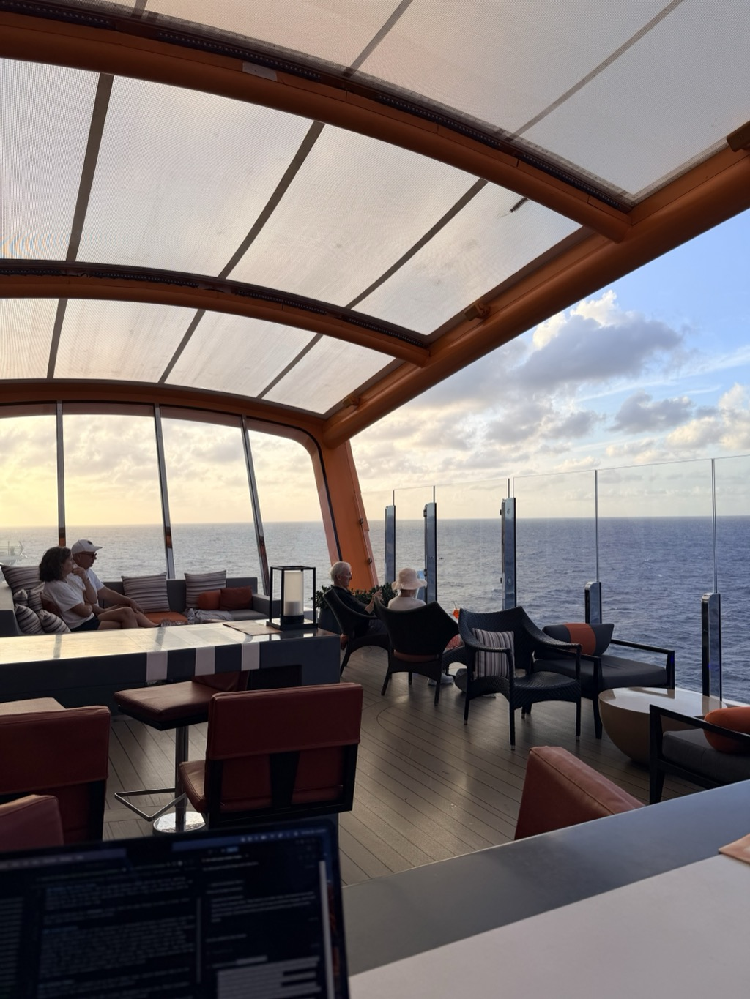
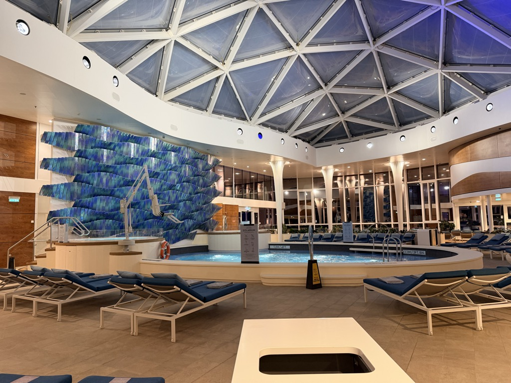
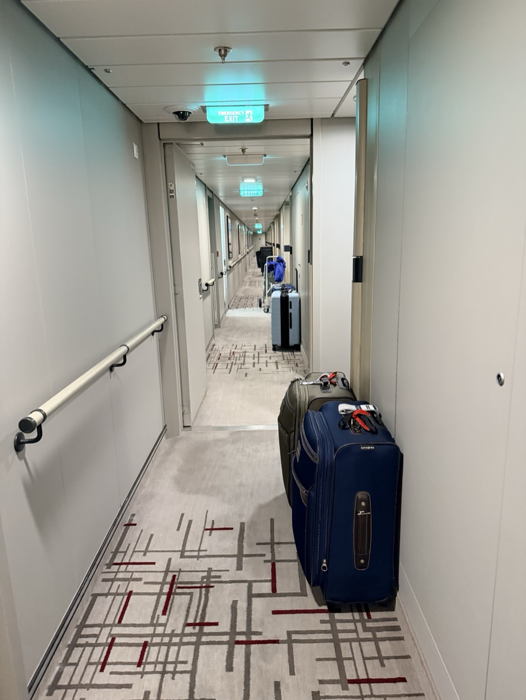

- **Start of day:** At sea
- **End of day:** At sea

Another sea day. The last full day of this cruise across the Atlantic. 

The worst night of them all:

See you in the morning. 

*Part of the [Transatlantic Crossing 2026 trip]({{ ta_recap.url }}).*
