- **Start of day:** Port Canaveral, Florida
- **End of day:** Home in North Carolina

Our final accounting is 4,693 nautical miles. 

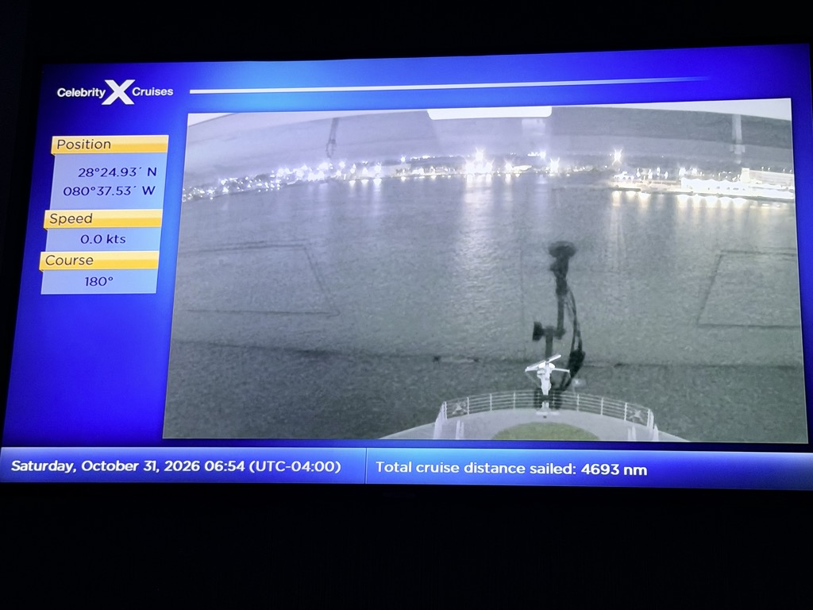

This is a pretty crazy view to wake up to, tbh.

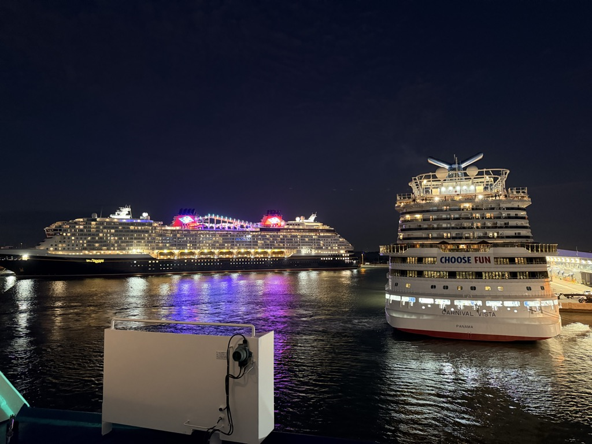

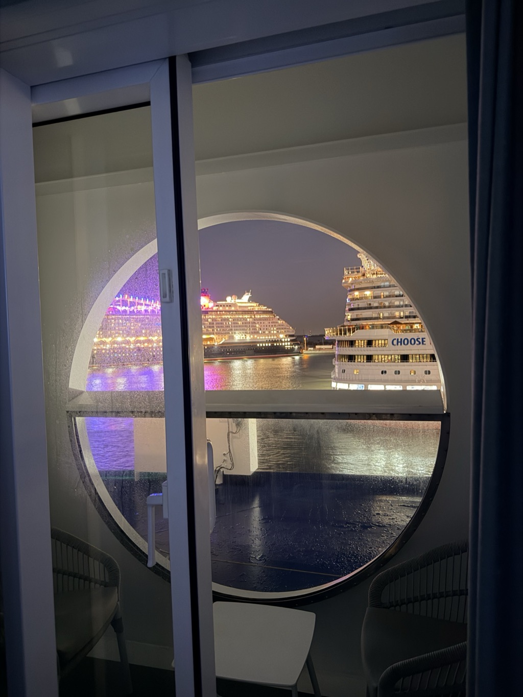

I didn't sleep well -- I never do the night before disembark. I walked around on this last morning, had a light breakfast, and snapped some photos. 

I had this excellent view of (one of?) Blue Origin's landing platform barges. a SpaceX vessel was docked next to it. 

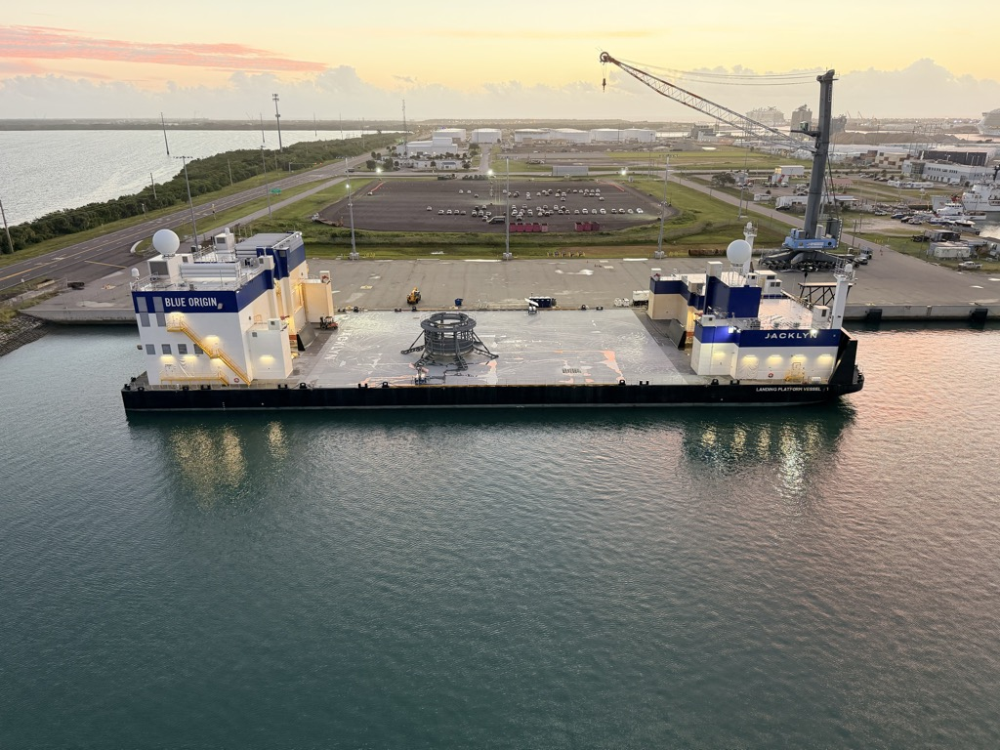

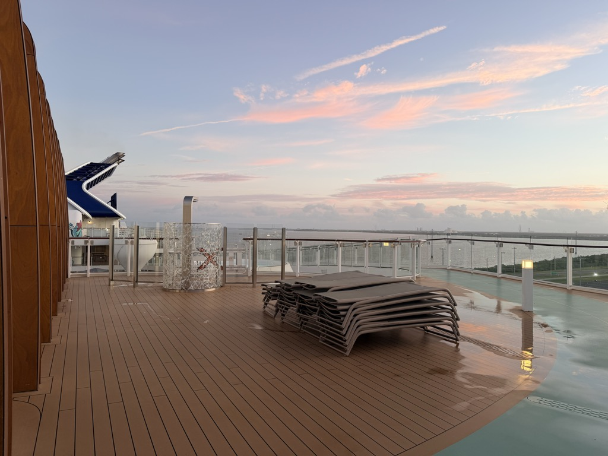

Sometimes self-service walk-off is a madhouse and sometimes it's like this:

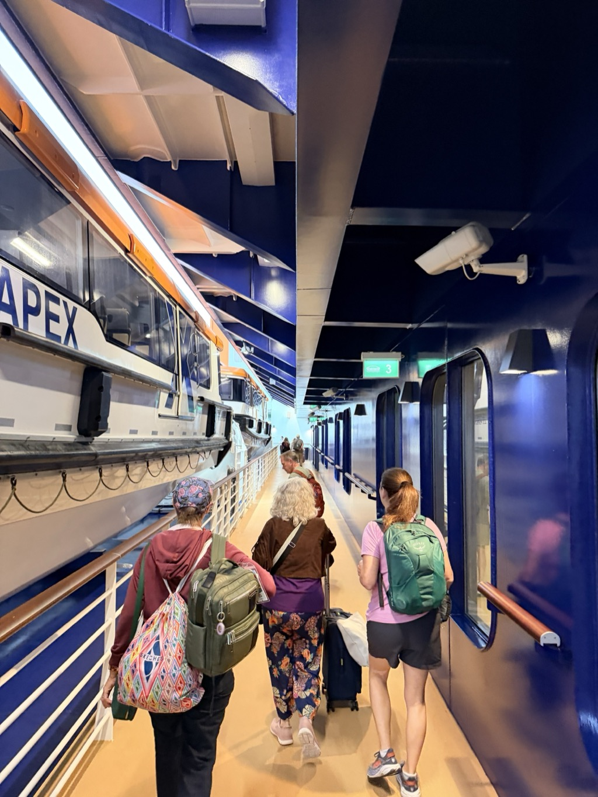

One of the most recognizable atriums in the world, I feel.

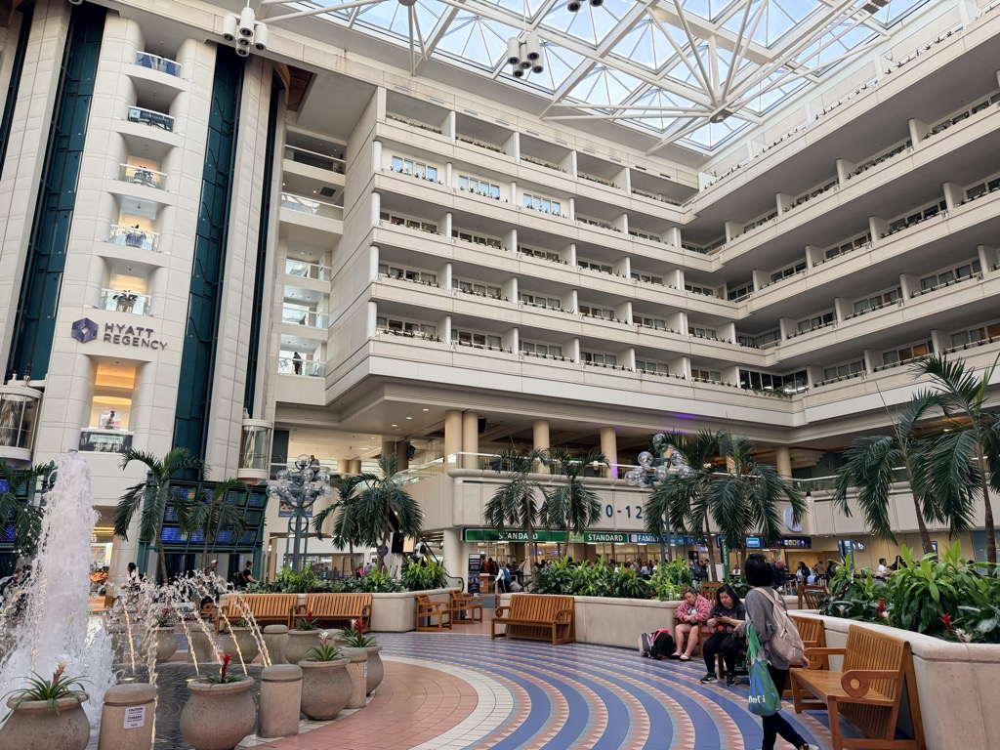

Same with the carpet.

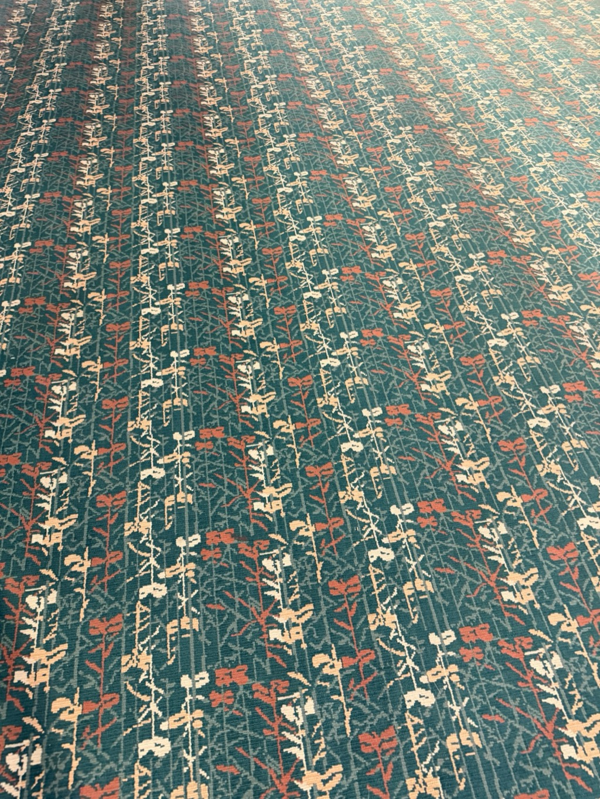

I arrived at the airport around 9:30am and by the time I was settled in at the Delta Sky Club at the B terminal it was around 10:00am. I had (another) light breakfast, then received a notification at 10:22 that my bag had been loaded -- onto a flight that wasn't mine and left in about 30 minutes. I travel a fair bit but this was the first time my bag was expedited; I was firmly operating under the belief your bag traveled with you.[^1] This opened up an opportunity: if my bag was already gone, could I fly standby? It's Orlando to Atlanta, there are tons of flights. By the time I made it to the gate for this flight they were already done, but I could standby for the noon flight. OK.

I knew the seat wouldn't be great, and it wasn't (37A), though it allowed me to make it to Atlanta 45 minutes earlier. 

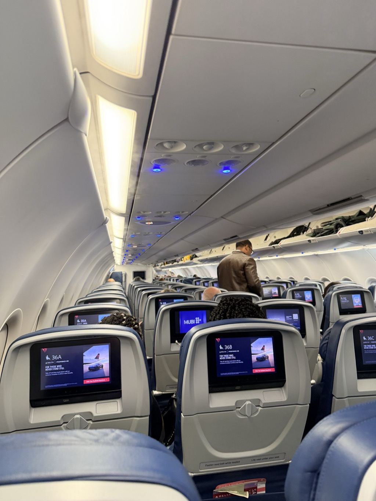

Once in Atlanta I walked all the way from the very end of Terminal D over to Terminal T, avoiding trains and moving sidewalks. It's a time-tested way to lock in at least a mile of steps. 

The lounge was basically at my gate, T6. Note for future travel this lounge doesn't have stairs, so plan a little extra time queueing for the elevator down when it's time to leave.

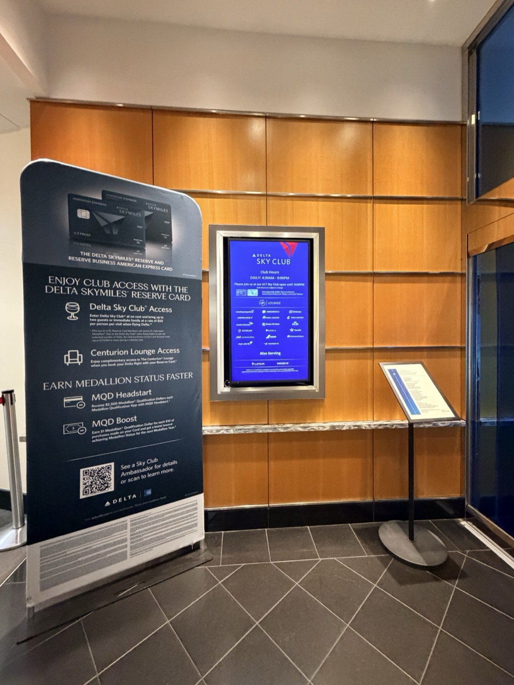

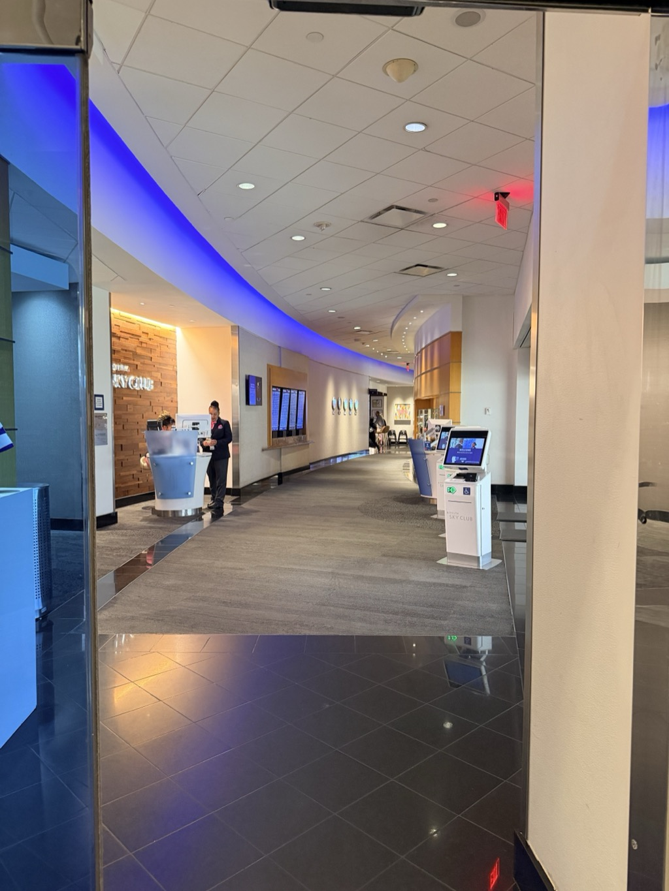

The flight was fine. The bonus of my bag being expedited was that it was waiting for me as soon as I stepped off the plane. I appreciated not having to wait those extra 5-15 minutes. 

I made it home right as Halloween trick or treating was kicking off.

End of trip.

**Footnotes**:

[^1]: I checked with an airlines person I know and they said the person-travels-with-bag rule is more for international flights and that domestic bags might be expedited to ensure the bags make their connections. 

*Part of the [Transatlantic Crossing 2026 trip]({{ ta_recap.url }}).*
